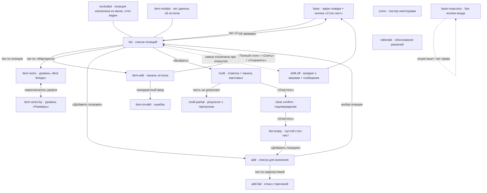
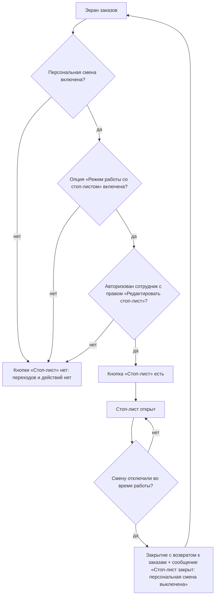
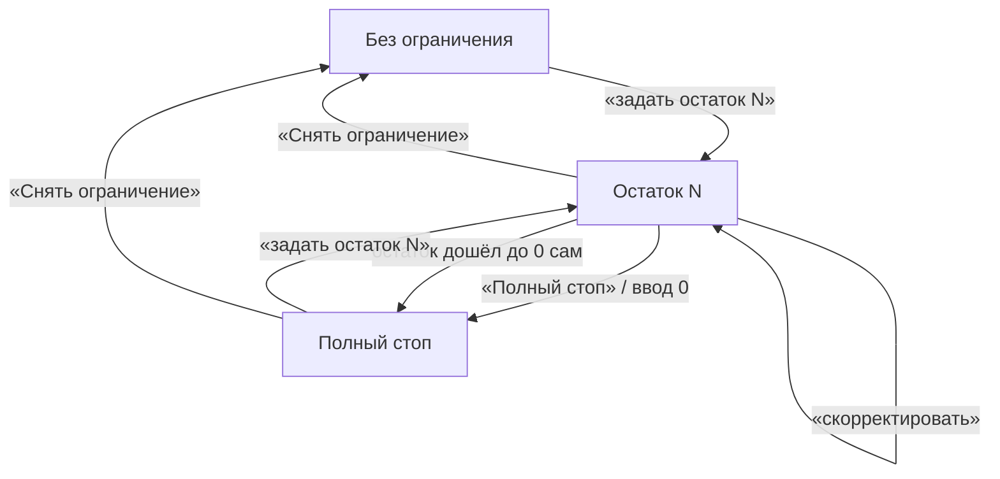
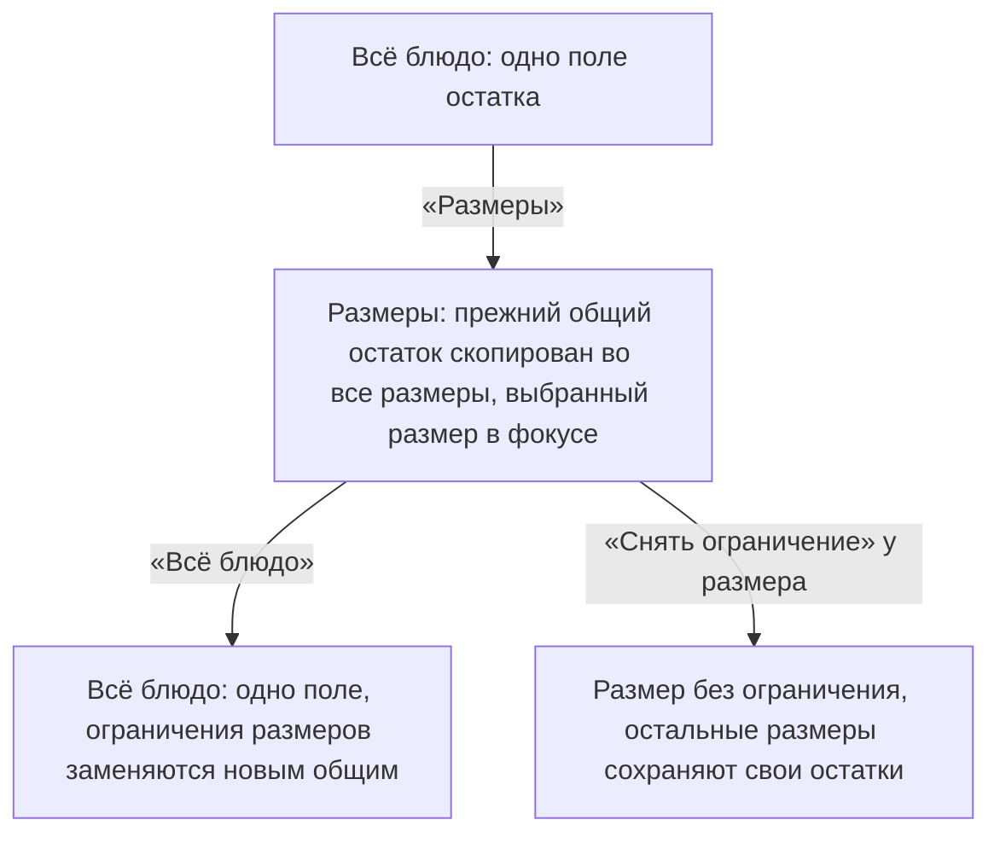
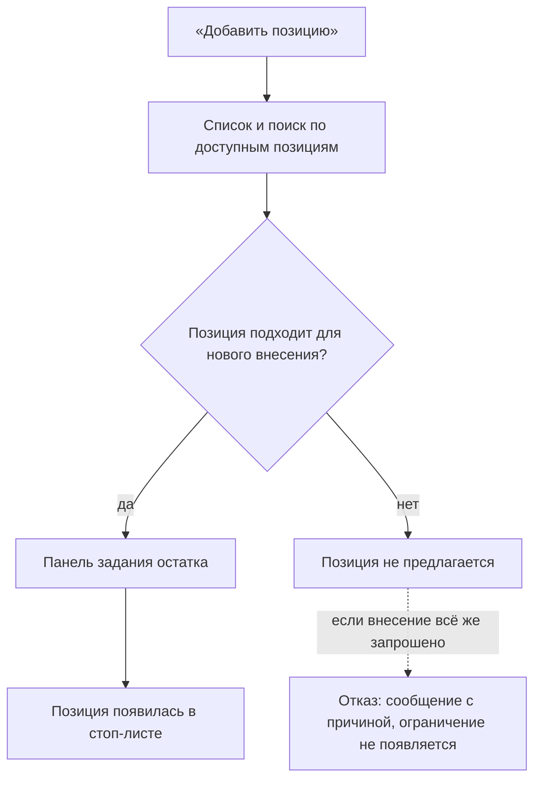
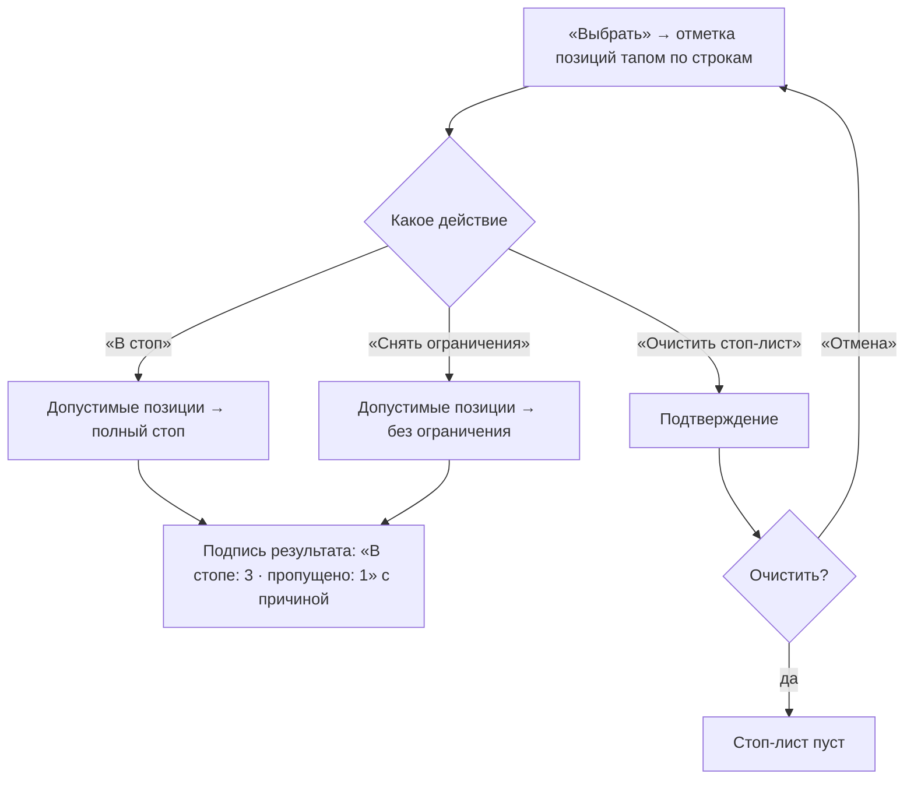
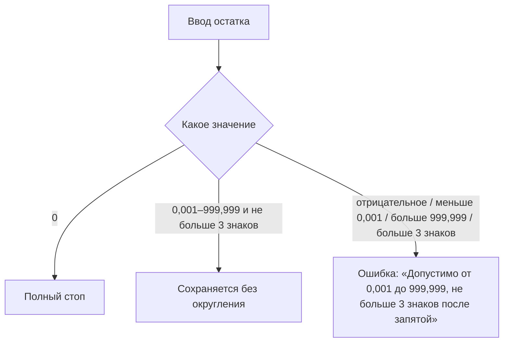

# КДС · Стоп-лист — ТЗ на отрисовку прототипа (Jira PB-8111)

Рабочее ТЗ для ИИ-агента (VS Code, DeepSeek). Ты отрисовываешь прототип интерфейса
«Стоп-лист и остатки на кухонном экране WebKDS» на базе готового прототипа комбо-набора.

**Результат:** новый прототип в репозитории `Anders7Rusk/ProtoApp-Draft`:

- `KDS/StopList/kds-stoplist.html` — один файл, 18 состояний, переключение `?state=`;
- `KDS/StopList/layouts.js` — реестр панели ревью;
- после сборки — commit + push в `main`, стенд проверить по ссылке
  `https://anders7rusk.github.io/ProtoApp-Draft/KDS/StopList/kds-stoplist.html?state=base&v=1`.

Если среда позволяет писать файлы — пиши прямо в репозиторий (локальный клон `ProtoApp-Draft`).
Если работаешь только чатом — выдай содержимое обоих файлов целиком, юзер сохранит сам.

## 0. Источники (читать обязательно, всё остальное — из них)

1. **Задача PB-8111** «Дизайн: стоп-лист и остатки на кухонном экране WebKDS» (описание ниже).
2. **Сценарии** `PB-8102-user-scenarios.md` — вложение к PB-8111; полный текст — Приложение A
   (встроено в этот же файл ниже).
3. **База** — `KDS/Combo/kds-combo.html` (состояние `base`) в том же репозитории. Это образец
   каркаса и стилей. ПРОЧИТАТЬ ФАЙЛ ЦЕЛИКОМ ДО ПРАВОК: каркас рисуется функцией `render()`/`mkView()`,
   данные состояний — в объекте `SCREENS`, палитра — CSS-переменные `.kds-view`, панель ревью —
   `connect.js` + `layouts.js`, переключение — событие `dsreview:state` и `?state=`.

## 1. Правила работы (из уроков PB-8108, нарушать нельзя)

1. Базу `base` скопировать 1:1 из kds-combo.html и **не перерисовывать**: экран повара, шапка,
   лента карточек, футер, интерактив. Менять в базе только одно — добавить кнопку входа
   в стоп-лист (см. §5.1).
2. Данные экранов — только из этого ТЗ и сценариев. Нет значения/компонента/текста — **не выдумывать**:
   остановиться и спросить дизайнера в чате.
3. Правки по одной, после каждой — самопроверка по критерию приёмки этого экрана.
4. Каждое состояние регистрировать в `layouts.js`; в конце сверить: число шагов = числу ключей `SCREENS`.
5. Стили — только палитра базы (CSS-переменные `--kds-*`), шрифт Roboto, иконки Material Icons
   Outlined (шрифт, как вся база). **Новые цвета не вводить.**
6. **Никаких подложек и фонов сверх базы**: у новых строк/панелей — ровно стиль строк-коробок базы
   (`#212121`, радиус 8), новых заливок, рамок-украшений и теней не добавлять.
7. Тач-терминал: без hover-зависимостей, цель нажатия ≥ 44 px, текст не выделяется.
8. Консоль без ошибок на каждом состоянии.
9. В контенте ссылок-переключателей нет — только селект панели ревью и `?state=` (правило 19.10.2026).
10. Каждое состояние — с аннотацией `anno` (что здесь важно, 1–2 фразы) и цитатой сценария в
    подписи панели ревью.

## 2. Суть задачи (PB-8111, сжато)

Стоп-лист сейчас живёт в кассе; кухня его не видит и не ведёт. Нужен **отдельный интерфейс
кухонного экрана**: повар/шеф переходит в него из экрана заказов, ведёт стоп-лист и остатки,
возвращается к заказам. Стоп-лист — не строка заказа, не подача, не статус блюда: внесение
в стоп не удаляет блюдо из меню и не меняет заказы.

**Условия, которые обязан сохранить дизайн** (полный список — Приложение A, §3 сценариев):

- Позиция — позиция меню, может иметь размеры. Три состояния: **без ограничения** (остаток не задан —
  это НЕ то же, что 0), **ограниченный остаток N**, **полный стоп** (остаток 0).
- Остаток дробный: 0 (полный стоп) или положительное от 0,001 до 999,999, максимум 3 знака после
  запятой. Дробный остаток разрешён любой позиции, включая штучные/порционные. WebKDS **не округляет**
  ни введённые, ни полученные значения. Единица измерения показывается рядом, **только если** данные
  системы позволяют определить её однозначно; сам WebKDS единицу не угадывает и не пересчитывает.
- Уровень ограничения один: **всё блюдо** ЛИБО **отдельные размеры**. Размеры задаются/снимаются
  независимо. Переключение уровня: общее → размеры: прежний общий остаток переносится на ВСЕ размеры,
  выбранному размеру задаётся новый. Размеры → общее: ограничения размеров заменяются новым общим.
- Снятие ограничения — отдельное действие (не то же, что задание остатка); снимается выбранный
  уровень, остальные размеры сохраняют свои остатки.
- Полный стоп наступает сам при остатке 0; остаток сам уменьшается при продаже и восстанавливается
  при отмене; сотрудник может скорректировать вручную.
- Массовые: перевод отмеченных в полный стоп, снятие ограничений, очистка стоп-листа целиком
  (обязательное подтверждение). Массовой установки положительных остатков НЕТ.
- Стоп-лист один на точку продаж (терминальную группу) / на группу; сотрудник видит, с каким
  стоп-листом работает.
- Доступ: опция «Режим работы со стоп-листом» в настройках экрана (видна в конфигураторе только при
  включённой персональной смене) + авторизация с правом «Редактировать стоп-лист». Есть печать.
- Для нового внесения предлагаются блюда, заготовки, услуги и модификаторы по критериям iikoFront
  (связь с приготовлением, правила меню/прайс-листа, комбо). Товары/внешние товары/позиции для
  закупки/тарифы/топливо НЕ предлагаются. Действующее ограничение видно и снимается, даже если
  позиция перестала подходить для нового внесения. Попытка внести недопустимую — отказ с причиной.

## 3. Схемы «что из чего» (блок-схемы переходов и логики)

Схемы — обязательная логика прототипа: если поведение, нарисованное в коде, противоречит
схеме — переделывать код, а не схему.

### 3.1. Переходы между состояниями (экраны)



### 3.2. Доступность интерфейса (когда вход есть, а когда нет)



### 3.3. Состояния позиции и уровни ограничения





### 3.4. Внесение новой позиции



### 3.5. Массовые действия



### 3.6. Валидация остатка



## 4. Палитра и стили (из базы, не менять)

Из `.kds-view` (тёмная тема):

```
--kds-bg: #121212   --kds-surface: #121212   --kds-row: #212121   --kds-btn: #3b3b43
--kds-line: #616161 --kds-text: #ffffff      --kds-text-2: #9e9e9e --kds-text-3: #d6d6d6
--kds-ic-accent: #448aff  --kds-ic-warning: #ffab40  --kds-ic-positive: #14b456  --kds-ic-negative: #ff5252
```

Ключевые размеры/стили базы:

- кадр 1280×800; topbar 44 (пад 12/16/8/16), footer 56 (пад 4/16);
- строка-коробка: высота 52, `#212121`, радиус 8, название 22/28 Medium `#fff`;
- плашка количества: `#E0E0E0`, 22/28 Bold `#333`; кнопка строки 52×52 `#3b3b43`, иконка 28;
- вторичный текст 14/20 и 12/16 `#9e9e9e`; строка гостя 12/16 `#9e9e9e`;
- вложенные строки (паттерн `nest` в базе): отступ 16, текст 18/24;
- меню-контейнер (паттерн `.kds-menu`): `#333333`, радиус 12, рамка 1px `#616161`, пад 12/4, пункт 48;
- кнопка футера: высота 48, пад 14/16, рамка 1px `#616161`, радиус 12, текст 14/20 Medium uppercase;
- переключатель `kds-toggle` (Toogle mode из Figma): пад 4/6, радиус 16, элементы 36×36 радиус 16,
  активный — белый/тёмный;
- статусы: `waiting #9e9e9e`, `urgent #ffab40`, `cooking #448aff`, `ready #14b456`, `cancelled #ff5252`.

Акцентное действие (кнопка «Добавить позицию», «Сохранить»): заливка `#448aff`, текст `#fff`,
радиус 12, высота 48 — как акцентные элементы базы. Остальные кнопки — обводка, как кнопка футера.

## 5. Спецификация интерфейса стоп-листа

Стоп-лист — отдельный интерфейс: он **сменяет** экран заказов (не модалка). Каркас тот же:
`kds-view` 1280×800, topbar, область контента, footer.

### 5.1. Точка входа (единственное изменение базы)

В topbar экрана заказов, в `.kds-tb-lists` после кнопки ресторана, до счётчиков, — кнопка-пик
в стиле соседних (`kds-tb-list kds-tb-pick`): иконка `block` (Material Icons Outlined) + текст
«Стоп-лист». Иконка — **кандидат, не утверждена** (см. §12 постеры). В состоянии `base-noaccess`
этой кнопки нет вовсе (опция выключена / нет права / смена выключена) — и никакого намёка, что
функция существует.

### 5.2. Шапка экрана стоп-листа

- Слева: кнопка возврата — `arrow_back` + «К заказам» (стиль `kds-tb-list kds-tb-pick`).
- Заголовок «Стоп-лист» (16/24 Medium, как текст шапки базы) + подпись `Терминальная группа: Зал`
  14/20 `#9e9e9e` — сотрудник видит, с каким стоп-листом работает.
- Справа: часы (как в базе), иконки `power_settings_new`, `settings` (как в базе).
- Счётчиков-фильтров заказов в шапке стоп-листа НЕТ.

### 5.3. Список позиций

- Над списком — поле поиска: коробка `#212121` r8, высота 52, иконка `search` 20 `#9e9e9e`,
  placeholder «Найти позицию» 18/24 `#9e9e9e`. Справа в той же строке — кнопка «Добавить позицию»
  (акцентная заливка, 48 px, `add` + текст) — вход в внесение.
- Под полем поиска — список позиций, вертикальный, со скроллом. Строка позиции — коробка `#212121` r8,
  высота 52:
  - слева: название 22/28 Medium `#fff`; длинное — многоточие + `data-full` с полным именем по тапу
    (механизм базы: `.kds-tip`, авто-скрытие 3 с);
  - справа: плашка остатка `#E0E0E0` 22/28 Bold `#333` с числом и единицей рядом в той же плашке
    (например `4 шт`); у позиции в полном стопе вместо плашки — красный текст «Полный стоп»
    22/28 Medium `#ff5252` (остаток 0 виден и есть причина — отдельного бейджа не нужно);
  - крайняя справа: кнопка 52×52 `#3b3b43`, иконка `edit` 28 — открывает панель действий (кандидат).
- Позиция с размерами (паттерн `nest` базы): заголовок «Маргарита» 22/28 Medium + вложенные строки
  размеров (отступ 16, текст 18/24): `25 см` — плашка `12 шт`; `30 см` — `4 шт`; `35 см` — «Полный стоп».
  Кнопка `edit` — у заголовка.
- Исключённая из меню позиция с действующим ограничением: строка как обычно + подпись под названием
  «Исключена из меню» 12/16 `#9e9e9e`; стоп виден, снять можно (состояние `excluded`).
- Позиция без данных об остатке: плашка остатка пустая — без числа и без единицы; ничего не выдумывать
  (состояние `item-nodata`).

### 5.4. Панель действий по позиции

Открывается тапом на строку позиции: строка раскрывается вниз (аккордеон в той же коробке):

- Переключатель уровня — компонент `kds-toggle` (Toogle mode): две позиции `Всё блюдо` / `Размеры`
  с иконками `restaurant` / `straighten` (кандидаты). Показывается только у позиций с размерами.
- Уровень «Всё блюдо»: одно поле остатка.
- Уровень «Размеры»: строки размеров (25/30/35 см), у каждой своё поле остатка. Поля независимы.
- Поле остатка: число + единица (`шт`), ввод дробный. Пустое поле = «нет данных» (значение не показано,
  но ввести можно).
- Кнопки подряд: «Полный стоп» (обводка), «Снять ограничение» (обводка), «Сохранить» (акцент).
  Полный стоп = остаток 0; снятие — ОТДЕЛЬНОЕ действие (не ввод нуля), после снятия позиция уходит
  из стоп-листа в состояние «без ограничения».
- Переключение уровня (решение открытого вопроса №1 задачи): при переходе «Всё блюдо» → «Размеры»
  прежний общий остаток уже стоит во ВСЕХ размерах, выбранный размер — в фокусе (подсвечен, поле
  готово к вводу), сотрудник меняет его значение. Переход «Размеры» → «Всё блюдо» — одно поле,
  прежние ограничения размеров заменяются новым общим. Никаких предупреждений: смена уровня —
  обычное действие, состояние видно сразу.

### 5.5. Валидация ввода

- Допустимо: 0 (полный стоп) и положительные от 0,001 до 999,999, не больше 3 знаков после запятой.
- Недопустимо (значение не принимается): отрицательное; больше 999,999; меньше 0,001, но не ноль;
  больше 3 знаков после запятой. Ошибка — красная подпись 14/20 `#ff5252` под полем:
  «Допустимо от 0,001 до 999,999, не больше 3 знаков после запятой». Поле остаётся для правки.

### 5.6. Внесение новой позиции

Экран `add`: шапка — возврат «К списку», заголовок «Добавить в стоп-лист», группа «Зал»;
поле поиска; список позиций, доступных для внесения (те же критерии iikoFront — в прототипе это
просто строки-коробки без плашек). У каждой — подпись «Без ограничения» 12/16 `#9e9e9e`.
Тап по позиции — панель задания остатка (как §5.4, кнопка «Добавить» вместо «Сохранить»).
Товары и прочие недопустимые типы в списке НЕ показываются.

### 5.7. Массовые действия

- В шапке списка (рядом с «Добавить позицию») — кнопка «Выбрать» (обводка). В режиме выбора:
  у строк слева чекбоксы `check_box_outline_blank` (отмечен — `check_box`), внизу — панель массовых
  действий поверх футера: счётчик «Выбрано: N», кнопки «В стоп» (полный стоп), «Снять ограничения»,
  «Очистить стоп-лист».
- Часть отмеченных не допускает действие (например, снятие у позиции без ограничения) — действие
  применяется к допустимым, после действия подпись результата (баннер, 3–5 с): «В стопе: 3 ·
  пропущено: 1 (без ограничения)».
- «Очистить стоп-лист» — обязательно подтверждение: контейнер в стиле `.kds-menu` (`#333333` r12,
  рамка 1px `#616161`): заголовок «Очистить стоп-лист?», текст «Будут сняты все ограничения, включая
  позиции с остатком», кнопки «Очистить» / «Отмена».
- Массового задания положительных остатков нет — таких кнопок не рисовать.

### 5.8. Печать

Кнопка `print` + «Печать» в шапке списка стоп-листа (обводка). По тапу — короткое подтверждение
«Стоп-лист отправлен на печать» (баннер, авто-скрытие 3 с). Шаблон печатной формы и выбор
устройства НЕ рисуем — их нет в документе.

### 5.9. Состояния недоступности

- Опция выключена / нет права / смена выключена: на экране заказов кнопки входа нет (`base-noaccess`),
  действий нет, частично работающего интерфейса не показывать.
- Смена отключена при ОТКРЫТОМ стоп-листе (`shift-off`): экран заказов + баннер сверху ленты
  «Стоп-лист закрыт: персональная смена выключена» — нейтральный (не красный, это не ошибка),
  авто-скрытие 3 с.

### 5.10. Открытые вопросы задачи — принятые решения (согласованы дизайнером 23.10.2026)

1. **Переключение уровней** — §5.4: перенос остатка виден сразу, выбранный размер в фокусе.
2. **Кто/когда/авто-изменение** — не показываем: кухне не нужно, экран без технических деталей;
   актуальное значение видно само (ручное и автоматическое не различаем).
3. **Часть отмеченных не допускает массовое действие** — §5.7: применяется к допустимым + подпись
   результата с пропуском.
4. **Полный стоп из-за нуля** — единый вид «Полный стоп» с остатком 0; отдельного бейджа нет.
5. **Причина отказа внесения** — недопустимые не предлагаются; если внесение всё же запрошено —
   сообщение с причиной: «Не удалось добавить: позиция исключена из меню».
6. **Закрытие из-за смены** — §5.9: нейтральное сообщение, не ошибка.

### 5.11. Футер экрана стоп-листа

Слева — версия и статус как в базе («WebKDS v. 9.4.5.208229» · точка · «Включен»). По центру —
«В стоп-листе: 7 позиций». Справа — кнопка «Печать» (обводка). «Всего заказов» и «Отменить»
на стоп-листе НЕ показывать (они про заказы).

## 5.12. Тач-требования и существующие элементы KDS (обязательно)

Это тач-панель: весь интерфейс ведётся пальцем. Всё новое строится по тач-правилам,
которые уже работают в базе, и из элементов, которые в базе уже есть, — новые виды
контролов не изобретать.

**Использовать готовые элементы базы:**

- строка-коробка 52 (`#212121` r8) + кнопка 52×52 + плашка количества — строки позиций;
- `kds-tb-list` / `kds-tb-pick` — кнопки шапки («К заказам», «Печать» в шапке, «Стоп-лист» в базе);
- `kds-toggle` (Toogle mode) — переключатель уровня «Всё блюдо / Размеры»;
- `kds-menu` (`#333333` r12, пункты 48) — диалог подтверждения очистки;
- `kds-footer__btn` (высота 48, обводка 1px `#616161` r12, uppercase) — «Печать», «Выбрать»,
  «Полный стоп», «Снять ограничение»; акцентные «Добавить позицию» и «Сохранить» — та же
  геометрия, заливка `#448aff`;
- тултип `.kds-tip` по тапу (`data-full`, авто-скрытие 3 с) — длинные названия;
- иконки Material Icons Outlined; чекбоксы отметки — `check_box_outline_blank` / `check_box`;
- поля (поиск, остаток) — коробки в стиле строки 52 (`#212121` r8): это единственные новые
  поля, их вид задан в §5.3 и §5.4.

**Тач-правила для всех новых элементов:**

1. Цель нажатия ≥ 44×44: строки 52, кнопки 52×52 и 48. Иконки 20–24 допустимы только внутри
   крупной цели.
2. Мелкие иконки-кнопки расширять невидимой областью нажатия — паттерн базы
   `.kds-iconbtn::after { inset: -10px }`.
3. Никаких hover-зависимостей: hover — только бонус на мыши (`matchMedia (hover: hover)`),
   всё рабочее — тапом. Раскрытие полного названия — тапом по строке (механизм базы).
4. Реакция на нажатие — `:active` (подсветка), как в базе.
5. Скролл списка — нативный свайп пальцем; полосы прокрутки скрыты (как в базе), никакой
   контент за скроллбар не прятать.
6. Чекбокс в режиме выбора: отметка ставится тапом по ВСЕЙ строке, сам чекбокс крупный (28).
7. Поле остатка: высота ≥ 52, шрифт 22/28; при фокусе всё значение выделено (удобно
   перепечатать); клавиатура — цифровая с запятой: `inputmode="decimal"`. Кнопки действий
   («Полный стоп», «Снять ограничение», «Сохранить») — 48 высотой, в один ряд под полем,
   в нижней части раскрытой строки — зоне досягаемости пальца.
8. Диалог подтверждения: кнопки 48, «Отмена» и «Очистить» разнесены по краям контейнера —
   очистку нельзя нажать случайно.
9. Баннеры/сообщения (результат, отказ, закрытие смены) — без обязательного тапа,
   авто-скрытие 3–5 с; если в баннере есть кнопка — цель ≥ 44.
10. Ошибка ввода: подпись под полем видна без скролла; поле остаётся в фокусе со значением
    для правки; «Сохранить» не сохраняет некорректное значение.
11. Текст не выделяется, tap-highlight прозрачный, touch-action — как в `.kds-view` базы.

## 6. Состояния SCREENS — по одному

Данные — из сквозного примера сценариев (§5): заведение «Пиццерия», Маргарита 25/30/35 см
(25 см = 12 шт, 30 см = 4 шт, 35 см = полный стоп). Остальные позиции — из меню базы
(Морс ягодный, Паста карбонара, Салат с морепродуктами, Пицца от шефа) + Фокачча и Тирамису
из примеров сценариев.

| # | state | Что на экране | Критерий приёмки |
|---|---|---|---|
| 1 | `base` | База 1:1 из kds-combo + кнопка «Стоп-лист» в шапке (block + текст) | База визуально не изменилась; кнопка в шапке слева от счётчиков; тап кнопки не обязателен (переход — через панель ревью), но `?state=base` открывает экран |
| 2 | `base-noaccess` | Та же база, кнопки входа НЕТ | Кнопки нет, никакого намёка на функцию; аннотация объясняет, почему |
| 3 | `list` | Стоп-лист: шапка (К заказам · Стоп-лист · Зал), поиск, «Добавить позицию», «Выбрать», «Печать»; позиции: «Фокачча — 2,5 шт», «Маргарита» с размерами (12 шт / 4 шт / Полный стоп), «Тирамису — Полный стоп», «Паста карбонара — 8 шт»; футер «В стоп-листе: 4 позиции» | Видны три состояния позиции (остаток, полный стоп) и размеры; дробный остаток без округления; кнопки шапки на месте; консоль чистая |
| 4 | `list-empty` | Пустой стоп-лист: подпись «Ограничений нет» + текст «Нажмите «Добавить позицию», чтобы задать остаток» + акцентная кнопка | Понятно, как задать первое ограничение; ничего лишнего |
| 5 | `excluded` | `list` + позиция «Суп дня — 3 порции» с подписью «Исключена из меню» | Ограничение видно, кнопка снятия доступна; подпись 12/16 `#9e9e9e` |
| 6 | `item-edit` | Строка «Фокачча» раскрыта: поле остатка `2,5` + `шт`, кнопки «Полный стоп» / «Снять ограничение» / «Сохранить» | Ввод дробный; три действия раздельны; кнопки 48 px |
| 7 | `item-sizes` | Строка «Маргарита» раскрыта, переключатель на «Всё блюдо», одно поле остатка | Уровень выбран «Всё блюдо»; размеры не показаны полями |
| 8 | `item-sizes-by` | Та же строка, переключатель на «Размеры»: строки 25 см / 30 см / 35 см с полями (12 / 4 / Полный стоп), поле 30 см в фокусе (подсвечено) | Прежний общий остаток перенесён во все размеры; выбранный размер в фокусе; поля независимы |
| 9 | `item-invalid` | Панель с ошибкой: поле содержит недопустимое значение, красная подпись «Допустимо от 0,001 до 999,999, не больше 3 знаков после запятой» | Ошибка под полем, поле доступно для правки, кнопка «Сохранить» не выполняет сохранение |
| 10 | `item-nodata` | `list`, у «Тирамису» плашка остатка пустая (без числа и единицы) | Значение не показано; ничего не выдумано |
| 11 | `add` | Экран «Добавить в стоп-лист»: поиск + строки доступных позиций («Фокачча», «Суп дня», «Салат с морепродуктами», «Соус к пасте») с подписью «Без ограничения» | Недопустимых типов нет; у каждой подпись состояния; тап открывает панель с «Добавить» |
| 12 | `add-fail` | Тот же экран: позиция «Суп дня» в списке помечена «исключена из меню», тап → сообщение «Не удалось добавить: позиция исключена из меню» | Ограничение не появилось; причина показана; сообщение нейтральным баннером |
| 13 | `multi` | Режим выбора: чекбоксы, отмечены 3 позиции, панель «Выбрано: 3 · В стоп · Снять ограничения · Очистить стоп-лист» | Чекбоксы слева, счётчик верный, три массовых действия, задания остатков нет |
| 14 | `multi-partial` | После «Снять ограничения»: подпись «Снято ограничений: 2 · пропущено: 1 (без ограничения)» | Результат виден; пропущенная позиция названа с причиной |
| 15 | `clear-confirm` | Диалог очистки в стиле `.kds-menu`: «Очистить стоп-лист?» + текст + «Очистить» / «Отмена» | Подтверждение обязательно; «Отмена» закрывает диалог без изменений |
| 16 | `shift-off` | Экран заказов (база) + баннер «Стоп-лист закрыт: персональная смена выключена» | Нейтральный баннер сверху ленты, не красный; аннотация: это не ошибка |
| 17 | `icons` | Постер пиктограмм (паттерн `kds-posters`): block — вход в стоп-лист, edit — действие строки, print — печать, restaurant/straighten — уровни; ВСЕ помечены «кандидат, не утверждена» | На постере честно: ни одна иконка не выдана за утверждённую |
| 18 | `rationale` | Постер «Обоснование решений» — 6 решений из §5.10 по одной карточке | Каждое решение названо и обосновано 1–2 фразами; отмечено, что решения согласованы с дизайнером |

Везде: `pill` (метка экрана), `stat` при необходимости, `anno` — 1–2 фразы «что здесь важно».
Мобильный кадр (`cfg.mobile`) не нужен — задача только про планшетный экран 1280.

## 7. Реестр layouts.js

Копировать формат из `KDS/Combo/layouts.js`: `проект: 'КДС · Стоп-лист'`, `адаптив: true`,
18 шагов `{ file: 'kds-stoplist.html', state, title }` — заголовок = короткое имя экрана + суть
(образец стиля — у комбо). Порядок — как в таблице §6.

## 8. Чек-лист приёмки (весь прототип)

- [ ] `base` — 1:1 с kds-combo, кроме новой кнопки входа; визуально ничего не съехало.
- [ ] `base-noaccess` — входа нет, намёков нет.
- [ ] Три состояния позиции различимы: остаток N, полный стоп, без ограничения (в списке добавления).
- [ ] Дробный остаток показан и редактируется без округления (2,5).
- [ ] Единица измерения рядом с числом, не выдумана.
- [ ] Уровень «Всё блюдо / Размеры» переключается; перенос остатка виден; выбранный размер в фокусе;
      снятие с одного размера не трогает остальные (в аннотации экрана это названо).
- [ ] Полный стоп и снятие ограничения — разные кнопки.
- [ ] Некорректный остаток не принимается, ошибка объяснена.
- [ ] Массовые: отметка, «В стоп», «Снять ограничения», очистка с подтверждением; массовых остатков нет.
- [ ] Печать запускается кнопкой, есть подтверждение отправки.
- [ ] Состояния недоступности: нет входа при выключенной опции/смене; при отключении смены — возврат
      к заказам с нейтральным сообщением.
- [ ] `excluded`: стоп виден, снятие доступно. `item-nodata`: значение не показано.
- [ ] Постеры icons (кандидаты помечены) и rationale (6 решений).
- [ ] `layouts.js`: 18 шагов = 18 ключей SCREENS; заголовки совпадают.
- [ ] Консоль без ошибок на каждом состоянии.
- [ ] Ни одной новой подложки/фона/тени сверх базы; новые цвета не введены.
- [ ] Шапка файла честно описывает, что взято откуда (образец — шапка kds-combo.html).

## 9. Публикация

Commit + push в `main` репозитория `Anders7Rusk/ProtoApp-Draft` (только новые файлы
`KDS/StopList/`). Проверить стенд: `https://anders7rusk.github.io/ProtoApp-Draft/KDS/StopList/kds-stoplist.html?state=base&v=1`
— каждая ссылка `?state=` из таблицы §6 должна открываться.

## 10. Чего делать нельзя

- Перерисовывать базу или менять kds-combo.html.
- Выдумывать значения, иконки, тексты, цвета, состояния, которых нет в ТЗ/сценариях.
- Добавлять подложки, рамки-украшения, тени, тонирование строк.
- Рисовать шаблон печатной формы и выбор устройства печати.
- Рисовать массовое задание остатков.
- Показывать автора/время изменения остатка.
- Добавлять ссылки-переключатели в контент.
- Вводить классы `ds-*` (КДС-карточки — своя раскладка; в прототипе их нет).

## 11. Если нет данных для решения

Остановиться и задать вопрос дизайнеру в чате. Не заменять «похожим». Формат вопроса:
что именно не хватает, какие варианты видишь.

---

## Приложение A. Полный текст сценариев (вложение PB-8102-user-scenarios.md)

Ниже — полный текст согласованных пользовательских сценариев, приложенных к задаче PB-8111.
Все данные, состояния и правила для экранов — отсюда.

---

# Пользовательские сценарии: стоп-лист и остатки на кухонном экране WebKDS

> Тип документа: пользовательские сценарии для дизайна
> Дата: 2026-10-22
> Статус: Согласовано
> Связанные задачи: эпик PB-7819, стори PB-8102, SA-спека DS-1564
> Источник сценариев: согласованная бизнес-спека «Пользовательские сценарии: стоп-лист и остатки на кухонном экране WebKDS» (репозиторий DS-1200.ba-specs, ba-specs/PB-8102-stop-list-user-scenarios.md), стори PB-8102, эпик PB-7819

## 1. Зачем этот документ

Документ описывает, что сотрудник кухни делает со стоп-листом и остатками и к какому результату это приводит. Он нужен дизайнеру и UX-специалисту, чтобы спроектировать интерфейс стоп-листа на кухонном экране: какие состояния и действия нужно отрисовать и что сотрудник видит на каждом шаге.

Что в документ не входит: устройство системы и технические детали; влияние на отображение и обработку заказов; контроль продаж; автоматические изменения и автоматическая очистка стоп-листа; шаблон печатной формы и выбор устройства печати; решения по реализации.

## 2. Кто работает с экраном

| Кто | Что ищет на экране | Что решает |
|---|---|---|
| Повар | что закончилось и что ещё можно готовить | сообщить или внести, что позиция кончилась |
| Шеф-повар / су-шеф | какие позиции в стопе и какие по ним остатки | внести в стоп, задать остаток, снять со стопа |
| Менеджер смены | полноту стоп-листа | снять стоп после завоза, очистить стоп, распечатать |

Название роли само по себе задачу не определяет: важно, что человек делает в конкретный момент.

## 3. Ключевые договорённости, которые дизайн обязан сохранить

- **Позиция** — позиция меню, для которой система предусматривает управление стоп-листом, в том числе модификаторы. У позиции может быть **размер**.
- **Какие позиции предлагаются для нового внесения в стоп-лист.** Перечень должен совпадать с перечнем стандартного интерфейса iikoFront при одинаковых настройках заведения. Предлагаются **блюда, заготовки, услуги и модификаторы**, связанные с приготовлением: задано место приготовления либо признак «готовить вместе с основным блюдом». Модификатор предлагается, если он включён в меню по умолчанию или привязан к позиции, которая сама проходит условия отбора. Доступность позиции в меню определяется по действующим правилам iikoFront с учётом прайс-листа, участия в комбо и признака «включено в меню по умолчанию». **Товары, внешние товары, позиции для закупки, тарифы и топливо не предлагаются.** Наличие ограничения в стоп-листе само по себе не исключает позицию из перечня допустимых для управления.
- **Отбор для нового внесения и действующие ограничения — разные вещи.** Если позиция уже находится в стоп-листе, но позже перестала соответствовать условиям нового внесения (например, исключена из меню), её действующее ограничение продолжает отображаться и может быть снято. Позиции, не подходящие для нового внесения, сотруднику для этого действия не предлагаются; если попытка внесения всё же происходит, действие не выполняется, сотрудник получает понятное сообщение об отказе. Кухонный экран не вводит новых критериев отбора по сравнению со стандартным интерфейсом iikoFront.
- **Стоп-лист** — набор позиций, для которых задано ограничение.
- **Три состояния позиции**:
  - **без ограничения** — остаток не задан; это не то же самое, что остаток 0;
  - **ограниченный остаток N** — позицию можно продавать, пока не израсходовано N;
  - **полный стоп** — остаток 0, позиция недоступна.
- **Остаток** — сколько позиции ещё можно продать или приготовить по правилам системы. Остаток может быть **дробным**: значение задаётся с той же точностью, что и в существующей функциональности.
- **Дробный остаток разрешён для любой позиции**, для которой система поддерживает управление стоп-листом, включая позиции, продаваемые штуками или порциями. Допустимость дробного остатка не зависит от типа позиции, признака продажи на вес, настройки заведения на дробное количество при продаже и прав кассира на дробную продажу: эти ограничения относятся к заказу, а не к вводу остатка стоп-листа. Дробный остаток не даёт разрешения продать дробную часть там, где продажа запрещена.
- **Точность остатка и данные из других компонентов.** Допустимы 0 (полный стоп) и положительные значения от 0,001 до 999,999 с точностью до трёх знаков после запятой. WebKDS не округляет дробные остатки при установке, отображении и корректировке; значения, полученные от других компонентов системы, показываются без округления, даже если позиция продаётся только целиком. Если для количества доступна однозначно соответствующая ему единица измерения из данных системы, она показывается рядом с остатком; WebKDS не угадывает единицу и не пересчитывает количество самостоятельно.
- **Остаток меняется сам** по существующим правилам системы: уменьшается при продаже и восстанавливается при отмене. Сотрудник может **вручную задать или скорректировать** остаток, если факт разошёлся с системой. Актуальный остаток виден и после изменений, сделанных другими компонентами системы.
- **Уровень ограничения.** Ограничение задаётся на одном уровне — либо **на всё блюдо**, либо **на отдельные размеры**; одновременно оба уровня не используются:
  - ограничение на всё блюдо действует для всех размеров;
  - ограничения размеров задаются и снимаются независимо друг от друга: снятие ограничения с одного размера не меняет ограничений остальных размеров;
  - при переключении с общего ограничения на размеры прежний общий остаток переносится на остальные размеры, а выбранному размеру сотрудник задаёт новый остаток;
  - при переключении с размеров на общее ограничение прежние ограничения размеров заменяются новым общим ограничением и самостоятельными ограничениями больше не являются.
- **Снятие ограничения едино**: и полный стоп, и положительный остаток снимаются одним действием — снятием ограничения; в состояние «без ограничения» возвращается выбранный уровень, а ограничения остальных размеров сохраняются.
- **Стоп-лист один на точку продаж** (терминальную группу); если в заведении включены «отдельные стоп-листы по группам» — на группу. Сотруднику видно, с каким стоп-листом он работает, и все действия — одиночные и массовые — применяются к этому стоп-листу.
- **Стоп-лист — отдельная сущность.** Это не строка заказа, не подача и не статус блюда. Внесение позиции в стоп-лист не удаляет блюдо из меню и не меняет отображение или обработку заказов.
- Работа со стоп-листом ведётся **не из того же окна**, где пользователь работает с заказами и блюдами: это отдельный интерфейс. Перейти к работе со стоп-листом и вернуться к работе с заказами и блюдами можно в любой момент.
- Работа со стоп-листом доступна **не на всех экранах**: она включается опцией «Режим работы со стоп-листом» в настройках экрана. **Опция видна в конфигураторе только при включённой персональной смене**: при выключенной она полностью скрыта и её нельзя увидеть или изменить.
- **Отключение персональной смены не сбрасывает настройку.** Ранее сохранённое значение остаётся, но перестаёт действовать: переход к стоп-листу не показывается, открытый интерфейс стоп-листа закрывается с возвратом к работе с заказами, действия со стоп-листом недоступны. После повторного включения персональной смены опция снова видна в конфигураторе с прежним значением; если она была включена, функция вновь доступна при соблюдении условий авторизации и права — повторно включать её не нужно.
- Работа со стоп-листом доступна **только при включённой персональной смене**, после авторизации сотрудника с правом **«Редактировать стоп-лист»** и при включённой опции стоп-листа. Право существующее, новое не вводится. При отсутствии любого из условий интерфейс стоп-листа недоступен; сохранённое включённое значение опции не отменяет запрет при выключенной персональной смене. Работа от служебных или системных учётных данных вместо авторизованного сотрудника не предусматривается.
- Позиция переходит в полный стоп сама, когда остаток дошёл до 0: действий пользователя для этого не требуется.

## 4. Варианты работы и их назначение

| Вариант | Когда применяется | Что делает пользователь |
|---|---|---|
| А. Ведение остатка | позицию ещё можно продавать, но её мало | задаёт или корректирует положительный остаток N |
| Б. Полный стоп | позиции нет совсем | задаёт остаток 0 |
| В. Массовые действия | нужно обработать несколько позиций сразу | массово ставит полный стоп, массово снимает ограничения, очищает стоп-лист целиком |

Все варианты доступны только при включённой персональной смене, после авторизации сотрудника с правом «Редактировать стоп-лист» и при включённой опции стоп-листа на экране (§3).

Что не является задачей вариантов: расчёт остатка по складу, правила списания и закупки, доступность блюда по технологическим картам, предотвращение продаж и обработка заказов.

## 5. Сквозной пример с конкретными данными

Заведение «Пиццерия», вечерняя смена. Пицца «Маргарита» — размеры 25 / 30 / 35 см. Ограничения заданы по размерам: 25 см — 12 шт, 30 см — 4 шт, 35 см — полный стоп. Этот пример используется во всех сценариях ниже.

## 6. Пошаговый путь. Вариант А — ведение остатка

| Шаг | Кто | Что делает | Что видит | Что из этого следует для макета |
|---|---|---|---|---|
| 1 | Шеф | после авторизации в персональной смене открывает стоп-лист | стоп-лист — отдельно от окна заказов и блюд | при включённой персональной смене и наличии права сотрудник работает со стоп-листом в отдельном интерфейсе |
| 2 | Шеф | ищет блюдо | список позиций с состоянием и остатком | возможность найти блюдо |
| 3 | Шеф | выбирает «Маргарита» | предлагается уровень: всё блюдо или конкретный размер | действие применяется к выбранному уровню |
| 4 | Шеф | выбирает размер 30 см | видит ограничение 4 шт | виден остаток и его можно изменить |
| 5 | Шеф | задаёт «осталось 3 шт» | остаток становится 3 | возможность задать новый остаток |
| 6 | Шеф | видит, что фактически осталось 2, и ставит 2 | остаток становится 2 | возможность скорректировать остаток под факт |
| 7 | Шеф | после пополнения по размеру 35 см (был в полном стопе) задаёт остаток 8 | размер выходит из полного стопа и получает остаток 8 | возможность задать остаток после пополнения |
| 8 | Шеф | снимает ограничение с размера 30 см | размер 30 см — без ограничения; размеры 25 см и 35 см сохраняют свои остатки | снятие ограничения — отдельное действие, не то же, что задание остатка; снятие с одного размера не меняет ограничений остальных |
| 9 | Шеф | (опционально) печатает стоп-лист | печатная форма со списком | возможность печати стоп-листа |
| 10 | Шеф | возвращается к работе | — | интерфейс не мешает основному экрану |

Пример автоматического изменения: было 5 пирожков; после продажи одного система по существующим правилам уменьшила остаток до 4; повар увидел, что фактически осталось 2, и вручную поставил 2.

Пример дробного остатка: сотрудник задаёт штучной позиции остаток 2,5; экран сохраняет и показывает 2,5, даже если в заведении нельзя продать половину такой позиции. Если значение 2,5 установлено в кассовом интерфейсе, кухонный экран также отображает 2,5 без округления. Возможность продать 0,5 определяется существующими правилами обработки заказа, а не стоп-листом.

Пример нового внесения: шеф находит в списке доступных для стоп-листа позиций фокаччу, для которой пока нет ограничения, и задаёт остаток 5. Позиция появляется в стоп-листе. Товар, для которого стандартный интерфейс iikoFront не предусматривает стоп-лист, не предлагается для нового внесения.

Пример изменения меню: если для позиции ранее задано ограничение, а затем её исключили из меню, ограничение остаётся видимым в стоп-листе; шеф может его снять. Возможность поставить новое ограничение определяется актуальными условиями отбора.

## 7. Пошаговый путь. Вариант Б — полный стоп; вариант В — массовые действия

Вариант Б — полный стоп:

| Шаг | Кто | Что делает | Что видит | Что из этого следует для макета |
|---|---|---|---|---|
| 1 | Повар | замечает, что позиция кончилась | — | — |
| 2 | Шеф | после авторизации в персональной смене открывает интерфейс стоп-листа | список позиций | доступно только при наличии права «Редактировать стоп-лист» |
| 3 | Шеф | выбирает позицию | предложение перевести в полный стоп | возможность перевести позицию в полный стоп |
| 4 | Шеф | переводит позицию в полный стоп | позиция в полном стопе, остаток 0 | видно состояние «полный стоп» |
| 5 | Шеф | (опционально) печатает стоп-лист | печатная форма со списком | возможность печати стоп-листа |
| 6 | Шеф | при завозе снимает полный стоп | позиция переходит в состояние «без ограничения» | снятие полного стопа |
| 7 | Шеф | возвращается к работе | — | интерфейс не мешает основному экрану |

Вариант В — массовые действия. Предусмотрены три массовых действия:

- **массовый полный стоп** — выбранные позиции переводятся в полный стоп;
- **массовое снятие ограничений** — с выбранных позиций снимается ограничение;
- **очистка всего стоп-листа** — удаляются все ограничения текущего стоп-листа, включая позиции с положительным остатком, а не только позиции с остатком 0; очистка выполняется с обязательным подтверждением.

Массовая установка или корректировка положительных остатков не предусматривается: остаток задаётся индивидуально по каждой позиции.

| Шаг | Кто | Что делает | Что видит | Что из этого следует для макета |
|---|---|---|---|---|
| 1 | Шеф | после авторизации в персональной смене открывает стоп-лист | список позиций | доступно только при наличии права «Редактировать стоп-лист» |
| 2 | Шеф | отмечает несколько позиций | видно, какие позиции отмечены | возможность отметить сразу несколько позиций |
| 3 | Шеф | переводит отмеченные позиции в полный стоп | позиции в полном стопе | массовый полный стоп |
| 4 | Шеф | при завозе снимает ограничения с отмеченных позиций | позиции переходят в состояние «без ограничения» | массовое снятие ограничений |
| 5 | Шеф | очищает стоп-лист целиком и подтверждает | стоп-лист пуст | полная очистка с обязательным подтверждением |
| 6 | Шеф | (опционально) печатает стоп-лист | печатная форма со списком | возможность печати стоп-листа |
| 7 | Шеф | возвращается к работе | — | интерфейс не мешает основному экрану |

Все массовые действия применяются к стоп-листу той точки продаж (группы), с которым работает сотрудник.

## 8. Сложные и исключительные ситуации

| Ситуация | Как проходит работа | Что дизайн не должен допускать |
|---|---|---|
| Персональная смена выключена | опция «Режим работы со стоп-листом» скрыта в конфигураторе; на кухонном экране нет перехода к стоп-листу, действия недоступны, даже если опция была включена раньше | показ частично работающего интерфейса стоп-листа или намёка, что функция доступна |
| Персональную смену отключили, когда интерфейс стоп-листа открыт | интерфейс закрывается с возвратом к работе с заказами; действия со стоп-листом недоступны | оставление открытого интерфейса или возможность продолжить действие |
| Персональную смену включили повторно | опция в конфигураторе снова видна с прежним значением; если она была включена, доступ восстанавливается после авторизации сотрудника с правом | требование заново включать опцию стоп-листа |
| Нет авторизации или права при включённой персональной смене | работа со стоп-листом недоступна | ощущение, что действие выполнено или может быть выполнено |
| Опция стоп-листа в настройках экрана выключена | интерфейс стоп-листа недоступен | показ частично работающего интерфейса стоп-листа |
| Нет данных об остатке | интерфейс не показывает значения | показ некорректного или выдуманного остатка |
| Остаток вне допустимого диапазона (меньше 0,001 или больше 999,999), с большей точностью или отрицательный | значение не принимается | сохранение некорректного значения |
| Позиция не подходит для нового внесения (не входит в перечень стандартного интерфейса iikoFront) | позиция не предлагается для внесения; если внесение всё же запрошено, действие не выполняется и сотрудник видит причину отказа | появление ограничения после отказа или отказ без объяснения причины |
| Уже ограниченная позиция исключена из меню или иначе перестала подходить для нового внесения | действующее ограничение остаётся видимым, сотрудник может его снять | скрытие действующего ограничения фильтром нового внесения |
| Дробный остаток у штучной или порционной позиции | значение отображается и редактируется без округления, даже если дробные продажи в заведении запрещены | округление введённого или полученного значения; блокировка ввода из-за настроек продаж |
| Позиция уже в полном стопе | повторное действие не требуется | требование выполнить то же действие ещё раз |
| У позиции нет ограничения | снятие ограничения недоступно | доступное действие, приводящее к ошибке |
| Остаток изменился автоматически (после продажи или отмены) | сотрудник видит актуальное значение | значение, оставшееся от прежнего состояния |
| Позиция стала полным стопом сама при остатке 0 | состояние видно без действий пользователя | ожидание ручного действия для перехода в полный стоп |
| Одновременное изменение одной позиции из разных мест | результат действия сотрудника не должен теряться незаметно; способ — в системной спеке | тихая подмена или потеря результата действия |
| Массовое действие, когда часть отмеченных позиций его не допускает | действие применяется к тем позициям, к которым применимо; результат виден | незаметная потеря части массового действия |

## 9. Что дизайн не должен ломать

- рабочий экран заказов и блюд — стоп-лист это отдельный интерфейс;
- существующий признак «позиция в стоп-листе» на рабочем экране;
- привычные действия повара со статусами и количеством;
- на экране нет технических деталей (идентификаторов, служебных полей).

## 10. Состояния, которые нужно отрисовать

| Состояние | Вариант | Что показать |
|---|---|---|
| Ограничений нет | А, Б, В | пустой стоп-лист и как задать ограничение |
| Без ограничения | А, Б, В | позиция без ограничения |
| Допустимая позиция ещё не в стоп-листе | А, Б | позицию можно найти среди доступных для внесения и установить ограничение |
| Позиция недопустима для нового внесения | А, Б | позиция не предлагается для нового внесения; попытка внесения не выполняется, показана причина отказа |
| Уже ограниченная позиция исключена из меню | А, Б, В | действующее ограничение видно, его можно снять |
| Ограниченный остаток | А | виден остаток, в том числе дробный, и его можно изменить |
| Дробный остаток у штучной или порционной позиции | А | значение отображается и редактируется без округления, даже если дробные продажи запрещены |
| Полный стоп | Б, В | видно состояние «полный стоп» |
| Позиция с размерами | А, Б | можно выбрать уровень: всё блюдо или размер |
| Отмечено несколько позиций | В | видно, какие позиции выбраны |
| Персональная смена выключена | А, Б, В | в конфигураторе опция стоп-листа полностью скрыта; на кухонном экране переход к стоп-листу отсутствует, действия недоступны, даже если опция была включена раньше |
| Персональную смену отключили при открытом стоп-листе | А, Б, В | интерфейс закрывается с возвратом к работе с заказами; операции со стоп-листом недоступны |
| Персональную смену включили повторно | А, Б, В | опция в конфигураторе снова видна с сохранённым значением; при ранее включённой опции доступ восстанавливается после авторизации сотрудника с правом |
| Нет авторизации или права при включённой персональной смене | А, Б, В | интерфейс стоп-листа недоступен; работа возможна только после входа сотрудника с правом «Редактировать стоп-лист» |
| Опция стоп-листа на экране выключена | А, Б, В | работа со стоп-листом недоступна |
| Некорректный остаток | А | ограничение объяснено |

## 11. Чек-лист проверки макетов

- Понятно, что работа со стоп-листом идёт отдельно от работы с заказами и блюдами и есть возврат к работе.
- На экранах без включённой опции стоп-листа работа со стоп-листом недоступна.
- При выключенной персональной смене опция «Режим работы со стоп-листом» полностью скрыта в конфигураторе, а на кухонном экране нет перехода к стоп-листу; сохранённое включённое значение работу не разрешает.
- Если персональную смену отключили после включения стоп-листа, открытый интерфейс закрывается с возвратом к заказам, действия недоступны, а значение опции сохраняется до повторного включения смены.
- При включённой персональной смене работа возможна только после авторизации сотрудника с правом «Редактировать стоп-лист».
- Различимы три состояния позиции: без ограничения, ограниченный остаток, полный стоп.
- Для нового внесения предлагаются те же типы и позиции, что в стандартном интерфейсе iikoFront при одинаковых условиях заведения: связь с кухней, правила меню и прайс-листа, комбо, использование модификаторов.
- Позиции, не допускаемые к новому внесению, не выдаются как доступные для этого действия; если внесение всё же запрошено, сотрудник видит отказ, а ограничение не появляется.
- Уже действующее ограничение остаётся видимым и доступным для снятия, даже если позиция больше не соответствует условиям нового внесения.
- Видно, к какому уровню применяется действие — всё блюдо или конкретный размер.
- Понятно, что изменение остатка и снятие ограничения — разные действия.
- Понятно, что снятие ограничения с одного размера не затрагивает остальные размеры.
- Понятно, как массово перевести позиции в полный стоп и снять ограничения; очистка стоп-листа требует подтверждения.
- Понятно, что массового задания положительных остатков нет.
- Дробный остаток можно задать и увидеть без округления для любой допустимой позиции, включая штучные и порционные; настройка дробных продаж не влияет на ввод.
- Значение, пришедшее из кассового интерфейса или после автоматического изменения, показывается без округления.
- Если данные системы позволяют однозначно определить единицу измерения остатка, она отображается рядом с количеством; никаких самостоятельных пересчётов нет.
- Некорректный остаток не принимается.
- Понятно, как запустить печать стоп-листа.

---

*Источники: PB-8111 (описание), PB-8102-user-scenarios.md (вложение к PB-8111, текст выше),
база KDS/Combo/kds-combo.html (состояние base), уроки прототипа PB-8108.
Согласования дизайнера — 23.10.2026.*
