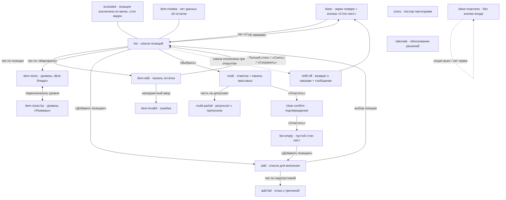

# КДС · Стоп-лист — ТЗ на отрисовку прототипа (Jira PB-8111)

Рабочее ТЗ для ИИ-агента (VS Code, DeepSeek). Ты отрисовываешь прототип интерфейса
«Стоп-лист и остатки на кухонном экране WebKDS» на базе готового прототипа комбо-набора.

**Результат:** новый прототип в репозитории `Anders7Rusk/ProtoApp-Draft`:

- `KDS/StopList/kds-stoplist.html` — один файл, 18 состояний, переключение `?state=`;
- `KDS/StopList/layouts.js` — реестр панели ревью;
- после сборки — commit + push в `main`, стенд проверить по ссылке
  `https://anders7rusk.github.io/ProtoApp-Draft/KDS/StopList/kds-stoplist.html?state=base&v=1`.

Если среда позволяет писать файлы — пиши прямо в репозиторий (локальный клон `ProtoApp-Draft`).
Если работаешь только чатом — выдай содержимое обоих файлов целиком, юзер сохранит сам.

## 0. Источники (читать обязательно, всё остальное — из них)

1. **Задача PB-8111** «Дизайн: стоп-лист и остатки на кухонном экране WebKDS» (описание ниже).
2. **Сценарии** `PB-8102-user-scenarios.md` — вложение к PB-8111; ключевые выдержки — Приложение A,
   полный текст юзер приложит к этому ТЗ отдельным файлом.
3. **База** — `KDS/Combo/kds-combo.html` (состояние `base`) в том же репозитории. Это образец
   каркаса и стилей. ПРОЧИТАТЬ ФАЙЛ ЦЕЛИКОМ ДО ПРАВОК: каркас рисуется функцией `render()`/`mkView()`,
   данные состояний — в объекте `SCREENS`, палитра — CSS-переменные `.kds-view`, панель ревью —
   `connect.js` + `layouts.js`, переключение — событие `dsreview:state` и `?state=`.

## 1. Правила работы (из уроков PB-8108, нарушать нельзя)

1. Базу `base` скопировать 1:1 из kds-combo.html и **не перерисовывать**: экран повара, шапка,
   лента карточек, футер, интерактив. Менять в базе только одно — добавить кнопку входа
   в стоп-лист (см. §5.1).
2. Данные экранов — только из этого ТЗ и сценариев. Нет значения/компонента/текста — **не выдумывать**:
   остановиться и спросить дизайнера в чате.
3. Правки по одной, после каждой — самопроверка по критерию приёмки этого экрана.
4. Каждое состояние регистрировать в `layouts.js`; в конце сверить: число шагов = числу ключей `SCREENS`.
5. Стили — только палитра базы (CSS-переменные `--kds-*`), шрифт Roboto, иконки Material Icons
   Outlined (шрифт, как вся база). **Новые цвета не вводить.**
6. **Никаких подложек и фонов сверх базы**: у новых строк/панелей — ровно стиль строк-коробок базы
   (`#212121`, радиус 8), новых заливок, рамок-украшений и теней не добавлять.
7. Тач-терминал: без hover-зависимостей, цель нажатия ≥ 44 px, текст не выделяется.
8. Консоль без ошибок на каждом состоянии.
9. В контенте ссылок-переключателей нет — только селект панели ревью и `?state=` (правило 19.10.2026).
10. Каждое состояние — с аннотацией `anno` (что здесь важно, 1–2 фразы) и цитатой сценария в
    подписи панели ревью.

## 2. Суть задачи (PB-8111, сжато)

Стоп-лист сейчас живёт в кассе; кухня его не видит и не ведёт. Нужен **отдельный интерфейс
кухонного экрана**: повар/шеф переходит в него из экрана заказов, ведёт стоп-лист и остатки,
возвращается к заказам. Стоп-лист — не строка заказа, не подача, не статус блюда: внесение
в стоп не удаляет блюдо из меню и не меняет заказы.

**Условия, которые обязан сохранить дизайн** (полный список — Приложение A, §3 сценариев):

- Позиция — позиция меню, может иметь размеры. Три состояния: **без ограничения** (остаток не задан —
  это НЕ то же, что 0), **ограниченный остаток N**, **полный стоп** (остаток 0).
- Остаток дробный: 0 (полный стоп) или положительное от 0,001 до 999,999, максимум 3 знака после
  запятой. Дробный остаток разрешён любой позиции, включая штучные/порционные. WebKDS **не округляет**
  ни введённые, ни полученные значения. Единица измерения показывается рядом, **только если** данные
  системы позволяют определить её однозначно; сам WebKDS единицу не угадывает и не пересчитывает.
- Уровень ограничения один: **всё блюдо** ЛИБО **отдельные размеры**. Размеры задаются/снимаются
  независимо. Переключение уровня: общее → размеры: прежний общий остаток переносится на ВСЕ размеры,
  выбранному размеру задаётся новый. Размеры → общее: ограничения размеров заменяются новым общим.
- Снятие ограничения — отдельное действие (не то же, что задание остатка); снимается выбранный
  уровень, остальные размеры сохраняют свои остатки.
- Полный стоп наступает сам при остатке 0; остаток сам уменьшается при продаже и восстанавливается
  при отмене; сотрудник может скорректировать вручную.
- Массовые: перевод отмеченных в полный стоп, снятие ограничений, очистка стоп-листа целиком
  (обязательное подтверждение). Массовой установки положительных остатков НЕТ.
- Стоп-лист один на точку продаж (терминальную группу) / на группу; сотрудник видит, с каким
  стоп-листом работает.
- Доступ: опция «Режим работы со стоп-листом» в настройках экрана (видна в конфигураторе только при
  включённой персональной смене) + авторизация с правом «Редактировать стоп-лист». Есть печать.
- Для нового внесения предлагаются блюда, заготовки, услуги и модификаторы по критериям iikoFront
  (связь с приготовлением, правила меню/прайс-листа, комбо). Товары/внешние товары/позиции для
  закупки/тарифы/топливо НЕ предлагаются. Действующее ограничение видно и снимается, даже если
  позиция перестала подходить для нового внесения. Попытка внести недопустимую — отказ с причиной.

## 3. Схема «что из чего» (блок-схема переходов)



## 4. Палитра и стили (из базы, не менять)

Из `.kds-view` (тёмная тема):

```
--kds-bg: #121212   --kds-surface: #121212   --kds-row: #212121   --kds-btn: #3b3b43
--kds-line: #616161 --kds-text: #ffffff      --kds-text-2: #9e9e9e --kds-text-3: #d6d6d6
--kds-ic-accent: #448aff  --kds-ic-warning: #ffab40  --kds-ic-positive: #14b456  --kds-ic-negative: #ff5252
```

Ключевые размеры/стили базы:

- кадр 1280×800; topbar 44 (пад 12/16/8/16), footer 56 (пад 4/16);
- строка-коробка: высота 52, `#212121`, радиус 8, название 22/28 Medium `#fff`;
- плашка количества: `#E0E0E0`, 22/28 Bold `#333`; кнопка строки 52×52 `#3b3b43`, иконка 28;
- вторичный текст 14/20 и 12/16 `#9e9e9e`; строка гостя 12/16 `#9e9e9e`;
- вложенные строки (паттерн `nest` в базе): отступ 16, текст 18/24;
- меню-контейнер (паттерн `.kds-menu`): `#333333`, радиус 12, рамка 1px `#616161`, пад 12/4, пункт 48;
- кнопка футера: высота 48, пад 14/16, рамка 1px `#616161`, радиус 12, текст 14/20 Medium uppercase;
- переключатель `kds-toggle` (Toogle mode из Figma): пад 4/6, радиус 16, элементы 36×36 радиус 16,
  активный — белый/тёмный;
- статусы: `waiting #9e9e9e`, `urgent #ffab40`, `cooking #448aff`, `ready #14b456`, `cancelled #ff5252`.

Акцентное действие (кнопка «Добавить позицию», «Сохранить»): заливка `#448aff`, текст `#fff`,
радиус 12, высота 48 — как акцентные элементы базы. Остальные кнопки — обводка, как кнопка футера.

## 5. Спецификация интерфейса стоп-листа

Стоп-лист — отдельный интерфейс: он **сменяет** экран заказов (не модалка). Каркас тот же:
`kds-view` 1280×800, topbar, область контента, footer.

### 5.1. Точка входа (единственное изменение базы)

В topbar экрана заказов, в `.kds-tb-lists` после кнопки ресторана, до счётчиков, — кнопка-пик
в стиле соседних (`kds-tb-list kds-tb-pick`): иконка `block` (Material Icons Outlined) + текст
«Стоп-лист». Иконка — **кандидат, не утверждена** (см. §12 постеры). В состоянии `base-noaccess`
этой кнопки нет вовсе (опция выключена / нет права / смена выключена) — и никакого намёка, что
функция существует.

### 5.2. Шапка экрана стоп-листа

- Слева: кнопка возврата — `arrow_back` + «К заказам» (стиль `kds-tb-list kds-tb-pick`).
- Заголовок «Стоп-лист» (16/24 Medium, как текст шапки базы) + подпись `Терминальная группа: Зал`
  14/20 `#9e9e9e` — сотрудник видит, с каким стоп-листом работает.
- Справа: часы (как в базе), иконки `power_settings_new`, `settings` (как в базе).
- Счётчиков-фильтров заказов в шапке стоп-листа НЕТ.

### 5.3. Список позиций

- Над списком — поле поиска: коробка `#212121` r8, высота 52, иконка `search` 20 `#9e9e9e`,
  placeholder «Найти позицию» 18/24 `#9e9e9e`. Справа в той же строке — кнопка «Добавить позицию»
  (акцентная заливка, 48 px, `add` + текст) — вход в внесение.
- Под полем поиска — список позиций, вертикальный, со скроллом. Строка позиции — коробка `#212121` r8,
  высота 52:
  - слева: название 22/28 Medium `#fff`; длинное — многоточие + `data-full` с полным именем по тапу
    (механизм базы: `.kds-tip`, авто-скрытие 3 с);
  - справа: плашка остатка `#E0E0E0` 22/28 Bold `#333` с числом и единицей рядом в той же плашке
    (например `4 шт`); у позиции в полном стопе вместо плашки — красный текст «Полный стоп»
    22/28 Medium `#ff5252` (остаток 0 виден и есть причина — отдельного бейджа не нужно);
  - крайняя справа: кнопка 52×52 `#3b3b43`, иконка `edit` 28 — открывает панель действий (кандидат).
- Позиция с размерами (паттерн `nest` базы): заголовок «Маргарита» 22/28 Medium + вложенные строки
  размеров (отступ 16, текст 18/24): `25 см` — плашка `12 шт`; `30 см` — `4 шт`; `35 см` — «Полный стоп».
  Кнопка `edit` — у заголовка.
- Исключённая из меню позиция с действующим ограничением: строка как обычно + подпись под названием
  «Исключена из меню» 12/16 `#9e9e9e`; стоп виден, снять можно (состояние `excluded`).
- Позиция без данных об остатке: плашка остатка пустая — без числа и без единицы; ничего не выдумывать
  (состояние `item-nodata`).

### 5.4. Панель действий по позиции

Открывается тапом на строку позиции: строка раскрывается вниз (аккордеон в той же коробке):

- Переключатель уровня — компонент `kds-toggle` (Toogle mode): две позиции `Всё блюдо` / `Размеры`
  с иконками `restaurant` / `straighten` (кандидаты). Показывается только у позиций с размерами.
- Уровень «Всё блюдо»: одно поле остатка.
- Уровень «Размеры»: строки размеров (25/30/35 см), у каждой своё поле остатка. Поля независимы.
- Поле остатка: число + единица (`шт`), ввод дробный. Пустое поле = «нет данных» (значение не показано,
  но ввести можно).
- Кнопки подряд: «Полный стоп» (обводка), «Снять ограничение» (обводка), «Сохранить» (акцент).
  Полный стоп = остаток 0; снятие — ОТДЕЛЬНОЕ действие (не ввод нуля), после снятия позиция уходит
  из стоп-листа в состояние «без ограничения».
- Переключение уровня (решение открытого вопроса №1 задачи): при переходе «Всё блюдо» → «Размеры»
  прежний общий остаток уже стоит во ВСЕХ размерах, выбранный размер — в фокусе (подсвечен, поле
  готово к вводу), сотрудник меняет его значение. Переход «Размеры» → «Всё блюдо» — одно поле,
  прежние ограничения размеров заменяются новым общим. Никаких предупреждений: смена уровня —
  обычное действие, состояние видно сразу.

### 5.5. Валидация ввода

- Допустимо: 0 (полный стоп) и положительные от 0,001 до 999,999, не больше 3 знаков после запятой.
- Недопустимо (значение не принимается): отрицательное; больше 999,999; меньше 0,001, но не ноль;
  больше 3 знаков после запятой. Ошибка — красная подпись 14/20 `#ff5252` под полем:
  «Допустимо от 0,001 до 999,999, не больше 3 знаков после запятой». Поле остаётся для правки.

### 5.6. Внесение новой позиции

Экран `add`: шапка — возврат «К списку», заголовок «Добавить в стоп-лист», группа «Зал»;
поле поиска; список позиций, доступных для внесения (те же критерии iikoFront — в прототипе это
просто строки-коробки без плашек). У каждой — подпись «Без ограничения» 12/16 `#9e9e9e`.
Тап по позиции — панель задания остатка (как §5.4, кнопка «Добавить» вместо «Сохранить»).
Товары и прочие недопустимые типы в списке НЕ показываются.

### 5.7. Массовые действия

- В шапке списка (рядом с «Добавить позицию») — кнопка «Выбрать» (обводка). В режиме выбора:
  у строк слева чекбоксы `check_box_outline_blank` (отмечен — `check_box`), внизу — панель массовых
  действий поверх футера: счётчик «Выбрано: N», кнопки «В стоп» (полный стоп), «Снять ограничения»,
  «Очистить стоп-лист».
- Часть отмеченных не допускает действие (например, снятие у позиции без ограничения) — действие
  применяется к допустимым, после действия подпись результата (баннер, 3–5 с): «В стопе: 3 ·
  пропущено: 1 (без ограничения)».
- «Очистить стоп-лист» — обязательно подтверждение: контейнер в стиле `.kds-menu` (`#333333` r12,
  рамка 1px `#616161`): заголовок «Очистить стоп-лист?», текст «Будут сняты все ограничения, включая
  позиции с остатком», кнопки «Очистить» / «Отмена».
- Массового задания положительных остатков нет — таких кнопок не рисовать.

### 5.8. Печать

Кнопка `print` + «Печать» в шапке списка стоп-листа (обводка). По тапу — короткое подтверждение
«Стоп-лист отправлен на печать» (баннер, авто-скрытие 3 с). Шаблон печатной формы и выбор
устройства НЕ рисуем — их нет в документе.

### 5.9. Состояния недоступности

- Опция выключена / нет права / смена выключена: на экране заказов кнопки входа нет (`base-noaccess`),
  действий нет, частично работающего интерфейса не показывать.
- Смена отключена при ОТКРЫТОМ стоп-листе (`shift-off`): экран заказов + баннер сверху ленты
  «Стоп-лист закрыт: персональная смена выключена» — нейтральный (не красный, это не ошибка),
  авто-скрытие 3 с.

### 5.10. Открытые вопросы задачи — принятые решения (согласованы дизайнером 23.10.2026)

1. **Переключение уровней** — §5.4: перенос остатка виден сразу, выбранный размер в фокусе.
2. **Кто/когда/авто-изменение** — не показываем: кухне не нужно, экран без технических деталей;
   актуальное значение видно само (ручное и автоматическое не различаем).
3. **Часть отмеченных не допускает массовое действие** — §5.7: применяется к допустимым + подпись
   результата с пропуском.
4. **Полный стоп из-за нуля** — единый вид «Полный стоп» с остатком 0; отдельного бейджа нет.
5. **Причина отказа внесения** — недопустимые не предлагаются; если внесение всё же запрошено —
   сообщение с причиной: «Не удалось добавить: позиция исключена из меню».
6. **Закрытие из-за смены** — §5.9: нейтральное сообщение, не ошибка.

### 5.11. Футер экрана стоп-листа

Слева — версия и статус как в базе («WebKDS v. 9.4.5.208229» · точка · «Включен»). По центру —
«В стоп-листе: 7 позиций». Справа — кнопка «Печать» (обводка). «Всего заказов» и «Отменить»
на стоп-листе НЕ показывать (они про заказы).

## 6. Состояния SCREENS — по одному

Данные — из сквозного примера сценариев (§5): заведение «Пиццерия», Маргарита 25/30/35 см
(25 см = 12 шт, 30 см = 4 шт, 35 см = полный стоп). Остальные позиции — из меню базы
(Морс ягодный, Паста карбонара, Салат с морепродуктами, Пицца от шефа) + Фокачча и Тирамису
из примеров сценариев.

| # | state | Что на экране | Критерий приёмки |
|---|---|---|---|
| 1 | `base` | База 1:1 из kds-combo + кнопка «Стоп-лист» в шапке (block + текст) | База визуально не изменилась; кнопка в шапке слева от счётчиков; тап кнопки не обязателен (переход — через панель ревью), но `?state=base` открывает экран |
| 2 | `base-noaccess` | Та же база, кнопки входа НЕТ | Кнопки нет, никакого намёка на функцию; аннотация объясняет, почему |
| 3 | `list` | Стоп-лист: шапка (К заказам · Стоп-лист · Зал), поиск, «Добавить позицию», «Выбрать», «Печать»; позиции: «Фокачча — 2,5 шт», «Маргарита» с размерами (12 шт / 4 шт / Полный стоп), «Тирамису — Полный стоп», «Паста карбонара — 8 шт»; футер «В стоп-листе: 4 позиции» | Видны три состояния позиции (остаток, полный стоп) и размеры; дробный остаток без округления; кнопки шапки на месте; консоль чистая |
| 4 | `list-empty` | Пустой стоп-лист: подпись «Ограничений нет» + текст «Нажмите «Добавить позицию», чтобы задать остаток» + акцентная кнопка | Понятно, как задать первое ограничение; ничего лишнего |
| 5 | `excluded` | `list` + позиция «Суп дня — 3 порции» с подписью «Исключена из меню» | Ограничение видно, кнопка снятия доступна; подпись 12/16 `#9e9e9e` |
| 6 | `item-edit` | Строка «Фокачча» раскрыта: поле остатка `2,5` + `шт`, кнопки «Полный стоп» / «Снять ограничение» / «Сохранить» | Ввод дробный; три действия раздельны; кнопки 48 px |
| 7 | `item-sizes` | Строка «Маргарита» раскрыта, переключатель на «Всё блюдо», одно поле остатка | Уровень выбран «Всё блюдо»; размеры не показаны полями |
| 8 | `item-sizes-by` | Та же строка, переключатель на «Размеры»: строки 25 см / 30 см / 35 см с полями (12 / 4 / Полный стоп), поле 30 см в фокусе (подсвечено) | Прежний общий остаток перенесён во все размеры; выбранный размер в фокусе; поля независимы |
| 9 | `item-invalid` | Панель с ошибкой: поле содержит недопустимое значение, красная подпись «Допустимо от 0,001 до 999,999, не больше 3 знаков после запятой» | Ошибка под полем, поле доступно для правки, кнопка «Сохранить» не выполняет сохранение |
| 10 | `item-nodata` | `list`, у «Тирамису» плашка остатка пустая (без числа и единицы) | Значение не показано; ничего не выдумано |
| 11 | `add` | Экран «Добавить в стоп-лист»: поиск + строки доступных позиций («Фокачча», «Суп дня», «Салат с морепродуктами», «Соус к пасте») с подписью «Без ограничения» | Недопустимых типов нет; у каждой подпись состояния; тап открывает панель с «Добавить» |
| 12 | `add-fail` | Тот же экран: позиция «Суп дня» в списке помечена «исключена из меню», тап → сообщение «Не удалось добавить: позиция исключена из меню» | Ограничение не появилось; причина показана; сообщение нейтральным баннером |
| 13 | `multi` | Режим выбора: чекбоксы, отмечены 3 позиции, панель «Выбрано: 3 · В стоп · Снять ограничения · Очистить стоп-лист» | Чекбоксы слева, счётчик верный, три массовых действия, задания остатков нет |
| 14 | `multi-partial` | После «Снять ограничения»: подпись «Снято ограничений: 2 · пропущено: 1 (без ограничения)» | Результат виден; пропущенная позиция названа с причиной |
| 15 | `clear-confirm` | Диалог очистки в стиле `.kds-menu`: «Очистить стоп-лист?» + текст + «Очистить» / «Отмена» | Подтверждение обязательно; «Отмена» закрывает диалог без изменений |
| 16 | `shift-off` | Экран заказов (база) + баннер «Стоп-лист закрыт: персональная смена выключена» | Нейтральный баннер сверху ленты, не красный; аннотация: это не ошибка |
| 17 | `icons` | Постер пиктограмм (паттерн `kds-posters`): block — вход в стоп-лист, edit — действие строки, print — печать, restaurant/straighten — уровни; ВСЕ помечены «кандидат, не утверждена» | На постере честно: ни одна иконка не выдана за утверждённую |
| 18 | `rationale` | Постер «Обоснование решений» — 6 решений из §5.10 по одной карточке | Каждое решение названо и обосновано 1–2 фразами; отмечено, что решения согласованы с дизайнером |

Везде: `pill` (метка экрана), `stat` при необходимости, `anno` — 1–2 фразы «что здесь важно».
Мобильный кадр (`cfg.mobile`) не нужен — задача только про планшетный экран 1280.

## 7. Реестр layouts.js

Копировать формат из `KDS/Combo/layouts.js`: `проект: 'КДС · Стоп-лист'`, `адаптив: true`,
18 шагов `{ file: 'kds-stoplist.html', state, title }` — заголовок = короткое имя экрана + суть
(образец стиля — у комбо). Порядок — как в таблице §6.

## 8. Чек-лист приёмки (весь прототип)

- [ ] `base` — 1:1 с kds-combo, кроме новой кнопки входа; визуально ничего не съехало.
- [ ] `base-noaccess` — входа нет, намёков нет.
- [ ] Три состояния позиции различимы: остаток N, полный стоп, без ограничения (в списке добавления).
- [ ] Дробный остаток показан и редактируется без округления (2,5).
- [ ] Единица измерения рядом с числом, не выдумана.
- [ ] Уровень «Всё блюдо / Размеры» переключается; перенос остатка виден; выбранный размер в фокусе;
      снятие с одного размера не трогает остальные (в аннотации экрана это названо).
- [ ] Полный стоп и снятие ограничения — разные кнопки.
- [ ] Некорректный остаток не принимается, ошибка объяснена.
- [ ] Массовые: отметка, «В стоп», «Снять ограничения», очистка с подтверждением; массовых остатков нет.
- [ ] Печать запускается кнопкой, есть подтверждение отправки.
- [ ] Состояния недоступности: нет входа при выключенной опции/смене; при отключении смены — возврат
      к заказам с нейтральным сообщением.
- [ ] `excluded`: стоп виден, снятие доступно. `item-nodata`: значение не показано.
- [ ] Постеры icons (кандидаты помечены) и rationale (6 решений).
- [ ] `layouts.js`: 18 шагов = 18 ключей SCREENS; заголовки совпадают.
- [ ] Консоль без ошибок на каждом состоянии.
- [ ] Ни одной новой подложки/фона/тени сверх базы; новые цвета не введены.
- [ ] Шапка файла честно описывает, что взято откуда (образец — шапка kds-combo.html).

## 9. Публикация

Commit + push в `main` репозитория `Anders7Rusk/ProtoApp-Draft` (только новые файлы
`KDS/StopList/`). Проверить стенд: `https://anders7rusk.github.io/ProtoApp-Draft/KDS/StopList/kds-stoplist.html?state=base&v=1`
— каждая ссылка `?state=` из таблицы §6 должна открываться.

## 10. Чего делать нельзя

- Перерисовывать базу или менять kds-combo.html.
- Выдумывать значения, иконки, тексты, цвета, состояния, которых нет в ТЗ/сценариях.
- Добавлять подложки, рамки-украшения, тени, тонирование строк.
- Рисовать шаблон печатной формы и выбор устройства печати.
- Рисовать массовое задание остатков.
- Показывать автора/время изменения остатка.
- Добавлять ссылки-переключатели в контент.
- Вводить классы `ds-*` (КДС-карточки — своя раскладка; в прототипе их нет).

## 11. Если нет данных для решения

Остановиться и задать вопрос дизайнеру в чате. Не заменять «похожим». Формат вопроса:
что именно не хватает, какие варианты видишь.

---

## Приложение A. Выдержки из сценариев PB-8102 (обязательные для дизайна)

### A.1. Ключевые договорённости (§3 сценариев)

- Позиция — позиция меню, для которой система предусматривает управление стоп-листом, в том числе
  модификаторы. У позиции может быть размер.
- Перечень для нового внесения совпадает со стандартным интерфейсом iikoFront при одинаковых настройках
  заведения: блюда, заготовки, услуги и модификаторы, связанные с приготовлением (место приготовления
  или «готовить вместе с основным блюдом»). Модификатор предлагается, если включён в меню по умолчанию
  или привязан к позиции, которая сама проходит условия отбора. Доступность — по правилам iikoFront
  с учётом прайс-листа, участия в комбо и «включено в меню по умолчанию». Товары, внешние товары,
  позиции для закупки, тарифы и топливо не предлагаются. Наличие ограничения само по себе не исключает
  позицию из перечня допустимых для управления.
- Отбор для нового внесения и действующие ограничения — разные вещи: если позиция в стоп-листе, но
  перестала подходить для нового внесения (например, исключена из меню), её ограничение остаётся
  видимым и может быть снято. Позиции, не подходящие для нового внесения, для этого действия не
  предлагаются; если попытка внесения всё же происходит — действие не выполняется, сотрудник получает
  понятное сообщение об отказе.
- Три состояния позиции: без ограничения (остаток не задан — не то же, что 0); ограниченный остаток N;
  полный стоп (остаток 0, позиция недоступна).
- Остаток дробный: 0 (полный стоп) и положительные от 0,001 до 999,999 с точностью до трёх знаков.
  Дробный остаток допустим для любой позиции, включая штучные и порционные; тип позиции, признак
  весового товара и настройка дробных продаж на ввод остатка не влияют. Отрицательный не принимается.
- WebKDS не округляет остатки — ни введённые, ни полученные от других компонентов, даже если позиция
  продаётся только целиком. Единица измерения показывается рядом, если данные системы позволяют
  однозначно её определить; WebKDS не угадывает единицу и не пересчитывает количество.
- Остаток меняется сам: уменьшается при продаже, восстанавливается при отмене; сотрудник может задать
  или скорректировать вручную; актуальное значение видно и после изменений из других компонентов.
- Ограничение задаётся на одном уровне: либо на всё блюдо, либо на отдельные размеры; оба уровня
  одновременно не используются. Ограничение на всё блюдо действует для всех размеров. Ограничения
  размеров задаются и снимаются независимо. Переключение общее → размеры: прежний общий остаток
  переносится на остальные размеры, выбранному размеру задаётся новый. Размеры → общее: прежние
  ограничения размеров заменяются новым общим.
- Снятие ограничения — отдельное действие, не то же, что задание остатка: снимается ограничение
  выбранного уровня, остальные размеры сохраняют свои остатки. И полный стоп, и положительный остаток
  снимаются одним действием.
- Позиция переходит в полный стоп сама, когда остаток дошёл до 0.
- Массовые действия: перевод отмеченных позиций в полный стоп, снятие ограничений, очистка стоп-листа
  целиком с обязательным подтверждением. Массовой установки положительного остатка нет.
- Стоп-лист один на точку продаж (терминальную группу), а при включённых «отдельных стоп-листах по
  группам» — на группу. Сотруднику видно, с каким стоп-листом он работает.
- Стоп-лист — отдельный интерфейс, не совмещённый с экраном заказов и блюд; переход туда и обратно
  доступен в любой момент.
- Доступ включается опцией «Режим работы со стоп-листом» в настройках экрана; опция видна в конфигураторе
  только при включённой персональной смене, при выключенной — полностью скрыта. Отключение персональной
  смены не сбрасывает сохранённое значение: оно перестаёт действовать, после повторного включения опция
  снова видна с прежним значением.
- Работа доступна только при включённой персональной смене, после авторизации сотрудника с правом
  «Редактировать стоп-лист» и при включённой опции. Если персональную смену отключают во время работы —
  интерфейс закрывается с возвратом к работе с заказами. Работа от служебных/системных учётных данных
  не предусматривается.
- Есть печать стоп-листа.
- Стоп-лист — не строка заказа, не подача и не статус блюда: внесение в стоп не удаляет блюдо из меню
  и не меняет отображение и обработку заказов.

### A.2. Сложные ситуации (§8 сценариев, сжато)

- Смена выключена: опция скрыта в конфигураторе, на экране нет перехода, действия недоступны, даже
  если опция была включена. Нельзя показывать частично работающий интерфейс или намёк, что функция
  доступна.
- Смену отключили при открытом интерфейсе: закрывается с возвратом к заказам, действия недоступны.
- Смена включена повторно: опция снова видна с прежним значением; повторно включать не нужно.
- Нет авторизации/права при включённой смене: работа со стоп-листом недоступна.
- Опция на экране выключена: интерфейс недоступен.
- Нет данных об остатке: интерфейс не показывает значения (не показывать выдуманный остаток).
- Остаток вне диапазона / с большей точностью / отрицательный: не принимается.
- Позиция не подходит для нового внесения: не предлагается; если внесение запрошено — отказ с причиной,
  ограничение не появляется.
- Уже ограниченная позиция исключена из меню: ограничение видно, снять можно; скрывать его фильтром
  нового внесения нельзя.
- Дробный остаток у штучной/порционной позиции: без округления, ввод не блокируется настройками продаж.
- Позиция уже в полном стопе: повторное действие не требуется.
- У позиции нет ограничения: снятие недоступно (не показывать действие, приводящее к ошибке).
- Остаток изменился автоматически: видно актуальное значение.
- Позиция стала полным стопом сама: состояние видно без действий пользователя.
- Одновременное изменение из разных мест: результат сотрудника не теряется незаметно (способ — в системной
  спеке, в макете не решаем).
- Массовое действие, когда часть отмеченных его не допускает: применяется к применимым, результат виден.

### A.3. Сквозной пример (§5 сценариев)

Заведение «Пиццерия», вечерняя смена. Пицца «Маргарита» — размеры 25/30/35 см. Ограничения по
размерам: 25 см — 12 шт, 30 см — 4 шт, 35 см — полный стоп.

Примеры: автоматическое изменение — было 5 пирожков, после продажи стало 4, повар вручную поставил 2.
Дробный остаток — сотрудник задаёт штучной позиции 2,5; экран сохраняет и показывает 2,5.
Новое внесение — шеф находит фокаччу без ограничения и задаёт остаток 5; позиция появляется в стоп-листе.

### A.4. Чек-лист сценариев (§11) — учтён в §8 этого ТЗ

*Источники: PB-8111 (описание), PB-8102-user-scenarios.md (вложение к PB-8111), база KDS/Combo/kds-combo.html
(состояние base), уроки прототипа PB-8108. Согласования дизайнера — 23.10.2026.*
