# Баннеры и группы баннеров — сценарии для прототипа и проверки

**Версия:** 1.0 · 19.10.2026
**Приложение:** iikoWeb → «Настройки и обслуживание системы» → «Управление киосками»
**Задачи:** WEB-22902 (доработка), PB-8074 (дизайн раздела «Баннеры»), PB-8092 (дизайн раздела «Группы»)

**Задание тому, кто берёт документ:**
1. По разделу A нарисовать прототип экранов S1–S10 (веб, 1440 px, компоненты ДС iiko).
2. По разделам B–D реализовать все сценарии, включая ветвления и ошибки.
3. По разделу G проверить прототип: для каждого пункта — «есть / нет / расходится» и что именно.
4. Раздел H — не решать самостоятельно, вынести в вопросы.

---

## 0. Как пользоваться документом

- **Раздел A** — контекст, термины, карта экранов. По нему рисуется прототип.
- **Раздел B** — сценарии баннеров. **Раздел C** — сценарии групп. **Раздел D** — киоск (что видит гость).
- **Раздел E** — краевые случаи и ошибки. **Раздел F** — сквозные правила и ограничения.
- **Раздел G** — чек-лист проверки прототипа по сценариям.
- **Раздел H** — открытые вопросы: их нельзя решать фантазией, только пометкой «уточнить».
- **Раздел J** — схемы всех сценариев в Mermaid (в конце файла).

**Правила для того, кто рисует прототип:**
1. Подписи полей и кнопок брать буквально из карточек сценариев — не переформулировать.
2. Не добавлять поля, кнопки и колонки, которых нет в карточках.
3. У каждого экрана рисовать состояния: обычное, пустое, «ничего не найдено», выбрано N, загрузка, ошибка.
4. Один баннер может быть в нескольких меню и местах (1:N) — это показывать чипсами «+N» и поповером, а не строкой через запятую.
5. Данные в примерах — условные (Биг Хит, Бургеры и роллы, 60 секунд).
6. Где в карточке стоит «(уточнить)» — рисовать по текущему поведению и вынести в раздел H.

---

## A. Контекст

Сейчас в «Управлении киосками» один баннер можно привязать только к одной категории в одном меню. Новая модель — **1:N**: один баннер используется в нескольких меню и в нескольких местах, без дублирования объектов.

Что добавляется:
- фильтр по внешнему меню и баннеру;
- группировка таблицы по типу расположения и по месту;
- мультиселекты для «Меню» и «Места расположения»;
- версии внешнего меню;
- счётчик баннеров внизу;
- восстановление удалённых баннеров;
- массовое изменение внешнего меню.

---

## A2. Роли

| Роль | Что делает |
|---|---|
| Администратор iikoWeb (ресторан/сеть) | создаёт и правит баннеры и группы, назначает рестораны и даты |
| Сотрудник поддержки / внедрения | настраивает по запросу клиента, диагностирует конфликты |
| Маркетинг | заказчик контента: присылает материалы, в системе не работает |
| Гость киоска | видит баннеры и кликает по ним |

Матрица прав (кто что может) в документации не описана — открытый вопрос H-1.

---

## A3. Термины

- **Баннер** — изображение или видео с параметрами показа.
- **Тип расположения** — одно из четырёх значений: «Экран ожидания» (WAITING_SCREEN), «Категории меню» (MENU_CATEGORIES), «Аллерген шапка» (ALLERGEN_HEAD), «Аллерген основная таблица» (ALLERGEN_MAIN_TABLE).
- **Место расположения** — категория внешнего меню. Раньше поле называлось «Расположение», в новой модели — «Место расположения». Доступно только для типа «Категории меню». Может быть несколько.
- **Внешнее меню** — меню киоска. У меню есть версии; баннер привязывается к меню и версии.
- **Блюда для деактивации** — блюда, при деактивации которых баннер не показывается. Мультивыбор, необязательное поле.
- **Группа баннеров** — набор баннеров с порядком и интервалом показа, привязанный к ресторанам и датам.
- **Интервал** — сколько секунд показывать баннер в группе.
- **ПБО** — предприятие (ресторан), к которому применяется группа.
- **Шаблон ресторанов** — группа применяется к шаблону, а не к отдельным ПБО.

---

## A4. Сущности и связи

- **Баннер → Меню:** 1:N (в новой модели). У меню учитывается версия.
- **Баннер → Места расположения:** 1:N, только для типа «Категории меню».
- **Баннер → Блюда для деактивации:** 1:N, необязательно.
- **Группа → Баннеры:** 1:N, у каждого баннера в группе свой порядок и интервал. Один и тот же баннер может встречаться в группе несколько раз.
- **Группа → ПБО:** N:N через список ресторанов или шаблон.
- **Группа → Даты:** дата начала и дата окончания (окончание может быть пустым).

Текстом: `Баннер (1) ── (N) Меню/Версии`; `Баннер (1) ── (N) Места`; `Группа (1) ── (N) Баннеры (order, interval)`; `Группа (N) ── (N) ПБО`.

---

## A5. Карта экранов

| ID | Экран | Что на нём | Обязательные состояния |
|---|---|---|---|
| S1 | Список баннеров | заголовок «Баннеры», поиск, «+ ДОБАВИТЬ», фильтр, переключатель группировки, таблица, счётчик внизу | обычное, пусто, нет результатов, выбрано N |
| S2 | Баннер, вкладка «ДЕТАЛИ» | «Основная информация»: Название, Меню, Тип расположения, Место расположения, Ссылка, Блюда для деактивации; блок файла и превью | пусто, заполнено, ошибки полей, загрузка файла |
| S3 | Баннер, вкладка «БЛЮДА» | таблица выбранных блюд, «+ Добавить», массовые действия | пусто, выбрано |
| S4 | Панель «Выберите блюда» | табы «Блюда» / «Категории», поиск, фильтр по типу, таблица, «ОТМЕНИТЬ» / «ДОБАВИТЬ» | пусто, ничего не найдено, выбрано |
| S5 | Панель «Фильтр» | «Внешнее меню», «Баннер», «Тип расположения», «Статус»; «Применить» / «Сбросить» | значения по умолчанию «Все» |
| S6 | Список групп | заголовок «Группы», поиск, «+ ДОБАВИТЬ», «Показать неактивные», таблица, бар выбора | обычное, пусто, выбрано |
| S7 | Группа, вкладка «ДЕТАЛИ» | Название, Тип, Рестораны, Дата начала показа, Дата окончания показа, «Активировать» | пусто, ошибки, конфликт |
| S8 | Группа, вкладка «БАННЕРЫ» | «Список баннеров», «+ Добавить», таблица в структуре раздела «Баннеры»: Фото, Номер, Наименование, Внешнее меню, Расположение, Интервал (без «Файла»); drag/удаление | пусто, выбрано N, перетаскивание, массовый интервал |
| S9 | Панель «Выберите баннер» | поиск, «Показать выбранное», таблица с чекбоксами, «ОТМЕНИТЬ» / «ДОБАВИТЬ» | пусто, выбрано |
| S10 | Диалоги | подтверждение удаления, ошибки сохранения и конфликтов | — |
| S11 | Киоск | вне прототипа; нужен для проверки логики показа | — |

Колонки таблицы баннеров (S1): **Название · Фото · Файл · Внешнее меню · Блюда · Расположение** (название — первая колонка после чекбокса, синяя кликабельная ссылка; в шапке «Название» — общая иконка «раскрыть/свернуть все группы»). В прототипе добавить: бейдж типа расположения (нейтральный), «Внешнее меню: +N», «Места: +N», статус (активен / удалён).

Колонки таблицы групп (S6): **Название · ПБО · Действует с · Действует по · Активен**.

---

## B. Сценарии: баннеры

### B-01. Открыть список баннеров
**Роль:** администратор.
**Когда:** нужен обзор всех баннеров.
**Шаги:**
1. «Управление киосками» → «Баннеры».
2. Экран S1: заголовок «Баннеры», подзаголовок «Список баннеров», справа «Поиск» и «+ ДОБАВИТЬ».
3. В таблице колонки: Название, Фото, Файл, Внешнее меню, Блюда, Расположение.
4. Внизу — счётчик «Всего N · показано M».
**Результат:** список баннеров с сортировкой и выбором строк.
**Состояния:** пусто — «Нет данных для отображения» + подсказка «Чтобы отобразить данные, нужно создать баннер, нажав «+ ДОБАВИТЬ»»; загрузка — скелетон таблицы; ошибка — плашка с повтором.
**Источник:** макет 2406:3665; вики 181774290.
**Приёмка:** при пустом списке видна подсказка и кнопка добавления; счётчик показывает 0.

### B-02. Поиск баннера
**Роль:** администратор.
**Когда:** нужно найти баннер по названию.
**Шаги:**
1. На S1 нажать «Поиск» (иконка) — раскрывается поле.
2. Ввести часть названия.
3. Таблица фильтруется по мере ввода.
**Результат:** в таблице только совпадения; счётчик «показано M».
**Ошибки:** ничего не найдено — «Ничего не найдено» + «Сбросить поиск».
**Ограничения:** поиск по названию; в спеке v1 — ещё и по кодам продуктов (уточнить).
**Источник:** вики 100567091; макет 2406:3665.
**Приёмка:** пустой результат отличается от пустого списка.

### B-03. Фильтр по меню и баннеру
**Роль:** администратор.
**Когда:** нужно сузить список до одного меню или баннера.
**Шаги:**
1. На S1 нажать иконку «Фильтр» — открывается панель S5.
2. «Внешнее меню» — выбор из списка, по умолчанию «Все».
3. «Баннер» — выбор по названию, по умолчанию «Все».
4. «Тип расположения» и «Статус» — дополнительные поля (предложение).
5. «Применить».
**Результат:** таблица отфильтрована; над таблицей чипсы активных фильтров и «Сбросить».
**Ошибки:** комбинация без результатов — «Ничего не найдено по фильтру» + «Сбросить фильтр».
**Ограничения:** фильтр по меню учитывает версии — в списке «Киоск: основное меню · v3».
**Источник:** вики 181774290 (требование).
**Приёмка:** фильтр применяется без перезагрузки; чипсы показывают выбранные значения.

### B-04. Сортировка таблицы
**Роль:** администратор.
**Когда:** нужно упорядочить баннеры.
**Шаги:**
1. Клик по заголовку колонки — сортировка по возрастанию, повторный клик — по убыванию.
2. Стрелка в заголовке показывает направление.
**Результат:** строки отсортированы; выбранная сортировка сохраняется при возврате в список.
**Ограничения:** сортировка по «Блюда» должна работать (раньше был баг WEB-20971).
**Источник:** вики 181774290; Jira WEB-20971.
**Приёмка:** сортировка по каждой колонке, включая «Блюда».

### B-05. Группировка по типу расположения
**Роль:** администратор.
**Когда:** нужно увидеть баннеры по группам типов.
**Шаги:**
1. На S1 переключатель группировки → «По типу расположения».
2. Таблица превращается в аккордеоны: «Экран ожидания», «Категории меню», «Аллерген шапка», «Аллерген основная таблица».
3. В заголовке каждой группы — количество баннеров.
4. Группы по умолчанию свёрнуты; клик раскрывает.
**Результат:** сгруппированный список; состояние раскрытия сохраняется.
**Исключения:** в группе нет баннеров — группа не показывается или показывается с «0» (уточнить).
**Источник:** вики 181774290.
**Приёмка:** свёрнуто по умолчанию; счётчики в заголовках; раскрытие/сворачивание работает.

### B-06. Группировка по месту расположения
**Роль:** администратор.
**Когда:** нужно увидеть, в каких категориях стоят баннеры.
**Шаги:**
1. Переключатель группировки → «По месту расположения».
2. Аккордеоны по категориям внешнего меню.
3. Баннеры с несколькими местами показываются в каждой группе.
4. Технические типы (экран ожидания, аллергены) — в группе «Без места расположения» (предложение).
**Результат:** видно, какие места заняты и чем.
**Ограничения:** группировка по месту доступна только для баннеров типа «Категории меню»; остальные — в «Без места».
**Источник:** вики 181774290.
**Приёмка:** один баннер с тремя местами виден в трёх группах; технические — отдельно.

### B-07. Создать баннер «Экран ожидания»
**Роль:** администратор.
**Когда:** нужна заставка на экране ожидания киоска.
**Предусловия:** есть внешнее меню с блюдами.
**Шаги:**
1. S1 → «+ ДОБАВИТЬ» → открывается S2, заголовок «Новый баннер».
2. Вкладка «ДЕТАЛИ», блок «Основная информация».
3. «Название *» — ввести.
4. «Меню *» — выбрать меню (с версией).
5. «Тип расположения *» — «Экран ожидания».
6. Поле «Место расположения» недоступно (экран один).
7. «Блюда для деактивации» — выбрать блюда (мультиселект, необязательно).
8. Блок «Загрузка изображения / видео» — перетащить файл или «Загрузить с компьютера»; проверить «Превью изображения / видео».
9. «СОХРАНИТЬ».
**Результат:** баннер сохранён и появился в списке; киоск показывает его на экране ожидания.
**Ошибки:** не заполнены обязательные поля — «СОХРАНИТЬ» неактивна, поля подсвечены, текст ошибки под полем.
**Источник:** вики 181774290 (сценарий 1); макеты 2659:19232, 2495:9112.
**Приёмка:** поле места недоступно; сохранение блокируется без названия и меню.

### B-08. Создать баннер «Категории меню»
**Роль:** администратор.
**Когда:** нужен баннер внутри категории меню.
**Шаги:**
1. S2: «Название *», «Меню *» (можно несколько — B-10).
2. «Тип расположения *» — «Категории меню».
3. «Место расположения *» — выбрать категории внешнего меню (мультиселект).
4. «Ссылка на блюдо или категорию» — выбрать блюдо или категорию.
5. «Блюда для деактивации» — при необходимости.
6. Файл и превью.
7. «СОХРАНИТЬ».
**Результат:** баннер показывается в выбранных категориях.
**Ошибки:** в выбранном меню нет категорий — поле места пустое с подсказкой «Сначала настройте внешнее меню».
**Ограничения:** места выбираются только из выбранных меню; при нескольких меню список мест объединяется.
**Источник:** вики 181774290 (сценарий 2).
**Приёмка:** мультиселект мест; при отсутствии категорий понятная подсказка.

### B-09. Создать технический баннер (аллергены)
**Роль:** администратор.
**Когда:** нужен баннер «Аллерген шапка» или «Аллерген основная таблица».
**Шаги:**
1. S2: «Название *».
2. «Тип расположения *» — «Аллерген шапка» или «Аллерген основная таблица».
3. «Меню *» — одно или несколько.
4. «Блюда для деактивации».
5. Файл → «СОХРАНИТЬ».
**Результат:** баннер отображается в шапке или в основной таблице аллергенов.
**Ограничения:** «Место расположения» недоступно; доступны только меню и блюда.
**Источник:** вики 181774290 (сценарий 3).
**Приёмка:** для обоих аллергенных типов набор полей одинаковый и без «Места».

### B-10. Один баннер в нескольких меню и местах (1:N)
**Роль:** администратор.
**Когда:** одна акция должна показываться в нескольких меню и категориях.
**Шаги:**
1. S2: «Меню *» — Select (multiple): выбрать 2–3 меню; в поле появляются значения через запятую, в списке отмечены чекбоксы.
2. «Место расположения *» — выбрать несколько категорий.
3. Сохранить.
4. В списке S1 в колонках «Меню» и «Расположение» — «+N» и поповер со списком.
**Результат:** одна запись баннера, N связей; дубликаты не создаются.
**Ошибки:** пересечение одинаковых мест — предупреждение «Баннер уже стоит в этой категории» (уточнить).
**Ограничения:** при правке баннера изменения применяются ко всем местам; при удалении — вопрос «удалить везде?».
**Источник:** вики 181774290 (цель); Jira WEB-22902.
**Приёмка:** в списке видно «+N»; поповер показывает все места.

### B-11. Привязка к версии внешнего меню
**Роль:** администратор.
**Когда:** нужно показывать баннер в конкретной версии меню.
**Шаги:**
1. S2: «Меню *» → выбрать меню.
2. Если у меню есть версии — появляется выбор версии: «Киоск: основное меню · v3 (01.02–28.02)».
3. Сохранить.
**Результат:** баннер привязан к меню и версии; киоск забирает нужную версию.
**Ошибки:** версия не выбрана — по умолчанию актуальная, с пометкой «актуальная».
**Ограничения:** как ведёт себя баннер при выходе новой версии — уточнить (H-2).
**Источник:** вики 181774290 (требование, вопрос к разработчику).
**Приёмка:** версия видна в поле и в списке; можно выбрать конкретную.

### B-12. Загрузить изображение или видео
**Роль:** администратор.
**Когда:** нужно приложить файл баннера.
**Шаги:**
1. S2, блок «Загрузка изображения / видео»: перетащить файл в область или «Загрузить с компьютера».
2. После загрузки — чип файла с «×» и «Превью изображения / видео».
3. Заменить файл — загрузить новый поверх.
**Результат:** файл прикреплён, превью отображается в пропорциях места.
**Ошибки:** превышен размер, неподдерживаемый формат, ошибка хранилища — плашка «Не удалось загрузить файл» и повтор.
**Ограничения:** лимиты для баннеров в документации не заданы; для главного экрана — 30 МБ, MP4, до 20 секунд. Уточнить (H-3).
**Источник:** макеты 2691:14865, 2659:19232; Jira WEB-18046, WEB-19373.
**Приёмка:** можно удалить файл крестиком; превью обновляется.

### B-13. Выбрать ссылку на блюдо или категорию
**Роль:** администратор.
**Когда:** баннер должен вести на блюдо или категорию.
**Шаги:**
1. S2: «Ссылка на блюдо или категорию» — открыть выпадающий список.
2. Найти блюдо или категорию поиском.
3. Если у блюда есть размеры — выбрать размер в дополнительном поле; если размеров нет — поле «Размер» недоступно, подставляется «Нет размера».
4. Сохранить.
**Результат:** ссылка сохранена.
**Ошибки:** блюдо не найдено — «Ничего не найдено».
**Ограничения:** обязательность ссылки противоречива: ТЗ называет обязательной, спека v1 и WEB-22701 — необязательной (H-4).
**Источник:** вики 100567091; 122520842 (задача 5); Jira WEB-13312.
**Приёмка:** размерное блюдо выбирается; поле размера недоступно без размеров.

### B-14. Выбрать блюда для деактивации
**Роль:** администратор.
**Когда:** баннер не должен показываться при деактивации определённых блюд.
**Шаги:**
1. S2: «Блюда для деактивации» — открыть панель выбора.
2. Отметить несколько блюд (в поле — значения через запятую, в списке — чекбоксы).
3. Подтвердить.
**Результат:** выбранные блюда привязаны к баннеру.
**Ограничения:** список блюд — только из выбранных меню; поле необязательное.
**Источник:** вики 181774290 (сценарии 1, 3); драфт 2691:14793.
**Приёмка:** мультивыбор; снятие чекбокса в списке убирает значение из текста в поле.

### B-15. Редактировать баннер
**Роль:** администратор.
**Когда:** нужно изменить параметры существующего баннера.
**Шаги:**
1. S1: клик по названию баннера (или по иконке редактирования).
2. S2 открывается с заполненными полями.
3. Внести изменения.
4. «СОХРАНИТЬ».
**Результат:** изменения сохранены; при 1:N — применены ко всем местам.
**Ошибки:** конфликт версий — «Баннер изменён в другом окне» (уточнить).
**Источник:** вики 100567091; макет 2495:9112.
**Приёмка:** поля заполнены; предупреждение о влиянии на несколько мест.

### B-16. Скопировать баннер
**Роль:** администратор.
**Когда:** нужен похожий баннер.
**Шаги:**
1. S1: в строке навести — иконка «Копировать».
2. Открывается S2 с копией: название «<Название> (копия)».
3. Изменить и сохранить.
**Результат:** новый баннер, оригинал не изменён.
**Ограничения:** копия не наследует привязку к группам.
**Источник:** комментарии к макетам 2024; макет 2406:3665.
**Приёмка:** копия создаётся с новым названием, оригинал цел.

### B-17. Удалить баннер
**Роль:** администратор.
**Когда:** баннер больше не нужен.
**Шаги:**
1. S1: в строке иконка «Удалить».
2. Диалог «Удалить баннер?» → «Удалить» / «Отмена».
3. После удаления строка исчезает из списка.
**Результат:** баннер помечен удалённым; его можно восстановить.
**Ошибки:** баннер входит в группу — удаление запрещено, в ошибке список групп (E-01).
**Источник:** Jira WEB-18093; вики 122520842 (задача 2).
**Приёмка:** при баннере в группе показывается понятная ошибка, а не общий текст.

### B-18. Массовое удаление
**Роль:** администратор.
**Когда:** нужно удалить несколько баннеров.
**Шаги:**
1. S1: чекбоксы в строках (или чекбокс в заголовке).
2. Появляется бар: «Выбрано баннеров: N», «Очистить выбор», справа «Удалить».
3. «Удалить» → подтверждение → удаление.
**Результат:** выбранные баннеры удалены; бар скрывается.
**Ошибки:** часть баннеров в группах — удаляются остальные, для спорных показывается список.
**Ограничения:** «выбрать все» действует на видимые строки с учётом фильтра (уточнить).
**Источник:** макет 2407:4242; вики 181774290.
**Приёмка:** счётчик выбранных корректен; «Очистить выбор» сбрасывает.

### B-19. Массовое изменение внешнего меню
**Роль:** администратор.
**Когда:** нужно перевести пачку баннеров на другое меню (или несколько меню).
**Шаги:**
1. S1: выбрать баннеры чекбоксами.
2. В баре выбрать «Изменить меню».
3. В панели отметить одно или несколько меню (мультивыбор) → «Применить».
**Результат:** у выбранных баннеров внешнее меню заменено выбранным набором.
**Ограничения:** массово меняется ТОЛЬКО внешнее меню; название, место расположения, файл и остальные поля — только в карточке баннера (B-15). Это не общий редактор строки.
**Ошибки:** заменить или добавить к существующим — уточнить (H-5); при замене предупреждение «Текущие меню будут заменены».
**Источник:** вики 181774290 (массовое управление).
**Приёмка:** изменение применяется только к выбранным; есть подтверждение.

### B-20. Показать удалённые и восстановить
**Роль:** администратор.
**Когда:** нужно вернуть удалённый баннер.
**Шаги:**
1. S1: переключатель «Показать удалённые».
2. Удалённые строки показываются с пометкой «Удалён».
3. В строке «Восстановить» (или массово).
**Результат:** баннер снова в активном списке.
**Ошибки:** восстановление при конфликте мест — предупреждение (уточнить).
**Источник:** вики 181774290; 122520842 (задача 2).
**Приёмка:** переключатель меняет набор строк; восстановление возвращает баннер.

### B-21. Просмотр превью баннера
**Роль:** администратор.
**Когда:** нужно рассмотреть изображение.
**Шаги:**
1. S1: клик по превью в колонке «Фото».
2. Открывается просмотр: изображение целиком и кнопка «Закрыть»; листание «←» / «→» — предложение.
**Результат:** просмотр без перехода в редактирование.
**Источник:** комментарии 2024; макет 2479:6277.
**Приёмка:** превью открывается по клику; закрывается по Esc.

---

## C. Сценарии: группы баннеров

### G-01. Открыть список групп
**Роль:** администратор.
**Когда:** нужен обзор групп.
**Шаги:**
1. «Управление киосками» → «Группы».
2. S6: заголовок «Группы», подзаголовок «Список групп», справа «Поиск» и «+ ДОБАВИТЬ».
3. Переключатель «Показать неактивные».
4. Таблица: Название, ПБО, Действует с, Действует по, Активен.
**Результат:** список групп с сортировкой и выбором строк.
**Состояния:** пусто — «Чтобы отобразить данные, нужно создать группу, нажав «+ ДОБАВИТЬ»»; нет результатов — отдельный текст.
**Источник:** макеты 2496:17450, 2496:14423.
**Приёмка:** подзаголовок «Список групп», не «Список ресторанов»; переключатель «Показать неактивные».

### G-02. Создать группу
**Роль:** администратор.
**Когда:** нужен набор баннеров с расписанием для ресторанов.
**Шаги:**
1. S6 → «+ ДОБАВИТЬ» → S7, заголовок «Новая группа», вкладки «ДЕТАЛИ» / «БАННЕРЫ».
2. «Название» — ввести.
3. «Тип» — «Рестораны» или «Шаблон ресторанов».
4. «Рестораны» — «Все рестораны» или выбрать конкретные ПБО (поиск по номеру и названию; можно вводить через «+» или «,»).
5. «Дата начала показа» и «Дата окончания показа» — выбрать; окончание может быть пустым.
6. «Активировать» — включить или оставить выключенным.
7. «СОХРАНИТЬ».
**Результат:** группа создана и появилась в списке; если «Активировать» включён — становится активной после проверок (G-11).
**Ошибки:** не заполнено название — ошибка под полем; пересечение ПБО — сообщение с кодами ресторанов.
**Ограничения:** одна активная группа на ПБО; в форме даты — один контрол диапазона (предложение). В спеке v1 «Тип» — одно поле с тремя значениями, в макете — два поля (уточнить).
**Источник:** макеты 2494:7053; вики 100567091, 122520842 (задача 3).
**Приёмка:** дата окончания необязательна; тип «Шаблон ресторанов» показывает поле шаблона.

### G-03. Добавить баннеры в группу
**Роль:** администратор.
**Когда:** нужно наполнить группу.
**Шаги:**
1. S7 → вкладка «БАННЕРЫ» → S8, заголовок «Список баннеров», справа «+ Добавить».
2. Открывается панель S9 «Выберите баннер».
3. Отметить баннеры чекбоксами; при необходимости «Показать выбранное».
4. «ДОБАВИТЬ».
5. Баннеры появляются в таблице S8: Фото, Номер, Наименование, Внешнее меню, Расположение, Интервал; колонки «Файл» нет.
**Результат:** баннеры добавлены в группу.
**Ошибки:** ничего не выбрано — «ДОБАВИТЬ» неактивна; нет баннеров — пустое состояние с кнопкой создания.
**Ограничения:** в таблице группы нет колонки «Файл».
**Источник:** макеты 2494:8396, 2494:7570.
**Приёмка:** колонка «Файл» отсутствует; счётчик выбранных в панели.

### G-04. Повторно добавить тот же баннер
**Роль:** администратор.
**Когда:** маркетинг просит показать тот же баннер повторно через N секунд.
**Шаги:**
1. S8 → «+ Добавить».
2. В панели S9 баннер, уже добавленный в группу, остаётся доступным.
3. Выбрать его ещё раз → «ДОБАВИТЬ».
4. В таблице появится вторая строка с тем же названием и своим порядком.
**Результат:** в группе две записи одного баннера с разными порядком и интервалом.
**Ограничения:** киоску передаются одинаковый id баннера и разные order / showDurationInSec.
**Источник:** вики 122520842 (задача 1).
**Приёмка:** баннер не исчезает из панели после добавления.

### G-05. Задать интервал показа
**Роль:** администратор.
**Когда:** нужно задать/изменить интервал у одного или нескольких баннеров группы.
**Шаги:**
1. S8: отметить один или несколько баннеров чекбоксами.
2. В полосе над таблицей нажать «Изменить интервал» (иконка).
3. Выбрать значение 15/30/45/60/90/120 секунд.
4. Интервал применяется ко всем выбранным; выбор снимается.
**Результат:** у выбранных баннеров один интервал; колонка «Интервал» показывает значение.
**Ошибки:** ничего не выбрано — масса действия скрыта (доступно «Добавить»).
**Источник:** макеты 2494:7570; вики 129640775 (правила интервалов).
**Приёмка:** массовое изменение интервала работает; значения сохраняются.

### G-06. Изменить порядок баннеров
**Роль:** администратор.
**Когда:** нужно поменять последовательность показа.
**Шаги:**
1. S8: навести на строку — в конце появляется иконка перетаскивания.
2. Перетащить строку вверх или вниз.
3. Порядок фиксируется, номера пересчитываются.
**Результат:** новый порядок сохранён; киоск показывает в этом порядке.
**Ограничения:** перетаскивание доступно и в выбранном состоянии (уточнить).
**Источник:** макеты 2494:7570; вики 129640775.
**Приёмка:** иконка появляется при наведении; порядок сохраняется после перезагрузки.

### G-07. Массово изменить интервал
**Роль:** администратор.
**Когда:** нужно выставить одинаковый интервал нескольким баннерам.
**Шаги:**
1. S8: отметить несколько баннеров чекбоксами.
2. Над таблицей бар: «Выбрано баннеров: N», «Очистить выбор», справа «Интервал» и «Удалить».
3. Выбрать интервал → «Применить».
4. Интервал обновляется у всех выбранных.
**Результат:** массовое изменение интервала.
**Ошибки:** не выбрано ни одного — бар не появляется.
**Источник:** вики 181774290 (сценарий 2, массовое управление).
**Приёмка:** в баре есть изменение интервала, а не только удаление.

### G-08. Удалить баннер из группы
**Роль:** администратор.
**Когда:** баннер больше не нужен в группе.
**Шаги:**
1. S8: в строке иконка «Удалить» — удаление одного баннера.
2. Или отметить несколько баннеров чекбоксами → в баре «Удалить» — массовое удаление.
3. Подтверждение «Убрать баннер из группы?».
4. Строки исчезают; баннеры в справочнике остаются.
**Результат:** связь группы и баннера удалена.
**Ошибки:** удаление последнего баннера — группа остаётся пустой (уточнить, нужно ли предупреждение).
**Источник:** макеты 2494:7570, 2494:7944.
**Приёмка:** удаляется только строка группы, баннер в «Баннерах» цел.

### G-09. Скопировать группу
**Роль:** администратор.
**Когда:** нужна группа с похожими настройками.
**Шаги:**
1. S6: в строке иконка «Копировать».
2. Открывается S7 с копией: название «<Название> (копия)», даты сброшены или сохранены (уточнить).
3. Проверить рестораны и даты → «СОХРАНИТЬ».
**Результат:** новая группа; оригинал не изменён.
**Ошибки:** пересечение ПБО — сообщение с кодами.
**Источник:** комментарии 2024; макет 2496:17450.
**Приёмка:** копия создаётся неактивной; ПБО проверяются на пересечение.

### G-10. Активировать и деактивировать группу
**Роль:** администратор.
**Когда:** нужно включить или выключить показ.
**Шаги:**
1. S7: переключатель «Активировать».
2. При включении — проверки (G-11), затем «СОХРАНИТЬ».
3. В списке S6 колонка «Активен» показывает состояние.
**Результат:** группа активна или неактивна.
**Ошибки:** конфликт — группа не активируется, показывается причина.
**Источник:** макеты 2494:7053, 2496:17450; вики 122520842.
**Приёмка:** статус виден в списке; деактивация не удаляет данные.

### G-11. Проверки при активации: ПБО и периоды
**Роль:** администратор.
**Когда:** включается активная группа.
**Шаги:**
1. При сохранении активной группы система проверяет, есть ли уже активная группа на этих ПБО.
2. Если есть — ошибка: «Для ресторана 12345 уже настроена группа баннеров-1» (коды ресторанов перечислить).
3. Проверка пересечения периодов с другими активными группами.
4. Если пересечение — ошибка «Пересекающиеся периоды» и предложение изменить даты.
**Результат:** группа активируется только без конфликтов.
**Ошибки:** несколько конфликтных ПБО — перечислить все коды.
**Ограничения:** неактивную группу можно назначить на занятый ПБО, но при активации будет ошибка.
**Источник:** вики 122520842 (задача 3).
**Приёмка:** ошибки содержат коды ресторанов и название группы.

### G-12. Удалить группу
**Роль:** администратор.
**Когда:** группа больше не нужна.
**Шаги:**
1. S6: иконка «Удалить» в строке (или массово).
2. Подтверждение.
3. Если группа активна — удаление запрещено: «Сначала деактивируйте группу».
**Результат:** группа удалена и скрыта из списка.
**Ошибки:** активная группа — запрет; группа с баннерами — удаляется вместе со связями (уточнить).
**Источник:** вики 122520842 (задача 2); комментарии 2024.
**Приёмка:** активную группу удалить нельзя; текст ошибки объясняет причину.

### G-13. Показать удалённые и восстановить группу
**Роль:** администратор.
**Когда:** нужно вернуть удалённую группу.
**Шаги:**
1. S6: переключатель «Показать удалённые».
2. Удалённые группы видны с пометкой.
3. «Восстановить» в строке.
4. Восстановленная группа — неактивная.
**Результат:** группа снова в списке, но выключена.
**Ошибки:** при восстановлении проверяются конфликты ПБО (уточнить).
**Источник:** вики 122520842 (задача 2).
**Приёмка:** восстановленная группа неактивна; переключатель меняет набор строк.

### G-14. Счётчики ПБО и баннеров
**Роль:** администратор.
**Когда:** нужно понять охват группы.
**Шаги:**
1. S6: в колонке «ПБО» — количество ресторанов, а не слово «Ресторан»; рядом с заголовком — общий счётчик.
2. S8: количество баннеров в группе.
**Результат:** видно, сколько ресторанов и баннеров в группе.
**Источник:** вики 122520842 (задача 6).
**Приёмка:** в колонке ПБО число; общий счётчик в заголовке.

---

## D. Сценарии: показ на киоске (гость)

### K-01. Синхронизация конфигурации
**Роль:** киоск.
**Когда:** киоск выходит на связь.
**Шаги:**
1. Киоск запрашивает конфигурацию баннеров и групп.
2. Получает конверт с `revision`, списком элементов и баннеров.
3. Применяет к своим экранам.
**Результат:** киоск показывает актуальные баннеры.
**Ошибки:** нет связи — работает последняя сохранённая конфигурация (уточнить).
**Источник:** вики 181774290 (структура конверта).
**Приёмка:** после сохранения баннера киоск обновляет показ без перезагрузки.

### K-02. Показ баннера категории
**Роль:** гость.
**Когда:** гость открывает категорию меню.
**Шаги:**
1. Гость открывает категорию.
2. Киоск показывает баннер, привязанный к этой категории по активной группе или напрямую.
3. Баннер сменяется по интервалу или по клику.
**Результат:** баннер виден в категории.
**Ошибки:** нет активного баннера — блок не показывается, категория работает.
**Источник:** вики 181774290 (сценарий 2).
**Приёмка:** баннер соответствует категории и меню.

### K-03. Заставка экрана ожидания
**Роль:** гость.
**Когда:** киоск простаивает.
**Шаги:**
1. Киоск показывает заставки типа «Экран ожидания».
2. Заставки сменяются по циклу.
**Результат:** на экране ожидания видна заставка.
**Ошибки:** нет заставки — стандартный экран ожидания.
**Источник:** вики 181774290 (сценарий 1).
**Приёмка:** заставка не блокирует начало заказа.

### K-04. Показ аллергенов
**Роль:** гость.
**Когда:** гость смотрит блюда и аллергены.
**Шаги:**
1. Открывается шапка или основная таблица аллергенов.
2. Показывается технический баннер соответствующего типа.
**Результат:** баннер в шапке или таблице.
**Источник:** вики 181774290 (сценарий 3).
**Приёмка:** «Аллерген шапка» и «Аллерген основная таблица» показываются в своих местах.

### K-05. Клик по баннеру
**Роль:** гость.
**Когда:** гость нажимает на баннер.
**Шаги:**
1. Если задана ссылка — киоск открывает блюдо или категорию.
2. Если ссылки нет — баннер не кликабелен (уточнить).
**Результат:** переход на блюдо или категорию.
**Ошибки:** блюдо недоступно — переход не выполняется, показывается уведомление (уточнить).
**Источник:** вики 100567091; 181774290.
**Приёмка:** переход работает только при заданной ссылке.

### K-06. Деактивация блюда
**Роль:** гость.
**Когда:** блюдо из списка «Блюда для деактивации» деактивировано.
**Шаги:**
1. Блюдо деактивируется в меню.
2. Баннер, привязанный к этому блюду, не показывается.
**Результат:** баннер скрыт; остальные баннеры показываются.
**Источник:** вики 181774290 (сценарии 1, 3); 129640775.
**Приёмка:** скрывается только связанный баннер.

### K-07. Ротация на главном экране (вне рамок задачи)
**Роль:** гость.
**Когда:** открыт главный экран киоска.
**Шаги:**
1. Показываются до 5 баннеров.
2. Интервал: «Автоматически», время в секундах, «По клику», «Неограниченно».
3. У видео интервал не задаётся — показ по длительности.
**Результат:** баннеры сменяются по правилам.
**Ограничения:** лимиты 30 МБ, MP4, до 20 секунд; последний баннер удалить нельзя.
**Источник:** вики 129640775.
**Приёмка:** правила интервалов соблюдаются.

---

## E. Краевые случаи и ошибки

### E-01. Удаление баннера, который стоит в группе
**Когда:** администратор удаляет баннер, привязанный к группе.
**Ожидаемо:** удаление запрещено; сообщение «Нельзя удалить баннер, он используется в группах: <список групп>». Кнопка «Перейти к группе».
**Нельзя:** общий текст «Не получилось удалить баннер».
**Источник:** Jira WEB-18093.

### E-02. Конфликт активных групп на одном ПБО
**Когда:** активируется группа, а на её ПБО уже есть активная.
**Ожидаемо:** ошибка «Для ресторана 12345 уже настроена группа баннеров-1»; перечислить все коды.
**Источник:** вики 122520842 (задача 3).

### E-03. Пересечение периодов
**Когда:** даты новой активной группы пересекаются с действующей.
**Ожидаемо:** ошибка «Пересекающиеся периоды» и подсказка изменить дату начала на следующий день после окончания действующей.
**Источник:** вики 100567091; 122520842.

### E-04. Ошибка загрузки файла
**Когда:** превышен размер, неподдерживаемый формат или ошибка хранилища.
**Ожидаемо:** плашка «Не удалось загрузить файл» с причиной и кнопкой «Повторить»; превью не меняется.
**Источник:** Jira WEB-18046, WEB-19373.

### E-05. Сортировка по «Блюда»
**Когда:** администратор сортирует баннеры по колонке «Блюда».
**Ожидаемо:** сортировка работает стабильно; направление показывается стрелкой.
**Источник:** Jira WEB-20971.

### E-06. Обязательность ссылки
**Когда:** баннер сохраняется без ссылки.
**Ожидаемо:** по спеке v1 и WEB-22701 — сохранение разрешено; по новому ТЗ — поле обязательное. До решения (H-4) — рисовать оба состояния и пометить.
**Источник:** вики 100567091; Jira WEB-22701.

### E-07. Правка 1:N-баннера
**Когда:** администратор меняет баннер, который стоит в нескольких местах.
**Ожидаемо:** плашка Accent с КОНКРЕТНЫМ составом: «Баннер входит в N внешних меню («…», «…») и/или показывается в N местах («…»). Изменения применятся во всех сразу.»; после сохранения изменения везде.
**Источник:** вики 181774290.
**Уточнение 20.10.2026:** абстрактное «Изменения применятся в N местах» заменено — оно не говорит, ГДЕ именно, и путает места расположения с внешними меню (в примере было 2 меню и 0 мест, а плашка писала «2 места»). Теперь плашка ЖИВАЯ: пересчитывается при каждом изменении «Внешнее меню»/«Место расположения» (не по сохранённой записи); видна, когда в форме >1 меню или >1 места; в создании — «Будет создан сразу во всех», в правке/копии — «Изменения применятся во всех сразу».

### E-08. Лимиты главного экрана
**Когда:** загружается видео для главного экрана.
**Ожидаемо:** подсказка «Видео до 30 МБ, MP4, не более 20 секунд»; при нарушении — ошибка.
**Источник:** вики 129640775.

---

## F. Сквозные правила

### F-1. Обязательные поля
- «Название *» — обязательно.
- «Меню *» — обязательно, мультиселект.
- «Тип расположения *» — обязательно.
- «Место расположения *» — обязательно для «Категории меню», мультиселект; для остальных типов недоступно.
- «Ссылка на блюдо или категорию» — по ТЗ обязательна, по спеке v1 необязательна (уточнить).
- «Блюда для деактивации» — необязательно.

### F-2. Валидация
- «СОХРАНИТЬ» неактивна, пока не заполнены все обязательные поля (название, тип, меню, место/размер для категорий, блюда для сценариев 1/3, файл). Кнопка включается только на валидной форме.
- Ошибки показываются под полями по мере заполнения/blur, плюс сводная плашка сверху.
- Переход между вкладками не сбрасывает введённое.

### F-3. Пустые состояния
- Нет данных — «Нет данных для отображения» + подсказка, как создать.
- Нет результатов по фильтру/поиску — отдельный текст + «Сбросить фильтр».
- Не выбрано меню — «Выберите внешнее меню»; места и блюда недоступны.

### F-4. Массовые действия
- Бар появляется при выборе хотя бы одной строки и заменяет подзаголовок.
- Слева: «Выбрано баннеров: N» / «Выбрано блюд: N», «Очистить выбор».
- Справа: действия («Удалить», «Изменить меню», «Восстановить», «Интервал»).
- Действия применяются только к выбранным и с подтверждением.
- Массовое «Изменить меню» меняет только внешнее меню; остальные поля строки — только в карточке баннера.

### F-5. Счётчики
- Внизу списка баннеров: «Всего N · показано M».
- В заголовках групп: количество баннеров.
- В колонке ПБО: количество ресторанов; рядом — общий счётчик.

### F-6. Отображение 1:N
- В таблице — «+N» и поповер со списком значений.
- В форме — Select (multiple): значения текстом в поле.
- В карточке баннера — «Используется в N местах».
- При удалении — вопрос «Удалить везде или убрать из этого места?» (уточнить).

### F-7. Ограничения
- Баннер, используемый в группе, удалить нельзя.
- Одна активная группа на ПБО.
- Пересечение периодов активных групп запрещено.
- «Показать удалённые» и «Показать неактивные» — разные переключатели для разных разделов.
- В таблице группы нет колонки «Файл».

---

## G. Чек-лист проверки прототипа

| ID | Что проверяем | Ожидаемо |
|---|---|---|
| B-01 | Список баннеров | колонки Название, Фото, Файл, Внешнее меню, Блюда, Расположение; счётчик |
| B-01 | Пустой список | подсказка создать баннер, кнопка «+ ДОБАВИТЬ» |
| B-02 | Поиск | фильтрация по названию; пустой результат отличается от пустого списка |
| B-03 | Фильтр | поля «Внешнее меню», «Баннер»; чипсы и «Сбросить» |
| B-04 | Сортировка | по каждой колонке, включая «Блюда» |
| B-05 | Группировка по типу | аккордеоны, свёрнуты, счётчики |
| B-06 | Группировка по месту | технические баннеры в «Без места» |
| B-07 | Баннер «Экран ожидания» | «Место» недоступно; сохранение без названия заблокировано |
| B-08 | Баннер «Категории меню» | мультиселект мест; ссылка с размером |
| B-09 | Аллергены | только меню и блюда деактивации |
| B-10 | 1:N | Select (multiple) для меню и мест; значения текстом в списке |
| B-11 | Версия меню | версия видна в поле и в списке |
| B-12 | Файл | загрузка, чип с «×», превью, ошибка загрузки |
| B-13 | Ссылка | размерное блюдо; поле размера недоступно без размеров |
| B-14 | Блюда для деактивации | Select (multiple), значения текстом в поле |
| B-15 | Редактирование | поля заполнены; предупреждение о N местах |
| B-16 | Копирование | копия с новым названием, оригинал цел |
| B-17 | Удаление | подтверждение; запрет при использовании в группе |
| B-18 | Массовое удаление | бар «Выбрано N», «Очистить выбор» |
| B-19 | Массовое изменение меню | выбор меню, подтверждение |
| B-20 | Удалённые | переключатель, пометка, восстановление |
| B-21 | Превью | открытие по клику, закрытие по Esc |
| G-01 | Список групп | «Список групп», «Показать неактивные» |
| G-02 | Создание группы | дата окончания необязательна; тип и ПБО |
| G-03 | Добавление баннеров | панель выбора, счётчик, «Файла» нет |
| G-04 | Повторный баннер | баннер не исчезает из панели |
| G-05 | Интервал | редактируется в строке |
| G-06 | Порядок | drag за иконку, номера пересчитываются |
| G-07 | Массовый интервал | в баре есть изменение интервала |
| G-08 | Удаление из группы | баннер в справочнике остаётся |
| G-09 | Копирование группы | копия неактивна, ПБО проверены |
| G-10 | Активация | статус в списке, деактивация без потери данных |
| G-11 | Конфликты | ошибки с кодами ресторанов и названием группы |
| G-12 | Удаление группы | активную удалить нельзя |
| G-13 | Восстановление группы | группа неактивна |
| G-14 | Счётчики | число ПБО в колонке и общий счётчик |
| K-02 | Показ категории | баннер соответствует категории |
| K-05 | Клик | переход только при заданной ссылке |
| K-06 | Деактивация блюда | скрывается только связанный баннер |
| K-01 | Синхронизация | после сохранения киоск обновляет показ |
| K-03 | Экран ожидания | заставка не блокирует начало заказа |
| K-04 | Аллергены | шапка и основная таблица — в своих местах |
| K-07 | Ротация главного экрана | правила интервалов соблюдены |
| E-01 | Удаление баннера в группе | ошибка со списком групп, а не общий текст |
| E-02 | Конфликт ПБО | сообщение с кодами ресторанов и названием группы |
| E-03 | Пересечение периодов | подсказка изменить дату начала |
| E-04 | Ошибка загрузки файла | причина, «Повторить», превью не сброшено |

---

## H. Открытые вопросы (не решать самостоятельно)

1. **Права.** Кто может создавать, править и удалять баннеры и группы — матрицы прав нет.
2. **Версия меню.** Где показывать версию и что происходит с баннером при выходе новой версии: переносится автоматически или помечается устаревшим.
3. **Лимиты файлов для баннеров.** В документации лимиты есть только для главного экрана (30 МБ, MP4, 20 секунд).
4. **Обязательность ссылки.** ТЗ называет обязательной, спека v1 и WEB-22701 — необязательной.
5. **Массовое изменение меню.** Заменять текущие меню или добавлять к существующим.
6. **Удаление 1:N-баннера.** Удалять везде или только из текущего места.
7. **Дубли мест.** Что делать, если баннер добавляют в то же место повторно.
8. **Удаление группы с баннерами.** Удаляются ли связи вместе с группой.
9. **Восстановление группы.** Проверяются ли конфликты ПБО при восстановлении.
10. **Максимум баннеров в группе.** Ограничения не заданы.

---

## I. Источники

| Код | Источник |
|---|---|
| В1 | вики 181774290 «Киоски: оптимизация управления баннерами» (2026, v12) |
| В2 | вики 100567091 «Централизованное управление киосками v.1» (2024) |
| В3 | вики 129640775 «Множественные баннеры в меню «Главный экран»» (2025) |
| В4 | вики 122520842 «Киоск для ВиТ: Доработки второй версии» (2025) |
| J | Jira: WEB-22902, PB-8074, PB-8092, WEB-18093, WEB-13312, WEB-22701, WEB-20971, WEB-18046, WEB-19373 |
| F | Figma «Централизованное управление киосками», страница 801-16063 (макеты 2406:3665, 2407:4242, 2479:6277, 2494:7053, 2494:7570, 2494:8396, 2496:17450, 2659:19232, 2691:14865) |

**Что в документе не описано и требует решения:** права, лимиты файлов баннеров, максимум баннеров в группе, поведение при новых версиях меню, точные тексты ошибок, правила восстановления групп.

---

## J. Схемы сценариев (Mermaid)

Схемы встроены в этот же файл: GitHub, Obsidian и VS Code их отрисуют, а модель прочитает как текст. Формат: овал — начало/конец, прямоугольник — действие, ромб — условие.

### J-1. Создание баннера (B-07, B-08, B-09, B-10, B-12, B-13, B-14)

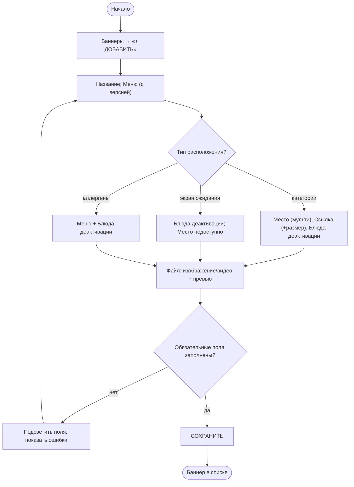

### J-2. Список: поиск, фильтр, группировка (B-01…B-06)

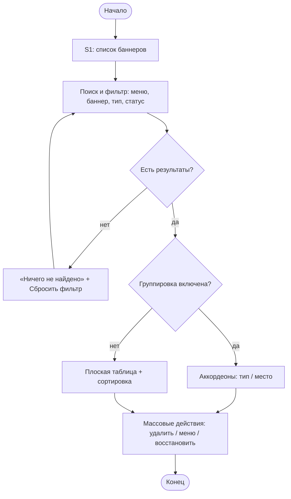

### J-3. Удаление и восстановление баннера (B-17, B-18, B-20)

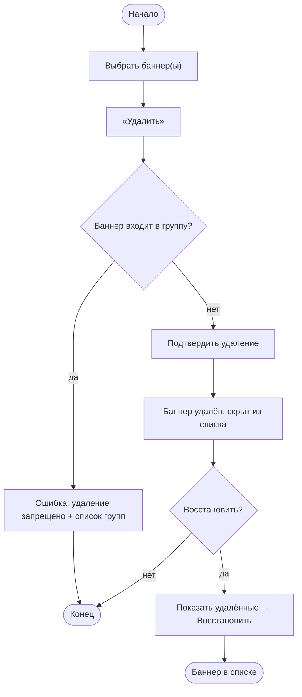

### J-4. Правка и копирование баннера (B-15, B-16)

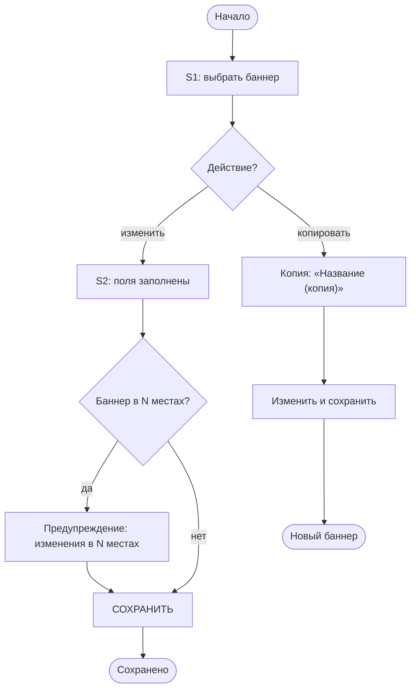

### J-5. Версии меню (B-11)

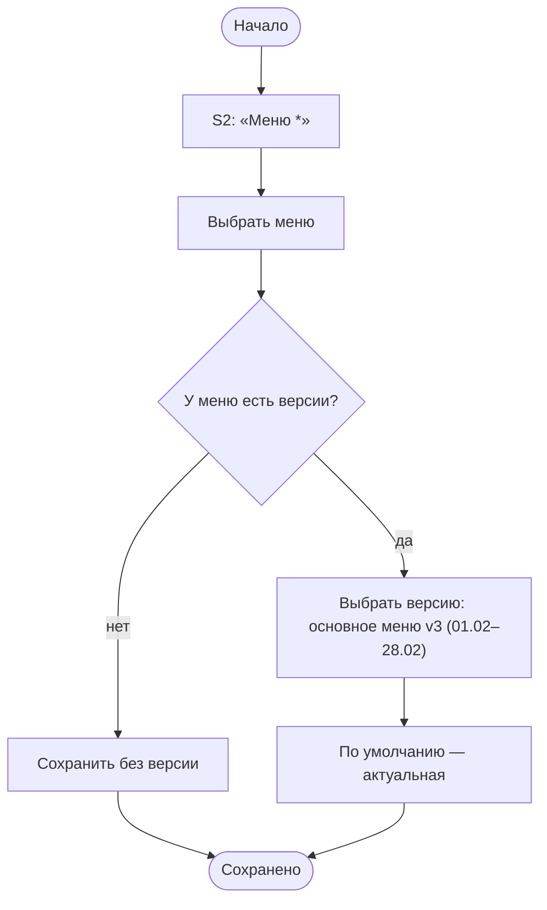

### J-6. Создание группы и добавление баннеров (G-02…G-06)

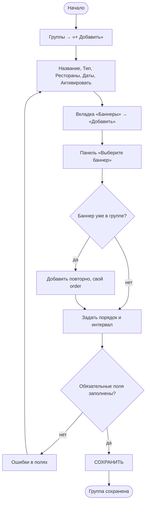

### J-7. Активация группы (G-10, G-11, E-02, E-03)

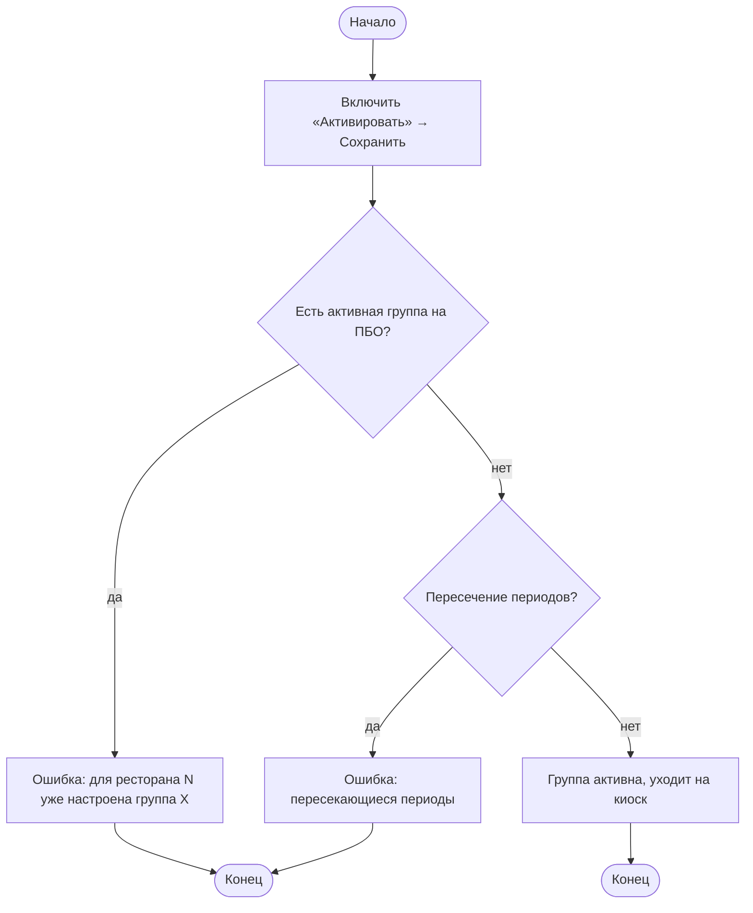

### J-8. Массовые действия в группе (G-07, G-08)

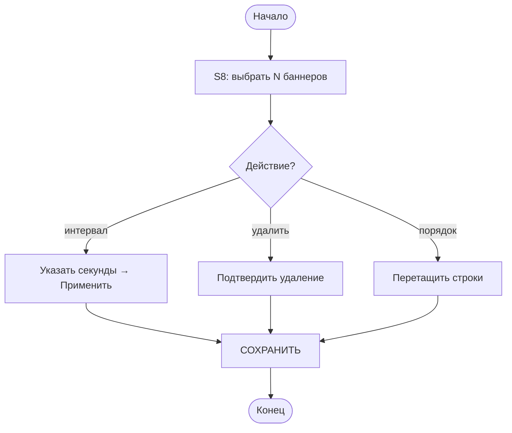

### J-9. Удаление и восстановление группы (G-12, G-13)

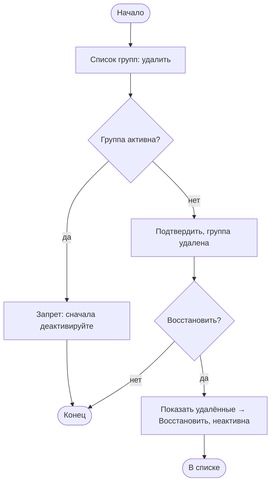

### J-10. Копирование группы (G-09)

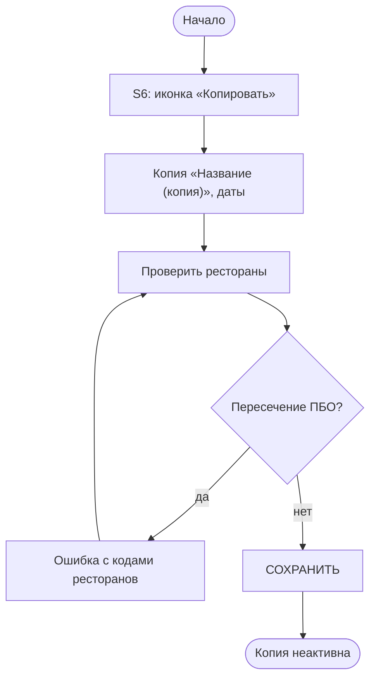

### J-11. Показ баннера на киоске (K-01…K-06)

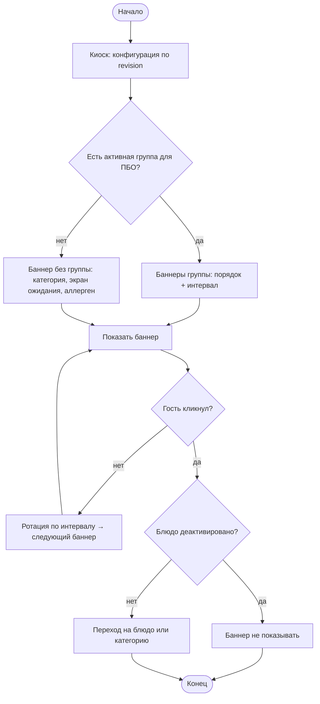

### J-12. Соответствие сценариев и схем

| Схема | Сценарии |
|---|---|
| J-1 | B-07, B-08, B-09, B-10, B-12, B-13, B-14 |
| J-2 | B-01, B-02, B-03, B-04, B-05, B-06, B-18, B-19 |
| J-3 | B-17, B-18, B-20 |
| J-4 | B-15, B-16 |
| J-5 | B-11 |
| J-6 | G-02, G-03, G-04, G-05, G-06 |
| J-7 | G-10, G-11, E-02, E-03 |
| J-8 | G-07, G-08 |
| J-9 | G-12, G-13 |
| J-10 | G-09 |
| J-11 | K-01, K-02, K-03, K-04, K-05, K-06 |
