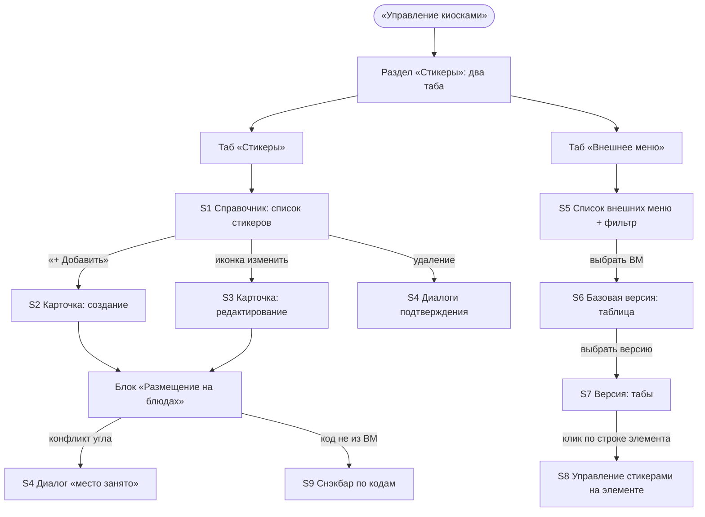
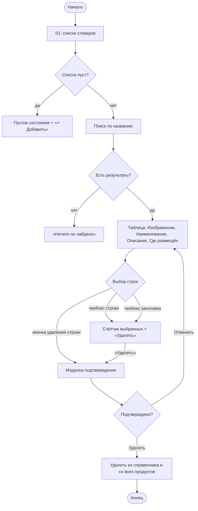
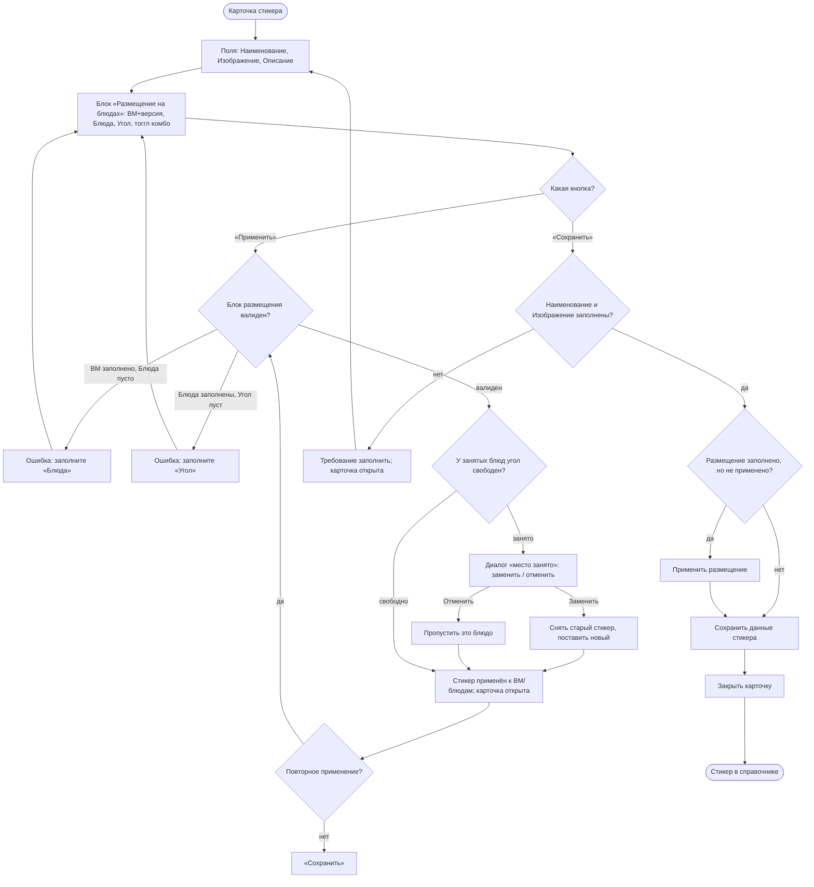
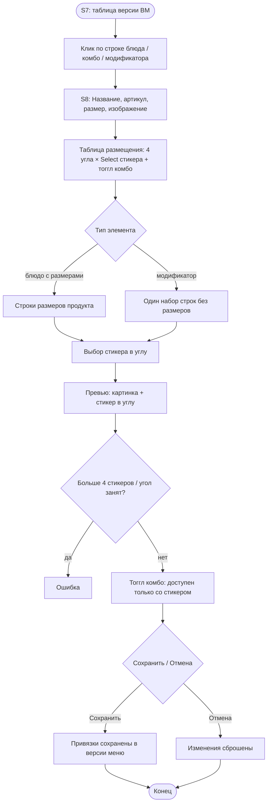

# Стикеры — сценарии для прототипа и проверки

**Версия:** 1.0 · 03.11.2026
**Приложение:** iikoWeb → «Настройки и обслуживание системы» → «Управление киосками» → раздел «Стикеры»
**Задачи:** PB-8147 (дизайн), WEB-23823 (back), WEB-23824 (front), ЯТ NKP-1221
**Источник:** вики VIT, страница 181778772 «Управление стикерами: доработка приложения „Управление киосками“» (единственный источник; полный текст — Приложение 1)
**Макеты:** папка `mockups/` (скриншоты предварительного UI со страницы вики)

**Задание тому, кто берёт документ:**
1. По разделу A нарисовать прототип экранов S1–S9 (веб, 1440 px, компоненты ДС iiko).
2. По разделам B–D реализовать все сценарии, включая ветвления и ошибки.
3. По разделу G проверить прототип: для каждого пункта — «есть / нет / расходится» и что именно.
4. Раздел H — не решать самостоятельно: решения дизайнера помечены ⚠️ (согласовываются отдельно), вопросы — вынести и спросить.

---

## 0. Как пользоваться документом

- **Раздел A** — контекст, термины, карта экранов. По нему рисуется прототип.
- **Раздел B** — сценарии справочника стикеров. **Раздел C** — сценарии карточки стикера. **Раздел D** — сценарии таба «Внешнее меню».
- **Раздел E** — краевые случаи и ошибки. **Раздел F** — сквозные правила и ограничения.
- **Раздел G** — чек-лист проверки прототипа по сценариям.
- **Раздел H** — решения дизайнера (⚠️) и открытые вопросы: их нельзя решать фантазией, только пометкой «уточнить».
- **Раздел J** — схемы всех сценариев в Mermaid (в конце файла).

**Правила для того, кто рисует прототип:**
1. Подписи полей и кнопок брать буквально из сценариев — не переформулировать.
2. Компоненты — только из ДС iiko (`Design-System/components-web`); правила — `Design-System/AGENTS.md`.
3. Каркас страницы (шапка, сайдбар, плашка ревью) — из `../../Design-System/connect.js` и `ds-review.js`, как в папке `VIT/Banners`.
4. Макет задаёт структуру и тексты, внешний вид задаёт ДС. Стили макета (капс, цвета, паддинги) на компоненты не переносить.
5. Иконки — Material Icons лигатурой (семейство Outlined), кроме глифов организмов (точные SVG).
6. Вне ДС — только раскладка (классы-обвязки), помечать в `<style>`.
7. В контенте прототипа ссылок-переключателей между экранами нет — только селект «Экраны» панели ревью.
8. Число шагов панели ревью (`layouts.js`) = числу экранов; для каждого — короткий hint, что на нём.

---

## A. Контекст

Сейчас стикер доезжает до киоска так: картинка продукта в мобильном приложении уже содержит стикеры; на киоске стикеры накладываются поверх картинки продукта, нужный стикер определяется по ID (ID задаётся при заведении стикера в iikoChain, в папку киоска кладётся картинка с именем = ID стикера; CSOUI по ID находит файл и совмещает картинки). Управление — ручное, файловое; привязки per-size и per-version нет.

Что добавляется:
- новый раздел «Стикеры» в приложении «Управление киосками» (kiosk-management);
- раздел делится на два таба: **Стикеры** и **Внешнее меню**;
- справочник стикеров: список с добавлением/редактированием/удалением;
- карточка стикера с массовым размещением на блюдах/модификаторах внешних меню;
- таб «Внешнее меню» — реплика внешнего меню (external-menu) по роуту, с управлением стикерами на уровне элементов номенклатуры;
- передача данных по стикерам киоску в JSON.

---

## A2. Роли

| Роль | Что делает |
|---|---|
| Администратор iikoWeb (ресторан/сеть) | ведёт справочник стикеров, размещает стикеры на блюдах/комбо/модификаторах внешних меню |
| Киоск (внешняя система) | получает JSON с привязками стикеров и компилирует картинку продукта |
| Гость киоска | видит итоговые картинки со стикерами |

Права доступа (без изменений): управление стикерами доступно при правах `KIOSK_VIEW` / `KIOSK_EDIT` / `KIOSK_DELETE`.

---

## A3. Термины

- **Стикер для изображения продукта (стикер)** — картинка, которая накладывается поверх изображения продукта в киоске (например, «НОВИНКА»).
- **ВМ (внешнее меню)** — список блюд/комбо/модификаторов для передачи данных внешней системе.
- **Версия внешнего меню** — конкретная версия ВМ; размещение стикеров задаётся в контексте версии.
- **Размер продукта** — размер блюда (например, Маленький/Средний/Большой); стикеры привязываются к размеру.
- **Угол (расположение)** — одно из четырёх мест размещения стикера на картинке: левый верхний, левый нижний, правый верхний, правый нижний.
- **Итоговая картинка комбо** — сборная картинка собранного комбо на экране проверки комбо в киоске.
- **Номенклатура** — элементы внешнего меню: блюда, комбо, модификаторы.

---

## A4. Сущности и связи

- **Стикер → ВМ/Версии:** 1:N (один стикер может быть присвоен разным внешним меню и их версиям).
- **Стикер → Блюда/Комбо/Модификаторы:** 1:N (один стикер может стоять более чем на одном блюде/комбо/модификаторе).
- **Блюдо → Размеры:** 1:N; стикер, поставленный на блюдо, добавляется ко **всем** размерам.
- **Размер → Стикеры:** до 4 (по числу углов); в одном углу — не более одного стикера.
- **Привязка стикера → Версия меню:** привязка хранится к конкретной версии; при изменении базовой версии остальные версии не меняются.
- **Элемент номенклатуры → Привязки стикеров:** при удалении элемента удаляются все его привязки; сам стикер в справочнике остаётся.

Текстом: `Стикер (1) ── (N) ВМ/Версии`; `Стикер (1) ── (N) Блюда/Комбо/Модификаторы`; `Блюдо (1) ── (N) Размеры`; `Размер (1) ── (≤4) Стикеры (угол)`.

---

## A5. Карта экранов

| ID | Экран | Что на нём | Обязательные состояния |
|---|---|---|---|
| S1 | Справочник «Стикеры» (список) | заголовок, поиск, «+ Добавить», таблица: чекбокс, Изображение, Наименование стикера, Описание, Где размещён; иконка изменить в строке, иконка удаления по наведению; счётчик выбранных + «Удалить» | обычное, пусто (старт), нет результатов, выбрано N, выбрано всё |
| S2 | Карточка стикера (создание) | заголовок «Новый стикер», Наименование*, Изображение*, Описание, кнопки Назад/Обновить/Удалить/Сохранить; блок «Размещение на блюдах»: Внешнее меню и версия, Блюда, Угол, тоггл комбо, «Применить» | пусто, ошибки полей, загрузка изображения |
| S3 | Карточка стикера (редактирование) | то же, заголовок = «Наименование»; блок размещения заполнен | заполнено, ошибки |
| S4 | Диалоги | подтверждение удаления, подтверждение закрытия без сохранения, «место размещения занято» | — |
| S5 | Таб «Внешнее меню»: список ВМ | построчный список всех внешних меню, иконка «Фильтр» в колонке фильтр | обычное, пусто, отфильтровано |
| S6 | Внешнее меню: базовая версия | таблица: Блюдо, название в системе, артикул; глобальный поиск (одна строка на подтаб), иконки номенклатуры, сортировка, перенос названий | обычное, нет результатов |
| S7 | Внешнее меню: версия ВМ | табы «Список блюд» (с комбо) / «Модификаторы»; аккордеоны групп; колонка «Стикеры» | обычное, группы свёрнуты/раскрыты, нет результатов |
| S8 | Управление стикерами на элементе | Название, артикул, размер, изображение; управление размещением стикера; превью картинка+стикеры; Сохранить/Отмена | пусто, стикер выбран, стикер удалён |
| S9 | Снэкбар | ввод по кодам с кодом, отсутствующим во внешнем меню | — |

Колонки таблицы справочника (S1): **Изображение · Наименование стикера · Описание · Где размещён** (плюс чекбокс выбора, иконка изменить у строки, иконка удаления по наведению).

Колонки таблицы базовой версии ВМ (S6): **Блюдо · Название в системе · Артикул** (плюс иконки элементов номенклатуры).

---

## B. Сценарии: справочник стикеров

### B-01. Открыть справочник стикеров
**Роль:** администратор.
**Когда:** нужно перейти к стикерам.
**Шаги:**
1. «Настройки и обслуживание системы» → «Управление киосками» → подраздел «Стикеры».
2. Система отображает таб «Стикеры» со списком стикеров.
**Результат:** справочник стикеров; при старте работы список пустой.
**Источник:** вики 181778772, «Структура раздела», п.1–3; UC-аналог не используется.
**Приёмка:** раздел «Стикеры» доступен в подразделах «Управления киосками»; открыт таб «Стикеры».

### B-02. Поиск по названию
**Роль:** администратор.
**Когда:** нужно найти стикер.
**Шаги:**
1. Ввести часть названия в строку поиска.
2. Список фильтруется по совпадению названия стикера.
**Результат:** в списке только совпадения.
**Ошибки:** ничего не найдено — пустое состояние «ничего не найдено» (текст отличим от пустого справочника).
**Ограничения:** поиск — по совпадению названия стикера.
**Источник:** вики 181778772, «Справочник стикеров», п.2.1.1.
**Приёмка:** фильтрация по названию; пустой результат ≠ пустой справочник.

### B-03. Пустой справочник (старт)
**Когда:** раздел только создан, стикеров нет.
**Ожидаемо:** пустое состояние + кнопка добавления стикера.
**Источник:** вики 181778772, п.2 («при старте работы список будет пустой»).
**Приёмка:** пустое состояние не путается с «ничего не найдено».

### B-04. Создать стикер
**Роль:** администратор.
**Шаги:**
1. Нажать кнопку добавления стикера («+ Добавить»).
2. Система открывает карточку стикера в режиме создания (S2).
3. Заполнение полей и размещение — сценарии раздела C.
**Результат:** сохранённый стикер появляется в справочнике.
**Источник:** вики 181778772, п.3.
**Приёмка:** карточка открывается пустой, заголовок «Новый стикер».

### B-05. Редактировать стикер
**Шаги:**
1. Нажать иконку «изменить» у строки стикера.
2. Система открывает карточку в режиме редактирования (S3).
**Результат:** поля заполнены данными стикера; заголовок = поле «Наименование».
**Источник:** вики 181778772, п.2.2.5.
**Приёмка:** карточка открыта с данными; изменение → «Сохранить» обновляет строку в списке.

### B-06. Удалить стикер (из строки)
**Шаги:**
1. Навести курсор на строку — появляется иконка удаления.
2. Нажать иконку — открывается модальное окно подтверждения удаления.
3. «Удалить» — стикер удаляется из справочника и из всех продуктов, на которые он был размещён.
4. «Отменить» — модальное окно закрывается, стикер остаётся.
**Источник:** вики 181778772, п.2.2.7.
**Приёмка:** удаление с подтверждением; удаляются и привязки (правило F-4/F-13).

### B-07. Выбрать все строки
**Шаги:**
1. Нажать чекбокс в заголовке таблицы.
2. Система выделяет все элементы справочника.
3. Появляются счётчик выбранных стикеров и кнопка «Удалить».
**Результат:** выделены все стикеры.
**Источник:** вики 181778772, п.2.2.6.
**Приёмка:** чекбокс заголовка выделяет всё; счётчик и «Удалить» появляются только при выборе.

### B-08. Массовое удаление
**Шаги:**
1. Отметить один или несколько стикеров чекбоксами (или выбрать все).
2. Нажать «Удалить».
3. Модальное окно подтверждения: «Удалить» — выделенные стикеры удаляются из справочника и из всех продуктов; «Отменить» — окно закрывается.
**Источник:** вики 181778772, п.2.2.6–2.2.7.
**Приёмка:** удаляются только выделенные; счётчик сбрасывается.

### B-09. Колонка «Где размещён»
**Когда:** стикер установлен в одно или несколько внешних меню.
**Ожидаемо:** колонка отображает внешнее меню, в котором установлен стикер.
**Решение дизайнера ⚠️:** при нескольких ВМ — значения через запятую; при большом количестве — «+N» с раскрытием. Согласовать.
**Источник:** вики 181778772, п.2.2.4 (перечисление не задано).
**Приёмка:** пусто, если стикер нигде не установлен; значения соответствуют применённым.

---

## C. Сценарии: карточка стикера

### C-01. Заголовок карточки
**Ожидаемо:**
- создание — строка с наименованием заполняется «Новый стикер» до первого сохранения;
- после сохранения и в редактировании — текст из поля «Наименование».
**Источник:** вики 181778772, п.3.1.
**Приёмка:** заголовок следует правилу; после сохранения — из «Наименование».

### C-02. Поле «Наименование»
**Ограничения:** строка до 50 символов, с валидацией; обязательное поле.
**Ошибки:** превышение 50 символов — валидация; пустое при «Сохранить» — не сохранять, показать требование заполнить.
**Источник:** вики 181778772, п.3.2.
**Приёмка:** лимит 50 символов; без значения «Сохранить» не проходит.

### C-03. Изображение стикера
**Ограничения:** PNG / JPG / SVG; максимальный размер 200 кБ; обязательное поле.
**Механика:** загрузка аналогична загрузке изображения для размера продукта в Карточке блюда Внешнего меню.
**Ошибки:** неподдерживаемый формат / превышение 200 кБ — ошибка, стикер не сохраняется.
**Источник:** вики 181778772, п.3.3.
**Приёмка:** загрузка как в карточке блюда ВМ; лимиты соблюдены; без изображения «Сохранить» не проходит.

### C-04. Поле «Описание»
**Ограничения:** строка до 256 символов; необязательное.
**Источник:** вики 181778772, п.3.4.
**Приёмка:** лимит 256; пустое значение допустимо.

### C-05. Кнопка «Сохранить»
**Ожидаемо:** сохраняет данные и закрывает карточку стикера, если заполнены «Наименование» и «Изображение стикера».
**Ошибки:** не заполнено обязательное — карточка остаётся открытой, показывается требование заполнить.
**Решение дизайнера ⚠️:** если блок «Размещение на блюдах» заполнен, но «Применить» ещё не нажималось — «Сохранить» применяет и размещение (иначе данные размещения теряются). Согласовать.
**Источник:** вики 181778772, п.3.8.
**Приёмка:** сохранение при заполненных обязательных; закрытие карточки; стикер в списке.

### C-06. Кнопка «Назад»
**Ожидаемо:**
- изменений не было — закрывает карточку без сохранения;
- изменения были — модальное окно подтверждения закрытия: «Подтвердить» закрывает без сохранения; «Отменить» закрывает окно, карточка остаётся открытой.
**Источник:** вики 181778772, п.3.5.
**Приёмка:** оба пути; модалка только при изменениях.

### C-07. Кнопка «Обновить»
**Ожидаемо:** обновляет карточку стикера (данные перечитываются с сервера).
**Решение дизайнера ⚠️:** если есть несохранённые изменения — предупредить (по аналогии с «Назад»). Согласовать.
**Источник:** вики 181778772, п.3.6.
**Приёмка:** обновление без потери логики сохранения.

### C-08. Кнопка «Удалить» в карточке
**Шаги:**
1. Нажать «Удалить» — модальное окно подтверждения удаления стикера.
2. «Удалить» — стикер удаляется из справочника и из всех продуктов, на которые он был установлен.
3. «Отменить» — окно закрывается.
**Источник:** вики 181778772, п.3.7.
**Приёмка:** идентично B-06, из карточки.

### C-09. «Размещение на блюдах»: Внешнее меню и версия
**Ожидаемо:**
- необязательное поле;
- выпадающий список из ссылок на элементы справочника «Внешние меню» и версий;
- мультивыбор.
**Решение дизайнера ⚠️:** поле составное «Внешнее меню + версия» — Select (multiple) по образцу карточки баннера (выбранные значения текстом в поле, у меню в подписи версия). Согласовать.
**Источник:** вики 181778772, п.3.9.1.1.
**Приёмка:** мультивыбор ВМ с версиями; очистка поля (C-14).

### C-10. «Размещение на блюдах»: Блюда
**Ожидаемо:**
- обязательное поле, если заполнено «Внешнее меню»;
- выпадающий список: блюда, комбо-блюда и модификаторы, включённые в выбранное ВМ; если выбрано несколько версий — блюда из обеих версий (объединение множеств);
- **иерархия** для отображения в одном списке блюд, комбо-блюд и модификаторов — задача дизайнера (см. H-1);
- если у блюда есть размер — стикер добавляется ко всем размерам;
- селект «Все» — выбрать сразу все элементы внешнего меню;
- мультивыбор;
- заполнение по кодам блюд/комбо/модификаторов: код, не входящий во внешнее меню, не вносится в поле — показывается снэкбар с кодом и информацией об отсутствии блюда в меню.
**Источник:** вики 181778772, п.3.9.1.2.
**Приёмка:** обязательность при заполненном ВМ; объединение множеств версий; «Все»; мультивыбор; снэкбар по кодам.

### C-11. «Размещение на блюдах»: Угол
**Ожидаемо:**
- обязательное поле, если поле «Блюдо» заполнено;
- выпадающий список из 4 значений (идентичны значениям таблицы управления стикерами в Карточке блюда): левый верхний угол, левый нижний угол, правый верхний угол, правый нижний угол;
- к выбору — только 1 значение.
**Источник:** вики 181778772, п.3.9.1.3.
**Приёмка:** 4 значения; одиночный выбор; обязательность при заполненных блюдах.

### C-12. Тоггл «Отображать на итоговой картинке комбо»
**Ожидаемо:** определяет, будет ли отображаться стикер на итоговой картинке собранного комбо в киоске. Идентичен одноимённому тогглу в таблице управления стикерами в Карточке блюда.
**Ограничения:** доступен только при выбранном стикере в той же строке (правило F-8).
**Источник:** вики 181778772, п.3.9.1.1 (кнопки), Правила п.8.
**Приёмка:** тоггл работает; без выбранного стикера — недоступен.

### C-13. Кнопки очистки поля
**Ожидаемо:**
- отображаются на полях «Внешнее меню», «Версия внешнего меню», «Блюда», если поля заполнены;
- очистка в поле «Блюда» очищает «Блюда»;
- очистка в поле «Внешнее меню» очищает «Внешнее меню», «Версию внешнего меню», «Блюда» и «Угол».
**Решение дизайнера ⚠️:** очистка в поле «Версия внешнего меню» очищает версию и «Блюда» (страница явно не описывает; по аналогии со старшей очисткой). Согласовать.
**Источник:** вики 181778772, п.3.9.1.2 (кнопки).
**Приёмка:** каскадные очистки по правилу.

### C-14. Кнопка «Применить»
**Ожидаемо:**
- после заполнения всех полей пользователь нажимает «Применить»: стикер применяется выбранным внешним меню и блюдам, комбо и/или модификаторам; заполненные данные сохраняются в таблице (отображение);
- до нажатия пользователь может вносить изменения;
- можно повторно внести изменения и нажать «Применить»; «Сохранить» нажимать не нужно, так как данные самого стикера не изменены.
**Решение дизайнера ⚠️ (валидация):** «Применить» проверяет блок размещения: заполнено «Внешнее меню» и пусты «Блюда» → ошибка «Заполните поле „Блюда“»; заполнены «Блюда» и пуст «Угол» → ошибка «Заполните поле „Угол“» (обязательность объявлена в п.3.9.1.2/3.9.1.3, тексты ошибок — предложение дизайнера). Согласовать.
**Решение дизайнера ⚠️:** «Применить» применяет только размещение и не закрывает карточку; данные стикера (название/описание/изображение) сохраняются кнопкой «Сохранить». Согласовать.
**Источник:** вики 181778772, п.3.9.2 (п.10).
**Приёмка:** применение без закрытия; повторное применение; валидация блока размещения.

### C-15. Конфликт: место размещения занято
**Когда:** выбраны блюда, у которых занято место размещения (угол уже занят другим стикером).
**Ожидаемо:** диалоговое окно: «для блюда ХХХХ место размещения занято. Хотите заменить/отменить?»
**Решение дизайнера ⚠️:** при нескольких конфликтующих блюдах окно показывается для каждого блюда с его названием; «Заменить» — старый стикер в этом углу снимается, ставится новый; «Отменить» — для этого блюда стикер не применяется. Согласовать (страница не описывает поведение «заменить»).
**Источник:** вики 181778772, «Ограничения» (справочник стикеров).
**Приёмка:** диалог с названием блюда; оба действия; нет двойного стикера в одном углу.

### C-16. Применённые стикеры видны в табе «Внешнее меню»
**Ожидаемо:** применённые стикеры видно на уровне блюда во вкладке «Внешнее меню» (колонка «Стикеры», D-05/D-07).
**Источник:** вики 181778772, п.3.9.2 (п.11).
**Приёмка:** после «Применить» в карточке стикера — привязка видна в табе «Внешнее меню».

---

## D. Сценарии: таб «Внешнее меню»

### D-01. Список внешних меню
**Ожидаемо:** по умолчанию пользователю открывается страница со списком внешних меню; построчно отображаются все внешние меню (сохраняется список всех возможных ВМ).
**Источник:** вики 181778772, «Создание реплики внешнего меню», п.2.
**Приёмка:** построчный список всех ВМ; переход на ВМ открывает базовую версию (D-03).

### D-02. Фильтр списка ВМ
**Ожидаемо:** иконка «Фильтр» — в колонке фильтр пользователь выбирает внешние меню, чтобы остальные не отображались в списке. Фильтр сохраняется после установки значений под учётной записью пользователя.
**Решение дизайнера ⚠️:** фильтр — компонент Menu (ds-menu-container) с пунктами-чекбоксами, футер «Сбросить | Применить», точка Badge на иконке при активном фильтре (по образцу фильтра списка баннеров S1). Согласовать.
**Источник:** вики 181778772, п.2.2.1.
**Приёмка:** фильтрация списка; сохранение выбора под учёткой (в прототипе — имитация в localStorage).

### D-03. Базовая версия ВМ
**Ожидаемо (сохранить существующее):**
- глобальный поиск по названию и артикулу блюда/комбо/модификатора;
- строка поиска одна на подтаб; поиск по названию, артикулу;
- общая структура таблицы с колонками: Блюдо, название в системе, артикул;
- иконки элементов номенклатуры;
- сортировка по столбцам;
- перенос названий, если большое количество символов.
**Источник:** вики 181778772, п.3.
**Приёмка:** таблица по колонкам; поиск по названию/артикулу; сортировка; перенос длинных названий.

### D-04. Переход на версию ВМ
**Ожидаемо:** пользователь может перейти на версию ВМ — доступны два таба: «Список блюд» (с комбо) и «Модификаторы».
**Решение дизайнера ⚠️:** выбор версии — селект версий в шапке экрана ВМ (по умолчанию базовая); при выборе конкретной версии появляются табы «Список блюд»/«Модификаторы» с аккордеонами групп. Согласовать (страница не описывает элемент переключения).
**Источник:** вики 181778772, п.4.
**Приёмка:** переключение базовой/конкретной версии; табы появляются для версии.

### D-05. Таб «Список блюд»
**Ожидаемо:**
- таблица: аккордеоны групп блюд и комбо;
- колонка «Стикеры» — отображает, какие стикеры присвоены блюду.
**Решение дизайнера ⚠️:** колонка «Стикеры» — миниатюры изображений стикеров; при нескольких — рядом; при отсутствии — пустая ячейка. Согласовать.
**Источник:** вики 181778772, п.4.1.
**Приёмка:** аккордеоны групп; колонка «Стикеры» заполняется после применения (C-16).

### D-06. Таб «Модификаторы»
**Ожидаемо:** таблица: аккордеоны групп модификаторов с элементами. По аналогии со списком блюд.
**Источник:** вики 181778772, п.4.2.
**Приёмка:** аккордеоны групп модификаторов; колонка «Стикеры» — по аналогии.

### D-07. Управление стикерами на уровне элемента номенклатуры
**Ожидаемо:**
- для каждого элемента номенклатуры доступны только данные: Название, артикул, размер, изображение;
- управление размещением стикера;
- кнопки сохранить/отмена;
- при добавлении стикеров система отображает превью: картинка + стикер(ы); превью доступно для всех типов элементов: комбо/блюда/модификаторы.
**Решение дизайнера ⚠️:** открывается кликом по строке элемента в таблице (S7) — открывается карточка/панель элемента (S8); размещение — таблица 4 углов, в каждой строке — Select со стикерами + тоггл «Отображать на итоговой картинке комбо» (по образцу раздела «Стикеры» карточки блюда); у модификатора строки размеров нет. Согласовать.
**Источник:** вики 181778772, п.6 (скрин `mockups/06-element-stikery.png`).
**Приёмка:** превью картинка+стикеры для всех типов; сохранить/отмена; максимум 4 стикера (по углам).

### D-08. Синхронизация с основным внешним меню
**Ожидаемо:**
- удаление блюда/комбо/группы/модификатора происходит в основном внешнем меню; данные синхронизированы: элементы удаляются из таба «Внешнее меню» вместе с привязками стикеров;
- при изменении основного меню: если блюдо/группа/модификатор удалены из ВМ — они удаляются и в дублирующем табе «Внешнее меню» (в «Управлении киосками»); привязки стикеров удаляются, JSON пересобирается;
- если у блюда/группы/модификатора изменены данные — название, описание, размерность, изображение, перемещение — данные дублируются в таб «Внешние меню»;
- вариант: выдать сообщение «данные были изменены, обновите таблицу», если основное внешнее меню было изменено (обсудить с разработкой).
**Источник:** вики 181778772, п.5 и «При изменении основного меню».
**Приёмка:** в прототипе — имитация: изменение основного ВМ отражается в табе; сообщение «данные изменены» — как вариант (пометить в H).

---

## E. Краевые случаи и ошибки

- **E-01. Более 4 стикеров на один размер продукта** — невозможно (по числу углов); при попытке установить более 4 — выдать ошибку. *Источник: Правила п.1, п.3.*
- **E-02. Угол занят дважды** — на одном размере в одном углу не более одного стикера; при конфликте через карточку стикера — диалог «заменить/отменить» (C-15). *Источник: Правила п.3, «Ограничения».*
- **E-03. Код элемента не из внешнего меню** — элемент не вносится в поле «Блюда»; снэкбар с кодом и информацией об отсутствии блюда в меню. *Источник: п.3.9.1.2.6.*
- **E-04. Удаление стикера из справочника** — снимает его со всех элементов и удаляет из JSON. *Источник: Правила п.4.*
- **E-05. Несколько версий в поле «Внешнее меню»** — в «Блюдах» отображаются блюда из всех выбранных версий (объединение множеств). *Источник: п.3.9.1.2.2.*
- **E-06. У блюда есть размеры** — стикер добавляется ко всем размерам. *Источник: п.3.9.1.2.3.*
- **E-07. Пересечение стикеров в одном углу от разных источников на итоговой картинке комбо** — ответственность пользователя (не валидируется). *Источник: Правила п.11.*
- **E-08. Тоггл «На итоговой картинке комбо» без выбранного стикера** — недоступен. *Источник: Правила п.8.*
- **E-09. Изменение базовой версии меню** — привязки в остальных версиях не меняются. *Источник: Правила п.10.*
- **E-10. Сохранение карточки с ошибкой сервера** — система информирует об ошибке, карточка остаётся открытой (аналог альтернатив UC; страница не описывает — ⚠️ решение дизайнера). *Согласовать.*

---

## F. Сквозные правила

### F-1. Обязательные поля карточки стикера
- «Наименование» — обязательно, до 50 символов.
- «Изображение стикера» — обязательно, PNG/JPG/SVG, до 200 кБ.
- «Описание» — необязательно, до 256 символов.
- Блок размещения: «Внешнее меню и версия» — необязательно; «Блюда» — обязательно, если заполнено «Внешнее меню»; «Угол» — обязательно, если заполнено «Блюда».

### F-2. Валидация
- «Сохранить» сохраняет и закрывает карточку, если заполнены «Наименование» и «Изображение стикера»; иначе — требование заполнить.
- «Применить» — валидация блока размещения (C-14).
- Ошибки — под полями; тексты ошибок — предложение дизайнера (согласовать).

### F-3. Пустые состояния
- Справочник пуст (старт) — отдельное состояние с подсказкой создать стикер.
- Нет результатов поиска — отдельное состояние (не путать с пустым справочником).
- Список ВМ — все ВМ построчно; при фильтре без результатов — состояние «нет результатов».

### F-4. Правила работы со стикерами (дословно из источника)
1. Максимум 4 стикера на один размер продукта (по числу углов): левый верхний, левый нижний, правый верхний, правый нижний.
2. Один стикер из справочника может быть установлен на более чем 1 блюдо/комбо/модификатор. Даже если у блюда несколько размеров.
3. На одном размере в одном углу — не более одного стикера (угол не может быть занят дважды). При попытке установить более 4 стикеров выдать ошибку.
4. Удаление стикера из справочника снимает его со всех элементов и удаляет из JSON.
5. Размещение задаётся в контексте версии меню.
6. Изменения в карточке применяются при сохранении; удаление из справочника — по подтверждению, сразу.
7. Стикеры назначаются на элементы: блюдо, комбо, модификатор. Для итоговой картинки комбо стикеры собирает киоск: картинка + стикеры, если установлен тоггл.
8. Тоггл «На итоговой картинке комбо» доступен только при выбранном стикере в той же строке.
9. Стикер не обязателен для добавления к элементу номенклатуры.
10. Привязка стикера хранится к конкретной версии меню, при изменении базовой остальные версии не меняются.
11. Пересечение стикеров в одном углу от разных источников на итоговой картинке комбо — ответственность пользователя.
12. Удаление блюда/комбо/группы/модификатора во внешнем меню удаляет элемент и в дублирующем табе «Внешнее меню» раздела «Стикеры».
13. При удалении элемента удаляются все его привязки стикеров; сам стикер в справочнике не удаляется.

### F-5. Массовые действия (справочник)
- Чекбокс в заголовке выделяет все элементы; счётчик выбранных и кнопка «Удалить» появляются при выборе.
- Удаление — только с подтверждением.

### F-6. Данные для киоска (контекст разработки, не прототипа)
- Данные по стикерам нужны только внешней системе «Киоск»; киоск получает данные по конкретной версии меню в формате JSON (массив стикеров в конкретной версии меню + привязка к размеру блюда) и на своей стороне компилирует картинку (стикеры + изображение блюда). JSON-структура — Приложение 1.

---

## G. Чек-лист проверки прототипа

| ID | Что проверяем | Ожидаемо |
|---|---|---|
| B-01 | Раздел «Стикеры» | подраздел в «Управлении киосками»; два таба: «Стикеры», «Внешнее меню» |
| B-02 | Поиск по названию | фильтрация; пустой результат ≠ пустой справочник |
| B-03 | Пустой справочник | пустое состояние + кнопка добавления |
| B-04 | Создание | «+ Добавить» → карточка «Новый стикер» |
| B-05 | Редактирование | иконка изменить → карточка с данными; заголовок = наименование |
| B-06 | Удаление из строки | иконка по наведению; модалка Удалить/Отменить; привязки удаляются |
| B-07 | Выбрать все | чекбокс заголовка; счётчик; «Удалить» |
| B-08 | Массовое удаление | подтверждение; удалены только выделенные |
| B-09 | «Где размещён» | ВМ списком; пусто, если нигде |
| C-01 | Заголовок карточки | «Новый стикер» до сохранения; из «Наименование» после |
| C-02 | «Наименование» | до 50 символов, валидация; обязательное |
| C-03 | Изображение | PNG/JPG/SVG, до 200 кБ; обязательное; загрузка как в карточке блюда ВМ |
| C-04 | «Описание» | до 256 символов; необязательное |
| C-05 | «Сохранить» | только при заполненных обязательных; закрывает карточку |
| C-06 | «Назад» | без изменений — закрыть; с изменениями — модалка |
| C-07 | «Обновить» | обновление карточки |
| C-08 | «Удалить» в карточке | модалка; удаление со всех продуктов |
| C-09 | ВМ и версия | необязательное; мультивыбор |
| C-10 | Блюда | обязательное при заполненном ВМ; объединение версий; «Все»; иерархия; размеры; мультивыбор |
| C-11 | Угол | 4 значения; одиночный; обязателен при блюдах |
| C-12 | Тоггл комбо | работает; недоступен без стикера |
| C-13 | Очистки полей | каскады: Блюда→Блюда; ВМ→ВМ+версия+блюда+угол |
| C-14 | «Применить» | валидация блока; применение без закрытия; повторное применение |
| C-15 | Конфликт угла | диалог с названием блюда; заменить/отменить |
| C-16 | Привязка видна в табе ВМ | колонка «Стикеры» после применения |
| D-01 | Список ВМ | построчно все ВМ |
| D-02 | Фильтр ВМ | выбор меню; сохранение под учёткой |
| D-03 | Базовая версия | Блюдо / название в системе / артикул; поиск; сортировка; иконки; перенос |
| D-04 | Переход на версию | селект версии; табы для версии |
| D-05 | Список блюд | аккордеоны групп; колонка «Стикеры» |
| D-06 | Модификаторы | аккордеоны групп по аналогии |
| D-07 | Управление на элементе | Название/артикул/размер/изображение; размещение; превью; сохранить/отмена |
| D-08 | Синхронизация | удаление/изменение из основного ВМ отражается |
| E-01 | >4 стикеров | ошибка |
| E-02 | Угол занят | не более одного стикера в углу |
| E-03 | Код не из ВМ | снэкбар с кодом |
| E-08 | Тоггл без стикера | недоступен |

---

## H. Решения дизайнера и открытые вопросы

### H-1. Решения дизайнера (⚠️ — согласовать с владельцем)

1. **Иерархия списка «Блюда»** (C-10): в одном списке блюда, комбо и модификаторы — группировка по типу элемента внутри выпадающего списка (заголовки «Блюда», «Комбо», «Модификаторы»); селект «Все» — отдельным пунктом сверху. Задача дизайнера — показать удобную иерархию.
2. **«Применить»** применяет только размещение (не закрывает карточку, не трогает данные стикера); «Сохранить» — данные стикера (+ применяет несохранённое размещение).
3. **Валидация «Применить»** по объявленной обязательности: пустые «Блюда» при заполненном ВМ — ошибка; пустой «Угол» при заполненных блюдах — ошибка.
4. **Колонка «Где размещён»**: несколько ВМ — через запятую, много — «+N».
5. **Очистка в поле «Версия внешнего меню»** очищает версию и «Блюда».
6. **Колонка «Стикеры»** — миниатюры стикеров.
7. **Переключение версий ВМ** — селект версии в шапке экрана ВМ (базовая по умолчанию).
8. **Управление стикерами на элементе** — открытие кликом по строке; таблица 4 углов со Select стикеров + тоггл комбо; у модификаторов без размеров.
9. **Конфликт занятого угла** — диалог на каждое конфликтующее блюдо; «Заменить» снимает старый стикер и ставит новый; «Отменить» — пропустить блюдо.
10. **«Обновить» с несохранёнными изменениями** — предупредить о потере.

### H-2. Открытые вопросы (к аналитику/разработке)

1. Точные тексты всех сообщений и ошибок (в источнике заданы не все).
2. Поведение «Обновить» и «Назад» после нажатого «Применить» (размещение уже применено, данные нет).
3. Снэкбар по кодам — точный текст и вид (есть скрин `mockups/08-snekbar-po-kodam.png`).
4. Сообщение «данные были изменены, обновите таблицу» — принять ли вариант (страница: «обсудить с разработкой»).
5. Что показывает «Где размещён» для стикера в нескольких версиях одного ВМ.
6. Фильтр списка ВМ — сохраняется ли выбор под учёткой между сеансами (страница: «сохранять фильтр… под учеткой»).

### H-3. Сводка для отчёта в Jira (PB-8147)

За основу взят единственный источник — вики 181778772. По местам, которые страница не описывает, приняты решения дизайнера (список H-1); по расхождениям с более ранней спекой (страница 181774302) приоритет у 181778772. Решения по пунктам H-1 вынесены на согласование. Открытые вопросы — H-2. Прототип собирается на ДС iiko, каркас — по образцу раздела «Баннеры» (`VIT/Banners`).

---

## J. Схемы сценариев (Mermaid)

Схемы встроены в этот же файл: GitHub, Obsidian и VS Code их отрисуют, а модель прочитает как текст. Формат: овал — начало/конец, прямоугольник — действие, ромб — условие.

### J-1. Навигация по разделу «Стикеры»



### J-2. Справочник: поиск, выбор, удаление (B-02…B-09)



### J-3. Карточка стикера: «Сохранить» vs «Применить» (C-01…C-16)



### J-4. Управление стикерами на элементе (D-07)



---

## Приложение 1. Полный текст источника (вики 181778772)

> Ниже — дословный текст страницы «Управление стикерами: доработка приложения "Управление киосками"» (v12, 30.10.2026). Включён целиком, так как у исполнителя нет доступа к вики. Единственный источник требований.

**Задача в Jira:** NKP-1221: Гибкое управление стикерами на изображениях продуктов в киоске @ Трекер
**Задачи в ЯТ:** PB-8147, WEB-23823, WEB-23824

**Бизнес-цель:** разработать функционал гибкого управления дополнительными картинками (стикерами) к основной картинке для блюд и/или модификаторов внешнего меню.

### Как сейчас (As-is)

Как сейчас доезжает стикер до киоска:
- в мобильном приложении картинка продукта уже содержит стикеры;
- на киоске стикеры накладываются поверх картинки продукта; нужный стикер определяется по ID: ID задаётся при заведении стикера в iikoChain, затем в папку киоска кладётся картинка с именем = ID стикера; CSOUI по ID находит файл и совмещает картинки;
- управление — ручное, файловое; per-size и per-version привязки нет.

**Терминология:** Стикер для изображения продукта (далее — стикер) — это картинка, которая накладывается поверх изображения продукта в киоске. Например, стикер «НОВИНКА». ВМ — внешнее меню, список блюд/комбо/модификаторов для передачи данных внешней системе.

### Реализация

Реализация включает три основных задачи:
1. Создание справочника стикеров (см основную спецификацию).
2. Создание панели управления стикерами.
3. Создание реплики UI внешнего меню в приложении «Управление киосками».

Структура раздела:
1. В приложении управление киосками (kiosk-management) создать новый раздел: «стикеры».
2. Раздел делится на два таба: Стикеры и Внешнее меню.
3. Таб стикеры содержит список стикеров, с возможностью добавления/редактирования/удаления.
4. Внешнее меню делится на два таба: «Список блюд» и «Модификаторы», с аккордеонами групп.
5. Предварительный UI (изображение «раздел стикеры» — вложение на странице).

### Справочник стикеров

1. Раздел стикеры — плоский список изображений с возможностью добавления новых строк.
2. На странице «Стикеры» пользователю открывается список стикеров (при старте работы список будет пустой):
   1. Строка поиска. Поиск по совпадению названия стикера.
   2. Таблица со столбцами:
      - «Изображение» — миниатюра изображения из Карточки стикера;
      - «Наименование стикера» — наименование из Карточки стикера;
      - «Описание» — описание из Карточки стикера;
      - «Где размещен» — внешнее меню, в котором установлен стикер.
      - У каждой строки иконка изменить: нажатие переводит в режим редактирования стикера.
      - Чекбокс в заголовке таблицы выделяет все элементы справочника, инициирует появление счетчика выбранных стикеров и кнопки «Удалить».
      - У каждой строки всплывающая иконка удаления:
        - нажатие открывает модальное окно подтверждения удаления стикера:
          - «Удалить» — удаляет стикер из справочника и из всех продуктов, на которые он был размещён;
          - «Отменить» — закрывает модальное окно.
3. Кнопка добавления стикера открывает панель с добавлением стикера. Поля:
   1. Строка с наименованием стикера:
      - в создании заполняется «Новый стикер» до первого сохранения Карточки;
      - после сохранения и в редактировании — из поля «Наименование».
   2. Наименование: строка до 50 символов (валидация); обязательное поле.
   3. Изображение стикера: PNG / JPG / SVG; максимальный размер — 200 кБ; обязательное поле; механизм загрузки аналогичен загрузке изображения для размера продукта в Карточке блюда Внешнего меню.
   4. Описание: строка до 256 символов; необязательное поле.
   5. Кнопка «Назад»: закрывает Карточку без сохранения, если изменений не вносилось; если вносились — модальное окно подтверждения закрытия: «Подтвердить» закрывает без сохранения; «Отменить» закрывает окно и оставляет Карточку открытой.
   6. Кнопка «Обновить» — обновляет Карточку стикера.
   7. Кнопка «Удалить» — открывает модальное окно подтверждения удаления: «Удалить» удаляет из справочника и из всех продуктов, на которые он был установлен; «Отменить» закрывает окно.
   8. Кнопка «Сохранить» — сохраняет данные и закрывает карточку стикера, если заполнены «Наименование» и «Изображение стикера».
   9. Добавление стикера из карточки возможно массово для блюд/модификаторов:
      1. Поле «Внешнее меню и версия»:
         - необязательное поле;
         - выпадающий список из ссылок на элементы справочника «Внешние меню» и версий;
         - мультивыбор.
      2. Блюда:
         - обязательно, если заполнено «Внешнее меню»;
         - выпадающий список из ссылок на блюда, комбо-блюда и модификаторы, включённые в выбранное внешнее меню; если выбрано несколько версий — блюда из обеих версий (объединение множеств); (для дизайнера: нужна удобная иерархия для отображения в одном списке блюд, комбо-блюд и модификаторов);
         - если у блюда есть размер — стикер добавляется ко всем размерам;
         - селект «Все», чтобы выбрать сразу все элементы внешнего меню;
         - мультивыбор;
         - заполнение по кодам блюд/комбо/модификаторов: код элемента, не входящего во внешнее меню, не вносится в поле — снэкбар с кодом и информацией об отсутствии блюда в меню.
      3. Угол:
         - обязательное, если поле «Блюдо» заполнено;
         - выпадающий список из 4 значений, идентичных значениям в таблице управления стикерами в Карточке блюда: левый верхний угол, левый нижний угол, правый верхний угол, правый нижний угол;
         - к выбору — только 1 значение.
      4. Тоггл «Отображать на итоговой картинке комбо»: определяет, будет ли отображаться стикер на итоговой картинке собранного комбо в киоске. Идентичен одноимённому тогглу в таблице управления стикерами в Карточке блюда.
      5. Кнопка очистки поля: отображается на полях «Внешнее меню», «Версия внешнего меню», «Блюда», если поля заполнены; в поле «Блюда» очищает «Блюда»; в поле «Внешнее меню» очищает «Внешнее меню», «Версию внешнего меню», «Блюда» и «Угол».
   10. После заполнения всех полей пользователь нажимает «применить». Стикер применяется выбранным внешним меню и блюдам, комбо и/или модификаторам. Сохранить отображение в таблице заполненные данные.
       - До нажатия кнопки пользователь может внести изменения.
       - Пользователь может внести повторно изменения, нажать «Применить»; кнопку «Сохранить» нажимать не нужно, т.к. данные самого стикера не изменены.
   11. Применённые стикеры можно увидеть на уровне блюда во вкладке Внешнее меню.
   12. Предварительный UI карточки стикера (вложение «стикер.png»).

Ограничения: если выбраны блюда, у которых занято место размещения — выдать диалоговое окно: «для блюда ХХХХ место размещения занято. Хотите заменить/отменить?»

### Создание реплики внешнего меню

1. В отдельный таб переносится по роуту дубль внешнего меню (external-menu).
2. По умолчанию у пользователя страница со списком внешних меню. Построчно отображаются все внешние меню.
   - сохраняем список всех возможных внешних меню;
   - иконка «Фильтр» — в колонке фильтр пользователь выберет внешние меню, чтобы остальные не отображались в списке. Сохранять фильтр после установки значений под учеткой пользователя.
3. При переходе на внешнее меню пользователю доступна базовая версия ВМ. Сохранить:
   - глобальный поиск по названию и артикулу блюда/комбо/модификатора;
   - строка поиска одна на подтаб, поиск по названию, артикулу;
   - общую структуру таблицы с колонками: Блюдо, название в системе, артикул;
   - иконки элементов номенклатуры;
   - сортировку по столбцам;
   - перенос названий, если большое количество символов.
4. Пользователь может перейти на версию ВМ, будут доступны два таба: Список блюд (с комбо) и Модификаторы.
   1. Таб «Список блюд»:
      - таблица: аккордеоны групп блюд и комбо;
      - колонка «Стикеры» — отображает, какие стикеры присвоены блюду.
   2. Таб «Модификаторы»: таблица: аккордеоны групп модификаторов с элементами. По аналогии со списком блюд.
5. Удаление блюда/комбо/группы/модификатора должно быть в основном внешнем меню. Данные синхронизированы: элементы удаляются из таба «Внешнее меню» вместе с привязками стикеров.
6. Управление стикерами на уровне всех элементов номенклатуры:
   - для каждого элемента номенклатуры доступны только следующие данные: Название, артикул, размер, изображение;
   - управление размещением стикера;
   - кнопка сохранить/отмена;
   - при добавлении стикеров система отображает превью: картинка + стикер(ы). Превью доступно для всех типов элементов номенклатуры: комбо/блюда/модификаторы.

Ограничения:
- стикеры изменяются/присваиваются в конкретной версии внешнего меню;
- стикеры для группы блюд/модификаторов не доступны.

При изменении основного меню:
- если блюдо/группа/модификатор удалены из внешнего меню, они удаляются и в дублирующем табе «Внешнее меню» (в «Управлении киосками»); привязки стикеров к ним удаляются, JSON пересобирается;
- если у блюда/группы/модификатора были изменены данные — название, описание, размерность, изображение, перемещение — данные должны дублироваться в таб «Внешние меню»;
- (как вариант, выдать сообщение «данные были изменены, обновите таблицу», в случае, если основное внешнее меню было изменено (обсудить с разработкой)).

### Получение данных со стороны киоска

Данные по стикерам нужны только внешней системе «Киоск»:
- киоск получает данные по конкретной версии меню;
- киоск получает данные в формате JSON: массив стикеров в конкретной версии меню + привязка к размеру блюда;
- киоск на своей стороне собирает данные: стикеры + изображение блюда во внешнем меню и компилирует картинку.

Права доступа (без изменений): `KIOSK_VIEW` / `KIOSK_EDIT` / `KIOSK_DELETE`.

### Правила работы со стикерами

1. Максимум 4 стикера на один размер продукта (по числу углов): левый верхний, левый нижний, правый верхний, правый нижний.
2. Один стикер из справочника может быть установлен на более чем 1 блюдо/комбо/модификатор. Даже если у блюда несколько размеров.
3. На одном размере в одном углу — не более одного стикера (угол не может быть занят дважды). При попытке установить более 4 стикеров выдать ошибку.
4. Удаление стикера из справочника снимает его со всех элементов и удаляет из JSON.
5. Размещение задаётся в контексте версии меню.
6. Изменения в карточке применяются при сохранении; удаление из справочника — по подтверждению, сразу.
7. Стикеры назначаются на элементы: блюдо, комбо, модификатор. Для итоговой картинки комбо стикеры собирает киоск: картинка + стикеры, если установлен тоггл.
8. Тоггл «На итоговой картинке комбо» доступен только при выбранном стикере в той же строке.
9. Стикер не обязателен для добавления к элементу номенклатуры.
10. Привязка стикера хранится к конкретной версии меню, при изменении базовой остальные версии не меняются.
11. Пересечение стикеров в одном углу от разных источников на итоговой картинке комбо — ответственность пользователя.
12. Удаление блюда/комбо/группы/модификатора во внешнем меню удаляет элемент и в дублирующем табе «Внешнее меню» раздела «Стикеры».
13. При удалении элемента удаляются все его привязки стикеров; сам стикер в справочнике не удаляется.

### Передача данных

1. Создать отдельный запрос для получения стикеров, с указанием Внешнего меню и версии внешнего меню. Формат json.
   - предварительный json ниже; в примере одно внешнее меню — один стикер может быть присвоен к разным внешним меню (и их версиям) + к разным блюдам и/или модификаторам;
   - при реализации добавить инструкцию с использованием метода и примером json 1:N (1 стикер ко многим внешним меню + элементам номенклатуры).
2. Киоск получает данные о стикерах и накладывает на основное изображение.
3. Если стикер присвоен комбо, то поле isCombo = true.

Структура JSON (схема на странице):

```json
{
  "schemaVersion": "1.1",
  "menuVersion": { "id": "v-base", "number": 1, "name": "Базовая", "isBase": true },
  "stickers": [
    {
      "id": "6f1c9a3e-1d2b-4a77-9a10-8b6f8e11c001",
      "name": "Новинка",
      "image": {
        "url": "https://iikoweb.host/api/menu/stickers/6f1c9a3e.../image?f=png&s=2x&h=9f2a17",
        "hash": "9f2a17",
        "mimeType": "image/png",
        "width": 480,
        "height": 480,
        "sizeBytes": 38912
      }
    }
  ],
  "products": [
    {
      "id": "b1...",
      "sku": "8869",
      "name": "Чикен Премьер",
      "nameInSystem": "Чикен Премьер",
      "isCombo": false,
      "sizes": [
        {
          "id": "s-1",
          "sizeName": "Средний",
          "image": { "url": "https://.../size-medium.png", "hash": "aa31" },
          "stickers": [
            { "stickerId": "6f1c9a3e-...-c001", "placement": "TOP_RIGHT", "useInComboImage": true }
          ]
        }
      ]
    }
  ],
  "modifiers": [
    {
      "id": "m-1",
      "sku": "70003112",
      "name": "несколько вариантов",
      "nameInSystem": "СОУС СЫРН И КИСЛ-СЛАД",
      "stickers": [
        { "stickerId": "6f1c9a3e-...-c002", "placement": "BOTTOM_LEFT", "useInComboImage": false }
      ]
    }
  ]
}
```

Описание полей:

| Поле | Тип | Обязательность | Описание |
| --- | --- | --- | --- |
| `schemaVersion` | string | да | версия контракта; при расширениях растёт минорная часть |
| `menuVersion` | object | да | версия меню, к которой относятся данные (в т.ч. стикеры) |
| `stickers[]` | array | да (может быть пустым) | справочник стикеров, используемых в меню (аналог `taxCategories`) |
| `stickers[].id` | uuid | да | совпадает с ID, по которому киоск ищет файл (обратная совместимость с текущим механизмом) |
| `stickers[].name` | string | да | наименование для логов/отладки |
| `stickers[].image.url` | string | да | ссылка на файл изображения в нужном формате; при замене изображения ссылка меняется |
| `stickers[].image.hash` | string | да | хэш содержимого → инвалидация кэша и защита от «киоск не обновил картинку» |
| `stickers[].image.mimeType/width/height/sizeBytes` | — | нет | служебные данные для кэша и логов |
| `products[].isCombo` | bool | да | признак комбо (превью не компилируется) |
| `products[].sizes[].stickers[]` | array | нет | стикеры, отображаемые на данном размере продукта |
| `…stickers[].stickerId` | uuid | да | ссылка на элемент `stickers[]` |
| `…stickers[].placement` | enum | да | `TOP_LEFT` (левый верхний), `TOP_RIGHT` (правый верхний), `BOTTOM_LEFT` (левый нижний), `BOTTOM_RIGHT` (правый нижний) |
| `…stickers[].useInComboImage` | bool | да | отображать на итоговой картинке собранного комбо |
| `modifiers[].stickers[]` | array | нет | стикеры модификатора (у модификатора нет размеров) |

\* данные могут быть изменены; \*\* UI предварительный и может быть изменён.

---

## Приложение 2. Макеты (папка mockups/)

| Файл | Что на нём |
|---|---|
| `01-spravochnik-maket.png` | макет справочника стикеров (список) |
| `02-kartochka-stikera.png` | предварительный UI карточки стикера |
| `03-spisok-vm.png` | список внешних меню (таб «Внешнее меню») |
| `04-tab-vm.png` | таблица ВМ (аккордеоны, таб «Список блюд») |
| `05-blyudo.png` | экран блюда (контекст) |
| `06-element-stikery.png` | управление стикерами на уровне элемента номенклатуры |
| `07-blyuda-multivybor.png` | поле «Блюда» — мультивыбор |
| `08-snekbar-po-kodam.png` | снэкбар: код не из внешнего меню |
| `09-toggl-kombo.png` | тоггл «Отображать на итоговой картинке комбо» |
| `10-ochistka-polya.png` | кнопка очистки поля |
| `11-modalka-zakrytiya.png` | модалка подтверждения закрытия карточки |
| `12-modalka-udaleniya.png` | модалка удаления (из карточки) |
| `13-modalka-udaleniya-spisok.png` | модалка удаления (из списка) |
| `14-knopka-nazad.png` | кнопка «Назад» |
| `15-knopka-obnovit.png` | кнопка «Обновить» |
| `16-knopka-udalit.png` | кнопка «Удалить» |
| `17-knopka-sohranit.png` | кнопка «Сохранить» |
| `18-udalit-massovo.png` | кнопка массового «Удалить» |
| `19-knopka-udalit-stroki.png` | иконка удаления строки |
| `20-knopka-poisk.png` | кнопка «Поиск» |
| `21-knopka-dobavit.png` | кнопка «+ Добавить» |
| `22-dobavit-izobrazhenie.png` | кнопка добавления изображения |
| `23-redaktirovat-izobrazhenie.png` | кнопка редактирования изображения |
| `24-udalit-izobrazhenie.png` | кнопка удаления изображения |

Примечание: на странице вики два изображения недоступны (битые ссылки): общий вид раздела «раздел стикеры.png» и пример стикера «НОВИНКА». Остальные макеты — выше.
